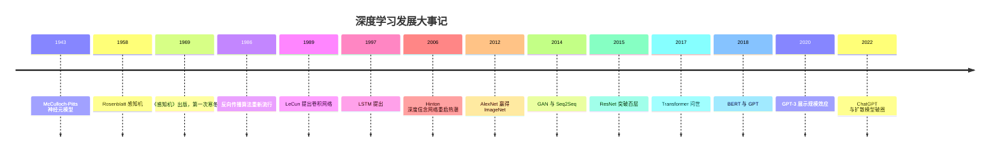
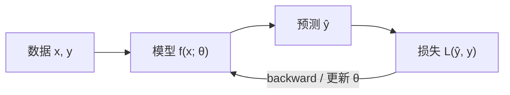
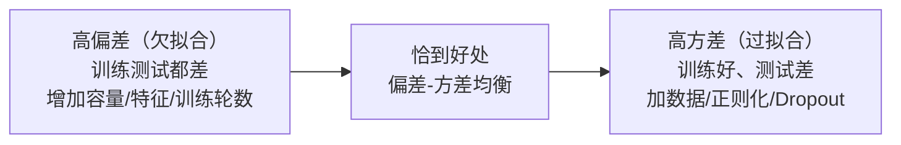
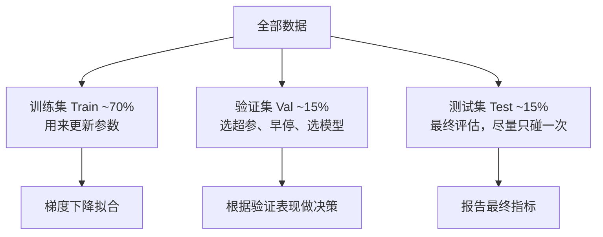

# 绪论与机器学习回顾

这一章是整个深度学习系列的开场。深度学习并不是凭空冒出来的一套新数学，它骨子里还是机器学习：定义目标、划分数据、衡量好坏、最小化损失。真正变了的是模型的表达能力和训练的工程规模。所以在正式进入神经网络之前，有必要把机器学习那套"怎么定义问题、怎么评估结果"的底子过一遍，顺带把后面做实验要用的 PyTorch 环境搭起来。

## 深度学习发展史

深度学习的历史挺有意思的，它不是一条平稳上升的曲线，而是两次热潮夹着两次寒冬。把这条线捋清楚，很多今天看起来理所当然的技术选择，其实都能在历史里找到动机。



### 起源与第一次寒冬

1943 年，神经生理学家 McCulloch 和逻辑学家 Pitts 合作提出了第一个神经元数学模型：把神经元抽象成一个"加权求和再取阈值"的单元。这个模型今天看当然简陋，但它第一次把"想法"变成了可以写下来的方程。

1958 年，Rosenblatt 搞出了感知机，还造了台硬件机器，媒体当时吹得神乎其神，说这东西以后能认字、能认人。结果 1969 年 Minsky 和 Papert 出了本书《Perceptrons》，从数学上证明单层感知机连异或（XOR）这种最简单的非线性问题都搞不定，同时也悲观地认为多层也没戏。这本书直接掐断了美国学界和军方的热情，第一次人工智能寒冬降临。

Minsky 的证明其实只针对单层网络，多层网络在理论上是能表示异或的，只是当时没人知道怎么训练它。这个"不知道怎么学"的尴尬，一挂就是十几年。

### 反向传播与第二次寒冬

1986 年，Rumelhart、Hinton 和 Williams 在 Nature 上把反向传播算法重新推到台前：多层网络可以一层层把误差往回传，逐层算梯度。多层感知机终于能被训练了，第二次热潮随之而来。

同一时期 LeCun 在贝尔实验室把卷积网络用在手写数字识别上，邮局和银行的支票识别系统里真的跑着他的模型，这是深度学习最早的大规模落地。LSTM 也是这个阶段（1997 年）被 Hochreiter 和 Schmidhuber 提出来的，用来对付循环网络里的梯度消失。

好景不长，90 年代中后期到 2006 年之间又冷了下来。原因不复杂：支持向量机（SVM）这类方法数学上干净、调参少、小数据上表现稳；而神经网络训练慢、调参玄学、当时的数据量和算力也撑不起深层网络。反向传播会随着层数加深而梯度衰减，这个理论问题在 2006 年之前一直没有好的解决办法。

### 深度学习的复兴

2006 年，Hinton 和 Salakhutdinov 在 Science 上发表深度信念网络的预训练方法，核心想法是先把每一层单独训好再叠起来，最后端到端微调。这篇文章重新点燃了"深度"这个词，"deep learning" 这个名字也是那前后开始流行。同一时期 Bengio 的团队、LeCun 也都在做深层网络的表示学习。

真正把这一切引爆的是 2012 年。Hinton 的学生 Alex Krizhevsky 设计了 AlexNet——一个八层的卷积网络，搭载两块 GTX 580 显卡训练，在 ImageNet 图像分类比赛上把第二名的传统方法甩开了十几个百分点（top-5 错误率 15.3% 对 26.2%）。这个差距大到所有人都坐不住了：GPU、大数据（ImageNet 的 120 万张标注图）、ReLU 和 Dropout 这些技巧，三样凑齐，深度学习的工业时代正式开始。

### 从 AlexNet 到大模型

AlexNet 之后节奏越来越快，几乎每年都有改变格局的工作：

- **2014 年**：Goodfellow 提出 GAN，生成模型有了新玩法；同年 Seq2Seq 把循环网络做成了"编码-解码"结构，机器翻译质量大幅跃升；
- **2015 年**：何恺明提出 ResNet，用残差连接让上百层的网络可以顺利训练，深度从此不再是障碍；
- **2017 年**：Google 发表《Attention Is All You Need》，Transformer 用纯注意力机制替代循环结构，训练可以高度并行，这条线后来长成了 BERT、GPT 和整个大语言模型家族；
- **2020 年**：GPT-3 用 1750 亿参数展示了所谓"涌现能力"，人们开始意识到模型规模本身就是一条独立的技术路线；
- **2022 年**：ChatGPT 让大模型真正出圈，同一时期 Stable Diffusion、DALL-E 2 把扩散模型推到了大众面前，文生图从实验室玩具变成了生产力工具。

这条线走到今天，方向已经不止一条：语言模型在往多模态、长上下文和推理能力走；CV 和机器人那边，视觉-语言-动作模型（VLA）正在把感知、决策和控制揉进同一个网络；科学计算领域 AlphaFold 解决了蛋白质结构预测，也算深度学习少数真正"解决了一个科学问题"的案例。

## 深度学习应用概览

深度学习的应用面已经铺得很开了，粗分一下大概这几个方向：

| 方向 | 典型任务 | 标志性工作 |
|------|----------|------------|
| 计算机视觉 | 分类、检测、分割、3D 重建 | AlexNet、YOLO、SAM、NeRF |
| 自然语言处理 | 翻译、问答、文本生成 | Transformer、BERT、GPT、DeepSeek |
| 语音 | 识别、合成、说话人分离 | WaveNet、Whisper |
| 多模态 | 图文理解、视觉问答 | CLIP、GPT-4V、Qwen-VL |
| 生成模型 | 图像/视频/3D 生成 | GAN、扩散模型、Sora |
| 科学与医疗 | 分子设计、结构预测、影像诊断 | AlphaFold、Med-PaLM |
| 具身智能 | 操控、导航、人形运动控制 | RT-2、π0、各类 VLA 模型 |

值得多说一句的是具身智能。前面这些应用大多处理的是"从数据到数据"——图像进标签出、文本进文本出。具身智能要求模型的输出最终落到真实世界的动作上，这就多了一整层麻烦：仿真和现实的差距、控制频率、安全边界，这些在纯算法论文里不常讨论的问题，到了机器人上全是硬约束。本系列后面的笔记会专门涉及这条线。

## 机器学习基本概念

深度学习是机器学习的一个子领域，先把机器学习的框架说清楚，后面很多概念才有落脚点。

### 机器学习在学什么

用一句话概括：机器学习是从数据中学习一个映射函数 $f: \mathcal{X} \to \mathcal{Y}$，使得这个函数在**没见过的数据**上也能做出准确的预测。注意"没见过"这三个字，它其实是整个领域的灵魂——我们关心的从来不是模型在训练集上背得多熟，而是它在新样本上的表现。这个能力叫泛化（generalization）。

训练过程本身可以抽象成一个循环：模型对输入做出预测，损失函数衡量预测和真值的差距，优化算法根据梯度更新参数，如此反复。这个"预测—衡量—更新"的循环，就是后面所有章节共用的骨架。



### 监督学习与无监督学习

**监督学习**是最常见的一类：训练数据里每个样本都带标签，形式是 $(x, y)$ 对，模型学习从 $x$ 到 $y$ 的映射。图像分类（图片→类别）、文本分类（评论→情感极性）、回归预测（房屋面积/地段→价格）都是监督学习。它的目标写成公式就是最小化期望风险：

$$
\min_f \; \mathbb{E}_{(x,y)\sim P}\left[\, L\big(f(x),\, y\big) \right]
$$

但真实分布 $P$ 我们是不知道的，能拿到的只有有限的训练样本，所以实际做的是在训练集上最小化经验风险，这两者之间的差距，正是过拟合理论要讨论的东西。

**无监督学习**则没有标签，模型只能从数据本身的结构里找规律。常见任务包括聚类（把相似样本归组，比如客户分群）、降维（把高维数据投影到低维便于可视化，t-SNE、PCA 都属此类）和密度估计（判断一个样本是不是"正常"，异常检测常用）。生成模型也可以归到无监督的大伞下面——它学的是数据的联合分布 $p(x)$，而不是某个条件映射。

还有一类经常被单独拿出来说：**自监督学习**。它本质上是无监督的，但人工构造出监督信号，比如 BERT 的遮盖语言建模：把输入里 15% 的词遮掉，让模型根据上下文把它们预测回来，被遮的词本身就成了标签。今天的 GPT、CLIP、MAE 全都是自监督预训练的产物，可以说自监督是过去五年深度学习最重要的范式转变。

### 损失函数

损失函数（loss function）量化"模型预测得有多差"，是训练的直接目标。选错损失函数是新手最常见的翻车点之一，因为损失函数其实编码了你对任务的假设。

**均方误差（MSE）** 是回归任务的默认选择：

$$
L_{\text{MSE}} = \frac{1}{n}\sum_{i=1}^{n}\left(\hat{y}_i - y_i\right)^2
$$

它对大误差罚得重（平方项），梯度也平滑，代价是遇到离群点会被带偏。如果数据里有明显的异常值，可以改用平均绝对误差（MAE），它对离群点更鲁棒，但在零点不可导，工程上常做平滑近似。

**交叉熵损失** 是分类任务的标配。对于二分类，模型输出概率 $\hat{p} = \sigma(z)$，真实标签 $y\in\{0,1\}$：

$$
L_{\text{BCE}} = -\Big[\, y\log \hat{p} + (1-y)\log(1-\hat{p}) \,\Big]
$$

多分类则推广为：

$$
L_{\text{CE}} = -\sum_{c=1}^{C} y_c \log \hat{p}_c
$$

交叉熵来自信息论，衡量的是用预测分布 $\hat{p}$ 去编码真实分布 $y$ 所需的比特数。它有个很好的性质：当预测概率趋近 0 而真实标签是 1 时，损失趋向无穷大——也就是说，模型"自信地犯错"会受到严厉惩罚。分类网络最后一层通常接 Softmax 输出概率，再和交叉熵配合使用，这两者在数值实现上往往被融合成一个算子（PyTorch 里的 `CrossEntropyLoss` 内部就包含了 Softmax），既省算力又稳数值。

其他常见的还有：Hinge 损失（SVM 的灵魂，$\max(0, 1-y\hat{y})$）、Huber 损失（MSE 和 MAE 的折中，小误差用平方、大误差用线性）、KL 散度（衡量两个分布的差异，蒸馏和生成模型里常用）。原则很简单：先想清楚你的任务假设是什么，再挑对应的损失。

### 过拟合与欠拟合

训练里最常遇到的两种失败模式，方向正好相反。

**欠拟合**（underfitting）指模型压根没学到数据里的规律，训练集误差就很高。原因通常是模型容量太小（比如用直线拟合曲线）、特征不够、或者训练不充分。表现是训练和测试误差都很差。

**过拟合**（overfitting）指模型把训练集背下来了，训练误差很低，一到新数据就拉胯。深度学习模型参数动辄上亿，过拟合几乎是默认要面对的敌人。直观感受是：模型学到的不是规律，而是训练集里的噪声和偶然相关性。想象一个学生把课后习题答案全背下来了，考试换个数字就不会做——就是这个状态。

判断方法也直接：切一部分数据出来不参与训练，专门用来观察。如果训练误差持续下降而验证误差掉头上升，过拟合没跑了。

缓解过拟合的手段很多，后面几章会反复出现：增加数据量、数据增强、正则化（L1/L2）、Dropout、早停（early stopping，验证误差不再改善就停止训练）、减小模型容量。这些手段本质上都在做同一件事——限制模型的"自由度"，逼它只学真正通用的模式。

### 偏差-方差权衡

欠拟合和过拟合这对现象，有一个更精确的数学刻画：偏差-方差分解（bias-variance tradeoff）。

对于回归问题，假设真实关系是 $y = f(x) + \varepsilon$，其中噪声 $\varepsilon\sim\mathcal{N}(0,\sigma^2)$，模型在训练集 $D$ 上学出 $\hat{f}_D(x)$，那么任意测试点 $x$ 上的期望预测误差可以分解为：

$$
\mathbb{E}_{D,\varepsilon}\left[\left(y - \hat{f}_D(x)\right)^2\right] = \underbrace{\left(f(x) - \mathbb{E}\big[\hat{f}_D(x)\big]\right)^2}_{\text{偏差}^2} + \underbrace{\mathbb{E}\left[\left(\hat{f}_D(x) - \mathbb{E}\big[\hat{f}_D(x)\big]\right)^2\right]}_{\text{方差}} + \underbrace{\sigma^2}_{\text{噪声}}
$$

三项各有各的含义：

- **偏差（bias）**：模型在所有可能训练集上的平均预测和真实值的差距，反映模型本身的系统性偏离。偏差高意味着模型假设错了，比如用线性模型拟合非线性数据——怎么训都训不好，这是"能力问题"。
- **方差（variance）**：模型预测随训练集变化的敏感程度。方差高意味着换一批训练数据，学出来的模型就面目全非——这是"不稳定"。
- **噪声（noise）**：数据本身不可约的误差，任何模型都消不掉，它是性能的天花板。

三者的关系是：模型复杂度升高时，偏差下降、方差上升；复杂度过头，方差的增长会吃掉偏差下降的红利。所以测试误差随复杂度呈现一条 U 形曲线：



工程上的启发很实际：遇到模型表现不好，先分清是欠拟合还是过拟合，再对症下药。这两种病吃的药几乎是反的，用反了只会更糟。还有一个常被忽略的结论是噪声项的存在——任何任务都有其内在噪声水平，模型再完美也不可能把误差降到噪声以下，盲目追求训练集零误差是没有意义的。

## 数据集划分与评估指标

### 训练集、验证集、测试集

数据要切分，这不是仪式感，而是泛化评估的逻辑必需品：



三者职责不同。**训练集**是模型梯度更新的唯一来源。**验证集**用来做模型选择：学习率调多少、Dropout 比例开多大、训练多少轮停——所有这类"不直接参与梯度、但影响最终模型"的决策都看验证集。**测试集**只在一切尘埃落定之后碰一次，用来给出对泛化性能的无偏估计。

测试集绝对不能参与任何决策。很多人习惯调完超参再在测试集上"顺便看看"，然后根据结果再调一版——测试集一旦影响了决策，它就变成了第二个验证集，报出来的数字会系统性偏乐观。这个错误叫**数据泄漏**（data leakage），是竞赛刷分和论文复现里翻车的重灾区。

数据量本身也影响切法。数据少的时候（比如几百上千条），切掉 30% 做验证太奢侈，常用 K 折交叉验证：把数据分成 K 份，轮流用其中一份做验证、其余训练，最后取 K 次结果的平均。数据多的时候（比如 ImageNet），直接固定切分反而省事，深度学习界通行的做法是 8:1:1 或者干脆只切训练/测试、用训练集内部再挖一小块做验证。

还有一些切分上的细节值得注意。做时间序列预测，必须按时间切，未来的数据不能出现在训练集里；做医疗影像，同一个人的多张片子必须切到同一侧，否则模型只是在认人而不是认病；做推荐系统，同一用户的相邻行为也不能随意跨越训练/测试边界。切分方式本身就是"你对问题的假设"的一部分，切错了，指标再好看也没意义。

### 分类任务评估指标

**准确率（accuracy）** 最直观：预测正确的样本占比。

$$
\text{Accuracy} = \frac{\text{预测正确的样本数}}{\text{总样本数}}
$$

但准确率有个致命盲区：类别不平衡。1000 个样本里 999 个正类 1 个负类，一个无脑全预测正类的模型准确率就有 99%，实际上什么都没学到。这时候需要看得更细。

把分类结果画成混淆矩阵，四个格子分别是真正例（TP）、假正例（FP）、真负例（TN）、假负例（FN），后面两个指标都从这里算：

$$
\text{Precision} = \frac{TP}{TP+FP}, \qquad \text{Recall} = \frac{TP}{TP+FN}
$$

**精确率（precision）** 回答"报出来的里面有多少是真的"，**召回率（recall）** 回答"真的里面报出来了多少"。两者天然矛盾：把判定阈值调低，召回上升、精确下降。医疗筛查通常宁可错杀（要召回），垃圾邮件过滤则宁可放过（要精确）。

如果想要一个数，可以用 F1：

$$
F_1 = 2\cdot\frac{\text{Precision}\times\text{Recall}}{\text{Precision}+\text{Recall}}
$$

它是精确率和召回率的调和平均，对两者中较小的那个更敏感。

**ROC 曲线与 AUC** 则换了一个角度：把判定阈值从 1 扫到 0，以假正例率（FPR）为横轴、真正例率（TPR，即召回率）为纵轴画出曲线，曲线下面积就是 AUC。AUC 有个好解释：随机抽一个正样本和一个负样本，模型给正样本打分更高的概率。它对类别不平衡相对鲁棒，0.5 相当于瞎猜，1.0 是完美分类器。

### 回归任务评估指标

回归任务的指标相对直白：

$$
\text{MAE} = \frac{1}{n}\sum_{i=1}^{n}|\hat{y}_i - y_i|, \qquad
\text{RMSE} = \sqrt{\frac{1}{n}\sum_{i=1}^{n}(\hat{y}_i - y_i)^2}
$$

MAE 对每个误差一视同仁，量纲和原数据一致，好解释。RMSE 因为平方再开根号，对大误差更敏感，数值上也往往会比 MAE 大——如果 RMSE 明显高于 MAE，通常说明存在少数误差特别大的样本，值得单独查一下。

还有决定系数 $R^2$：

$$
R^2 = 1 - \frac{\sum_i (y_i - \hat{y}_i)^2}{\sum_i (y_i - \bar{y})^2}
$$

它衡量的是模型比"无脑输出均值"好多少：$R^2=1$ 是完美预测，$R^2=0$ 说明和输出均值没区别，负数则说明模型比均值还差（这种情况在训练集上不会出现，测试集上出现就说明模型严重过拟合或者分布漂移了）。

指标的选择本身就是价值判断。上线一个风控模型，漏报一个 fraud 的代价远大于误报一个正常用户，这时候看召回率和 PR-AUC 比看准确率有意义得多。先想清楚业务代价，再挑指标——这句话在深度学习时代同样适用。

## 实验：PyTorch 环境与张量操作

概念铺垫完毕，这一节动手把环境搭起来，再把最核心的数据结构——张量——的操作过一遍。后面所有章节的代码实验都建立在这之上。

### 环境搭建

PyTorch 的安装主要看有没有 NVIDIA GPU。先去 [pytorch.org](https://pytorch.org) 的 Get Started 页面确认当前推荐的 CUDA 版本，官网的安装命令是跟着版本走的，网上抄的命令经常已经过时。

以 conda 为例（`cu121` 对应 CUDA 12.1，按官网实际推荐改）：

```bash
# 创建独立环境，Python 3.11 是目前比较稳的选择
conda create -n dl python=3.11 -y
conda activate dl

# 按官网命令安装，注意 CUDA 版本
conda install pytorch torchvision pytorch-cuda=12.1 -c pytorch -c nvidia -y
```

纯 pip 环境也可以：

```bash
python -m venv .venv
source .venv/bin/activate
pip install torch torchvision --index-url https://download.pytorch.org/whl/cu121
```

装完做一次冒烟测试：

```python
import torch

print(torch.__version__)          # 2.x.x
print(torch.cuda.is_available())  # True（有GPU且驱动装对）
print(torch.cuda.device_count())  # 1
print(torch.cuda.get_device_name(0))
# NVIDIA GeForce RTX 4090 之类
```

`torch.cuda.is_available()` 返回 `False` 不一定是装错了，也可能是驱动太旧、或者装成了 CPU 版。排查顺序一般是：`nvidia-smi` 有没有输出 → 驱动里显示的 CUDA 版本是否 ≥ 运行时需要的版本 → `torch.version.cuda` 是否非 None（None 说明装的是 CPU 版）。

只用 CPU 跑通本章的练习完全没问题，张量操作和设备无关；但往后训练 CNN、Transformer 就必须有 GPU 了。

### 张量是什么

张量（tensor）是多维数组，是 PyTorch 里一切数据的载体。标量是 0 维张量，向量是 1 维，矩阵是 2 维，图像 batch 常见是 4 维 `(N, C, H, W)`，序列数据常见是 3 维 `(N, L, D)`。理解张量的形状（shape）和维度语义，比背 API 重要得多——后面大量的 bug 都是形状对不上。

创建张量有几种常用途径：

```python
import torch

# 从 Python 列表
a = torch.tensor([[1.0, 2.0], [3.0, 4.0]])
print(a.shape)   # torch.Size([2, 2])
print(a.dtype)   # torch.float32

# 常用工厂函数
z = torch.zeros(2, 3)          # 全 0
o = torch.ones(2, 3)           # 全 1
r = torch.randn(2, 3)          # 标准正态随机
eye = torch.eye(3)             # 单位矩阵

# 与 NumPy 互转
import numpy as np
n = np.arange(6, dtype=np.float32).reshape(2, 3)
t = torch.from_numpy(n)        # 共享内存，改一个另一个跟着变
n2 = t.numpy()                 # 反向同理
```

需要注意 `torch.from_numpy` 是共享底层内存的，对其中一边的修改会直接反映到另一边。想断开引用用 `.clone()`。这个共享设计在数据预处理时很方便（NumPy 算完直接零拷贝转过来），但也容易在不经意间引入副作用。

### 数据类型与设备

两个容易踩的维度。**dtype** 决定精度，PyTorch 默认浮点是 `float32`；**device** 决定张量在 CPU 还是 GPU 上。

```python
# dtype
x = torch.tensor([1.0, 2.0])
print(x.dtype)                    # torch.float32
y = x.double()                    # → float64
z = x.half()                      # → float16，混合精度训练用

# device
if torch.cuda.is_available():
    x_gpu = x.cuda()              # 或 x.to('cuda')
    # x_gpu = x.to('cuda:0')      # 多卡时指定卡号
    # x_cpu = x_gpu.cpu()
```

跨设备运算是高频报错点：

```python
x = torch.randn(2, 2)             # CPU 上
y = torch.randn(2, 2).cuda()      # GPU 上
# x + y  → RuntimeError: Expected all tensors to be on the same device
```

报错信息说的就是字面意思：PyTorch 不会自动帮你搬运。统一设备最省事的写法是让整个模型和当前 batch 保持同步移动，训练循环里通常这么写：

```python
device = torch.device('cuda' if torch.cuda.is_available() else 'cpu')
model = model.to(device)
for x, y in dataloader:
    x, y = x.to(device), y.to(device)
    ...
```

另外注意整型张量默认是 `int64`，分类任务的标签必须是 `LongTensor`（`int64`），这是接 `CrossEntropyLoss` 的硬性要求，新手经常在这里吃 `RuntimeError`。

### 形状变换

深度学习代码里最高频的操作不是加减乘除，而是变形。核心几个：

```python
t = torch.arange(12)
print(t.shape)  # torch.Size([12])

# reshape：元素总数必须对得上
a = t.reshape(3, 4)
b = t.reshape(2, -1)      # -1 表示自动推断，这里推出 6
print(b.shape)            # torch.Size([2, 6])

# view 与 reshape 的区别：view 要求内存连续
c = a.transpose(0, 1)     # 转置后内存不连续
print(c.is_contiguous())  # False
# c.view(4, 3)            # ← 会报错，必须先 .contiguous()
d = c.reshape(4, 3)       # reshape 内部会自动拷贝，安全
e = c.contiguous().view(4, 3)

# 增删维度
f = torch.randn(3, 4)
g = f.unsqueeze(0)        # (3,4) → (1,3,4)，加 batch 维常用
h = g.squeeze(0)          # (1,3,4) → (3,4)
print(f.unsqueeze(-1).shape)  # (3,4,1)，末尾加通道维

# 拼接与切分
x1 = torch.randn(2, 3)
x2 = torch.randn(2, 3)
cat_dim0 = torch.cat([x1, x2], dim=0)   # (4,3)
cat_dim1 = torch.cat([x1, x2], dim=1)   # (2,6)
s1, s2 = torch.chunk(cat_dim0, 2, dim=0)
```

`view` 和 `reshape` 的区别值得单独记一下：`view` 只能在内存连续的张量上用，好处是零拷贝；`transpose`、`permute` 之后内存就不连续了，此时要么用 `reshape`（自动拷贝），要么手动 `.contiguous()` 之后再 `view`。图像处理里 `(N,C,H,W)` 和 `(N,H,W,C)` 之间的转换几乎每个项目都会碰到。

### 广播与基本运算

PyTorch 的广播（broadcasting）规则和 NumPy 一致：从末尾维度开始对齐，维度相等或者其中一方为 1 就可以广播，否则报错。

```python
a = torch.ones(3, 4)
b = torch.ones(4)
print((a + b).shape)   # (3,4)，b 被广播成 (1,4) 再扩到 (3,4)

c = torch.ones(3, 1)
print((a + c).shape)   # (3,4)，c 被广播成 (3,4)

# 行/列归约的典型用法
x = torch.randn(4, 3)
print(x.sum(dim=0).shape)        # (3,)   沿列方向压缩
print(x.mean(dim=1, keepdim=True).shape)  # (4,1)
```

广播的坑在于它太方便了，形状稍有不对就会静默地广播出你没想到的结果而不报错。比如想按行加一个偏置，写成了 `x + bias` 而 `bias` 的形状是 `(4,)` 而不是 `(1,4)` 或 `(4,1)`，可能恰好能广播但加错了方向。养成用 `keepdim=True` 显式保留维度的习惯，能避开大半这类问题。

### 自动求导

PyTorch 的自动求导是基于动态图的：前向计算时构建计算图，调用 `.backward()` 后沿图反向传播梯度。张量创建时设 `requires_grad=True`，它就会被纳入求导追踪：

```python
x = torch.tensor(2.0, requires_grad=True)
w = torch.tensor(3.0, requires_grad=True)
b = torch.tensor(1.0, requires_grad=True)

y = w * x + b          # y = 3*2+1 = 7
y.backward()
print(x.grad)          # 3.0  即 ∂y/∂x = w
print(w.grad)          # 2.0  即 ∂y/∂w = x
print(b.grad)          # 1.0
```

矩阵形式同样直观：

```python
x = torch.randn(3, requires_grad=True)
A = torch.randn(3, 3)
y = x @ A              # 矩阵乘
y.sum().backward()     # 标量才能 backward，向量先归约
print(x.grad.shape)    # torch.Size([3])
```

两点纪律要记住。第一，**只有标量能直接调用 `backward()`**，如果输出是向量，要么先 `.sum()` 要么 `.mean()`，要么传入 `grad_outputs` 指定方向。第二，**梯度默认是累加的**，循环里不清零就会越加越大：

```python
for x, y in dataloader:
    loss = criterion(model(x), y)
    optimizer.zero_grad()   # ← 不写这行，梯度会叠加上前几次的
    loss.backward()
    optimizer.step()
```

`optimizer.zero_grad()` 放在 `backward()` 之前还是之后都能跑，但放在前面是通行写法。这个细节后面讲反向传播时还会从计算图的层面再拆一遍，这里先建立肌肉记忆。

### 索引、切片与就地操作

张量的索引语义和 NumPy 基本一致，支持花式索引：

```python
t = torch.arange(24).reshape(4, 6)

print(t[0])            # 第 0 行
print(t[:, 1])         # 第 1 列
print(t[1:3, 2:4])     # 子矩阵
print(t[t > 20])       # 布尔掩码，返回一维向量
print(t[[0, 2], [1, 3]])  # 花式索引：(0,1) 和 (2,3) 两个元素
```

PyTorch 里以 `_` 结尾的操作是**就地修改**（in-place），如 `add_`、`relu_`、`transpose_`。就地操作节省内存，但会破坏计算图——如果一个张量正在被 autograd 追踪，对它做就地修改会报错或者得到错误的梯度。默认不用就地操作，等确认不需要梯度时再考虑。

```python
x = torch.randn(3, requires_grad=True)
y = x * 2
# y.relu_()   # ← RuntimeError: a leaf Variable that requires grad is being used in an in-place operation 之类
y = y.relu()      # 安全写法
```

### 第一个完整小实验

把上面的操作串起来，用纯 PyTorch 手写一个线性回归。虽然下一章有更正式的推导，但先跑通一个完整的"数据→模型→损失→优化"循环，后面所有代码的心智模型就有了：

```python
import torch
import matplotlib.pyplot as plt

torch.manual_seed(42)
device = torch.device('cuda' if torch.cuda.is_available() else 'cpu')

# 1. 造数据：y = 3x + 1 + 噪声
X = torch.rand(100, 1, device=device) * 10
y = 3.0 * X + 1.0 + torch.randn_like(X) * 0.5

# 2. 定义模型与损失、优化器
model = torch.nn.Linear(1, 1).to(device)
criterion = torch.nn.MSELoss()
optimizer = torch.optim.SGD(model.parameters(), lr=0.02)

# 3. 训练循环
for epoch in range(200):
    pred = model(X)
    loss = criterion(pred, y)
    optimizer.zero_grad()
    loss.backward()
    optimizer.step()
    if (epoch + 1) % 40 == 0:
        print(f'epoch {epoch+1:3d}  loss={loss.item():.4f}')

w = model.weight.item()
b = model.bias.item()
print(f'学到的参数: w={w:.3f} (真值 3.0), b={b:.3f} (真值 1.0)')

# 4. 可视化
cpu_X = X.cpu().squeeze()
cpu_y = y.cpu().squeeze()
plt.scatter(cpu_X, cpu_y, s=8, label='data')
with torch.no_grad():
    line = model(X).cpu().squeeze()
plt.plot(cpu_X, line, 'r', label='fit')
plt.legend()
plt.show()
```

训练完打印出来的参数应该非常接近 3.0 和 1.0，散点图上红线穿过数据点云的中心。这个脚本麻雀虽小五脏俱全：造数据、定义模型、前向、算损失、反向、更新参数、评估可视化，后面训练 CNN 或 Transformer 时，骨架一模一样，变的只是模型结构和数据管道。

到这里，背景、概念和工具都齐了。下一章正式进入神经网络：先看单个神经元怎么组合成网络，再看激活函数为什么是必需品。
