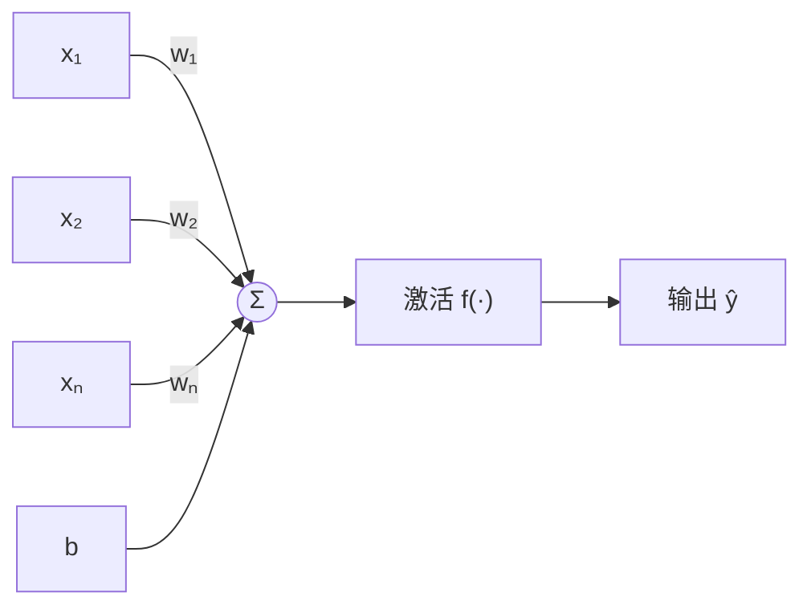
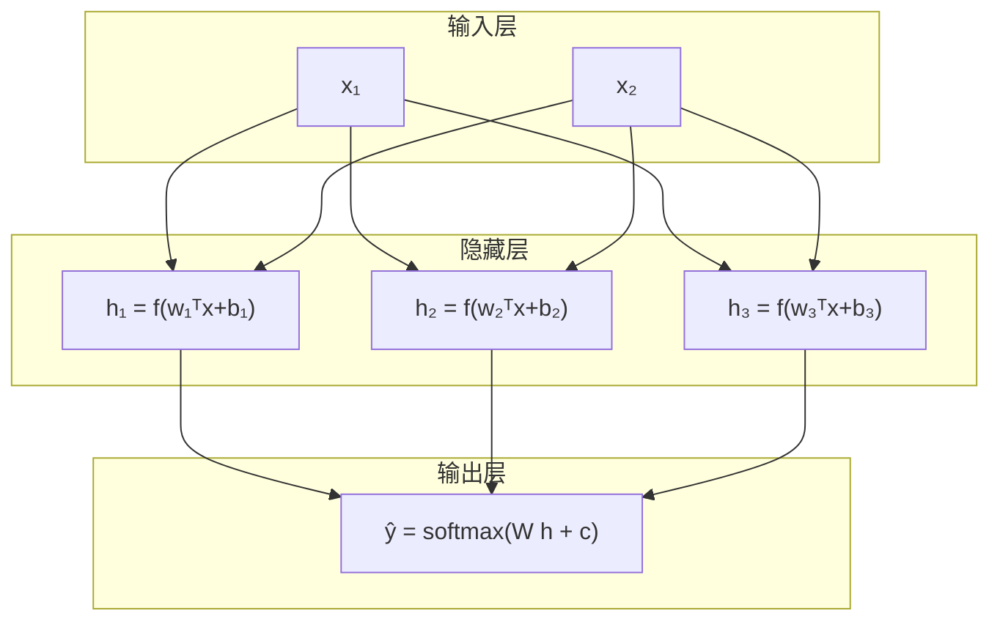

# 神经网络基础

上一章结尾留了个话头：先看单个神经元怎么组合成网络，再看激活函数为什么是必需品。这一章就把这两件事讲透。线性模型（线性回归、Softmax 回归）的表达能力有天花板——它画出来的决策边界永远是直的，真实世界里的问题几乎都不是直线可分的。神经网络的全部魔法，说穿了就是在一层层线性变换之间塞进非线性。

## 从神经元说起

生物神经元接收多个树突的信号，加权汇总，超过阈值就放电。1943 年的 McCulloch-Pitts 模型就是把这个过程抽象成数学：输入 $x_1,\dots,x_n$ 乘上权重 $w_1,\dots,w_n$，加偏置 $b$，过一个阶跃函数输出。

$$
y = \begin{cases} 1 & \text{if } \sum_i w_i x_i + b \geq 0 \\ 0 & \text{otherwise} \end{cases}
$$

这个模型在逻辑推理上其实很强，几个神经元拼起来就能实现与、或、非门。问题是它不可学习：权重是人为设定的，没有从数据里调整参数的机制。1958 年 Rosenblatt 的感知机补上了这一块，给出了感知机学习规则：预测错了就把权重往正确方向挪一点。



把上图写成公式，就是今天所有前向网络的最小单元：

$$
\hat{y} = f\left(\sum_{i=1}^{n} w_i x_i + b\right) = f(\mathbf{w}^\top\mathbf{x} + b)
$$

线性回归里的 $f$ 是恒等映射，Softmax 回归里的 $f$ 是 Softmax，两者都可以看作"单个神经元"——这个视角在上一章的线性网络笔记里其实已经埋过伏笔。

### 感知机的致命短板

感知机学习规则能收敛到正确分类线性可分的数据，这在当时很了不起。但它有一个数学上无法绕过的硬伤：**单层感知机只能解决线性可分问题**。

最经典的反例是异或（XOR）：

| $x_1$ | $x_2$ | $x_1 \oplus x_2$ |
|-------|-------|------------------|
| 0 | 0 | 0 |
| 0 | 1 | 1 |
| 1 | 0 | 1 |
| 1 | 1 | 0 |

在平面上画出来，两个 1 在对角线，两个 0 在另一条对角线——没有任何一条直线能把它们分开。Minsky 1969 年在《Perceptrons》里证明的正是这件事，顺便把当时学界对多层网络的幻想也一起浇了冷水（虽然他悲观地认为多层也没用，这一点后来被反向传播打脸了）。

XOR 这个例子值得记住，因为它是一切"非线性必要性"的最简证明：线性模型无论怎么加权重、加偏置，边界都只能是直线（或超平面），而 XOR 的边界天生就是弯的。

## 多层前馈网络

单个神经元不行，那就叠起来。把若干个神经元并排放成一层，再把多层首尾相接，前一层的输出作为后一层的输入，没有跨层连接、没有环路，这种结构叫**多层前馈网络**（multi-layer feedforward network），也常叫**多层感知机**（Multi-Layer Perceptron, MLP）。



写成矩阵形式，一层的计算就是：

$$
\mathbf{h} = f(\mathbf{W}^{(1)}\mathbf{x} + \mathbf{b}^{(1)}), \qquad
\hat{\mathbf{y}} = \mathbf{W}^{(2)}\mathbf{h} + \mathbf{b}^{(2)}
$$

其中 $\mathbf{W}^{(1)} \in \mathbb{R}^{m \times n}$ 把 $n$ 维输入映射到 $m$ 维隐藏层，$f$ 是逐元素作用的非线性函数（激活函数），$\mathbf{W}^{(2)}$ 再把隐藏表示映射到输出空间。中间的 $\mathbf{h}$ 叫**隐藏表示**（hidden representation），也叫特征（feature）——注意这个特征不是人工设计的，是网络自己学出来的，这正是深度学习和传统机器学习在特征工程上的分水岭。

有几层数几个层：只有一层权重的叫单层网络（线性回归、Softmax 回归都属此类），有一层隐藏层的叫两层网络，以此类推。"深度"说的就是权重层的数量——层数深了，"深度学习"这个词就来了。

### 为什么必须加激活函数

这里有一个容易被讲糊涂、但其实很干脆的结论：**如果不加激活函数（或者说 $f$ 取恒等映射），无论叠多少层，整个网络等价于一个单层线性模型**。

证明两行就够。两层无激活：

$$
\hat{\mathbf{y}} = \mathbf{W}^{(2)}(\mathbf{W}^{(1)}\mathbf{x} + \mathbf{b}^{(1)}) + \mathbf{b}^{(2)} = \underbrace{\mathbf{W}^{(2)}\mathbf{W}^{(1)}}_{\mathbf{W}'}\mathbf{x} + \underbrace{(\mathbf{W}^{(2)}\mathbf{b}^{(1)} + \mathbf{b}^{(2)})}_{\mathbf{b}'}
$$

两个矩阵相乘还是矩阵，整个东西塌缩成 $\mathbf{W}'\mathbf{x} + \mathbf{b}'$——还是个线性模型，XOR 照样解不了。归纳一下，任意多层无激活网络都能合并成一层线性变换。所以激活函数不是装饰品，它是网络拥有非线性拟合能力的唯一来源。工程上激活函数通常**只加在隐藏层**，输出层要不要激活取决于任务：回归用恒等映射，二分类常用 Sigmoid，多分类用 Softmax。

### 万能近似定理

"加了非线性之后，多层网络到底能有多强？"这个问题有一个优美的答案：**万能近似定理**（Universal Approximation Theorem）。粗略地说，只要隐藏层神经元足够多，一个含单隐藏层、配 Sigmoid 这类挤压型激活函数的前馈网络，就能以任意精度逼近 $\mathbb{R}^n$ 上任意紧集上的连续函数。

Cybenko（1989）和 Hornik（1991）给出了严格的证明。这个定理经常被误读成"一层就够了"，实际含义远没有这么慷慨：

- **它是存在性证明**：它说"存在一组权重使得网络逼近目标函数"，没说梯度下降能找到这组权重；
- **宽度可能大得离谱**：理论上需要的神经元数量可能是指数级的，实际根本不划算；
- **连续函数之外没保证**：间断的、高度震荡的目标函数不在覆盖范围内。

真正让人信服"深比宽好"的理由不是这个定理，而是下一节要说的组合结构——以及 ResNet 之后深度学习用实践给出的回答。

## 激活函数详解

激活函数的选择对训练影响极大，面试和实战里都是高频话题。理想的激活函数要满足：非线性（不然白加了）、处处可导或几乎处处可导（反向传播要算梯度）、不能饱和得太快（不然梯度消失）、计算便宜（每个样本每个神经元都要过一遍）、零中心附近最好（梯度方向不系统性偏移）。

### Sigmoid 与 Tanh

Sigmoid 把任意实数压缩到 $(0,1)$，天然适合表示概率：

$$
\sigma(z) = \frac{1}{1+e^{-z}}, \qquad \sigma'(z) = \sigma(z)\big(1-\sigma(z)\big)
$$

导数最大值只有 0.25（在 $z=0$ 处），并且当 $|z|$ 变大时导数迅速趋近 0——这就是**饱和**。饱和叠加起来就是**梯度消失**：深层网络反向传播时，梯度要连乘很多个接近 0 的数，传到浅层几乎归零，浅层参数学不动。另外 Sigmoid 输出恒正、不是零中心的，会让下一层的输入产生系统性偏移，拖慢收敛。

Tanh 是零中心版本，把输出压到 $(-1,1)$，导数最大 1，比 Sigmoid 略好，但两端同样会饱和。循环网络时代的默认选择基本是它。

### ReLU 及其变体

2011 年左右开始，ReLU（Rectified Linear Unit）成了隐藏层的主流：

$$
\text{ReLU}(z) = \max(0, z), \qquad \text{ReLU}'(z) = \begin{cases} 1 & z > 0 \\ 0 & z < 0 \end{cases}
$$

优点很直白：正半轴导数恒为 1，梯度不衰减，深层也能训；计算就是一次比较，比指数运算便宜得多。AlexNet 之后它几乎统治了视觉网络。

但它也有脾气。负半轴导数恒为 0，一旦某个神经元的输入总是落在负区间，它的梯度就永远是 0，参数再也更新不动——这个现象叫**dead ReLU**（死亡 ReLU）。学习率调太大时整批神经元可能同时死掉，前向输出全是 0。缓解方案有几个变体：

$$
\text{LeakyReLU}(z) = \begin{cases} z & z > 0 \\ \alpha z & z \leq 0 \end{cases} \quad (\alpha \text{ 通常取 } 0.01)
$$

$$
\text{PReLU}：\alpha \text{ 可学习}; \qquad
\text{ELU}: \begin{cases} z & z>0 \\ \alpha(e^z-1) & z\leq 0 \end{cases}
$$

GELU（Gaussian Error Linear Unit）和 Swish/SiLU 则是另一条思路——用平滑的随机门控代替硬截断，在 Transformer、EfficientNet 等架构里表现更好：

$$
\text{GELU}(z) = z\cdot\Phi(z) \approx 0.5z\left(1 + \tanh\left[\sqrt{2/\pi}\,(z + 0.044715\,z^3)\right]\right)
$$

$$
\text{Swish}(z) = z\cdot\sigma(\beta z)
$$

两者都是"平滑版 ReLU"：负半轴不是一刀切零，而是保留一点小负值，既缓解 dead ReLU，也让函数在 0 点附近可导性更好。

### 梯度特性汇总

反向传播时激活函数的导数会一层层连乘，所以各函数的梯度行为直接决定深层能不能训。把这一节讲过的集中到一张表：

| 激活函数 | 导数 | 值域 | 零中心 | 饱和 | 计算量 | 典型问题 |
|----------|------|------|--------|------|--------|----------|
| Sigmoid | $\sigma(1-\sigma)$，最大 0.25 | $(0,1)$ | 否 | 两侧均饱和 | 指数运算 | 梯度消失、输出偏移 |
| Tanh | $1-\tanh^2$，最大 1 | $(-1,1)$ | 是 | 两侧均饱和 | 指数运算 | 深层仍会梯度消失 |
| ReLU | $z>0$ 时为 1，否则 0 | $[0,+\infty)$ | 否 | 仅负半轴 | 一次比较 | dead ReLU |
| LeakyReLU | $z>0$ 时为 1，否则 $\alpha$ | $(-\infty,+\infty)$ | 否 | 不饱和 | 一次比较 | 负半轴斜率需手调 |
| GELU | 平滑，略小于 1 | 约 $(-0.17,\infty)$ | 近似 | 不饱和 | 近似 erf | 指数/乘方略贵 |
| Swish | $\sigma(\beta z)+\beta z\sigma(\beta z)(1-\sigma(\beta z))$ | $(-\infty,+\infty)$ | 近似 | 不饱和 | 指数运算 | 同上 |

读这张表的要点：

- **Sigmoid 的梯度上限只有 0.25**，两层连乘后上限变 1/16，十层之后就是 $0.25^{10}\approx 10^{-6}$——这就是它退出隐藏层舞台的直接原因；
- **Tanh 零中心且原点导数为 1**，比 Sigmoid 好训，但两端照样饱和，深层网络依旧吃亏；
- **ReLU 正半轴导数恒为 1**，梯度不随深度衰减，这是它统治 CNN 时代的根本原因；负半轴导数为 0 是双刃剑——稀疏激活省算力，但配大学习率会批量杀死神经元；
- **GELU/Swish 的导数处处连续**，在 0 点附近平滑过渡，对基于梯度的优化器更友好，这是 Transformer 时代 GELU 成为默认的原因之一。

### 怎么选

一张简表概括常见默认：

| 场景 | 常用选择 | 理由 |
|------|----------|------|
| 隐藏层·CNN | ReLU / SiLU | 训得快，不易饱和 |
| 隐藏层·Transformer/MLP-Mixer | GELU | 原始 Transformer 的选择，效果稳 |
| 循环网络 | Tanh / LSTM 门控 Sigmoid | 需要输出有界 |
| 二分类输出 | Sigmoid | 直接给概率 |
| 多分类输出 | Softmax | 输出分布归一化 |
| 回归输出 | 恒等映射 | 不要人为限制值域 |

经验法则：没有银弹，从任务默认值开始，验证集不好再换。激活函数是超参，不是信仰。

## 前向传播

把多层网络的计算从输入到输出完整走一遍，这个过程叫**前向传播**（forward pass）。每一层做同一件事：仿射变换 + 非线性。以一个两隐藏层的 MLP 为例：

$$
\begin{aligned}
\mathbf{z}^{(1)} &= \mathbf{W}^{(1)}\mathbf{x} + \mathbf{b}^{(1)}, &
\mathbf{h}^{(1)} &= f(\mathbf{z}^{(1)}) \\
\mathbf{z}^{(2)} &= \mathbf{W}^{(2)}\mathbf{h}^{(1)} + \mathbf{b}^{(2)}, &
\mathbf{h}^{(2)} &= f(\mathbf{z}^{(2)}) \\
\mathbf{z}^{(3)} &= \mathbf{W}^{(3)}\mathbf{h}^{(2)} + \mathbf{b}^{(3)}, &
\hat{\mathbf{y}} &= g(\mathbf{z}^{(3)})
\end{aligned}
$$

$g$ 是输出层的处理（Softmax、Sigmoid 或恒等映射），中间层的 $f$ 是激活函数。批量计算时把单样本的列向量拼成矩阵，$\mathbf{X} \in \mathbb{R}^{B \times n}$（$B$ 是 batch size），每层变成 $\mathbf{H} = f(\mathbf{X}\mathbf{W}^\top + \mathbf{b})$，$\mathbf{W} \in \mathbb{R}^{m \times n}$。这就是为什么 PyTorch 里 Linear 层的权重形状是 `(out_features, in_features)`——左乘的是权重的转置。

追踪维度是读代码和调模型的基本功。举个例子：输入 `(32, 1, 28, 28)` 的 MNIST batch（32 张 28×28 灰度图），Flatten 之后变 `(32, 784)`，过 `Linear(784, 256)` 变 `(32, 256)`，再过 `Linear(256, 10)` 变 `(32, 10)`——10 类的 logits。维度对不上，90% 的情况是 `Flatten` 忘了、维度写反了、或者 `view` 用错了。

注意一个工程细节：前向传播里矩阵乘法占了绝大部分算力。GPT-3 级别的模型，前向一次的浮点运算量在 $10^{11}$ FLOPs 量级，这也是推理优化（KV Cache、算子融合、量化）全部围绕矩阵乘做文章的原因。

## 深度的意义

既然一层隐藏层就能逼近任意连续函数，为什么还要深？答案藏在**组合**（composition）里。

直观地想：要表达"猫的耳朵"这个概念，用一个神经元需要在整个像素空间里搜出所有可能的耳朵形状——耳朵可能出现在图片任何位置、任何大小、任何朝向，单个线性判别面根本覆盖不过来。但如果先有一层神经元学"边缘"，再有一层学"角点和纹理"，再有一层学"部件"，最后学"类别"，每层只需要在上一层的抽象上做组合，表达效率高得多。

这种逐层抽象不是比喻，卷积网络的可视化研究（Zeiler & Fergus, 2014）真的观测到了：浅层学 Gabor 式的边缘和色块，中层学纹理和部件，深层学物体语义。层次化表示正是"深度"的价值所在。

换个角度看，深度实际上是在做**参数共享和结构先验**的权衡：同样表达能力的网络，深而窄通常比浅而宽参数更少、泛化更好，因为深层网络强制了"分层组合"这个先验——它在告诉你，世界是层级结构的，而这个假设在视觉、语言、语音里都惊人地成立。

当然，深了之后就是上一章说过的梯度消失问题，以及本系列后面要讲的残差连接——深度学习的历史某种意义上就是"把网络堆得更深"和"解决堆深了训不动"这两件事的交替。

## 实验：用 NumPy 手写两层神经网络

PyTorch 的 `nn.Module` 把前向和反向都封装好了，用起来爽，但容易变成"会调包不会原理"。这一节抛开框架，只用 NumPy 把一个两层神经网络的前向传播、反向传播、参数更新全部手写一遍。亲手把链式法则敲成代码之后，下一章讲反向传播的矩阵推导会好懂很多。

### 问题与数据

还是 XOR，它足够小（四个点），肉眼可验证，又刚好是单层搞不定、两层轻松搞定的分界线：

```python
import numpy as np
import matplotlib.pyplot as plt

np.random.seed(42)

X = np.array([[0, 0], [0, 1], [1, 0], [1, 1]], dtype=np.float64)
y = np.array([[0], [1], [1], [0]], dtype=np.float64)   # 列向量，方便后面矩阵乘

print(X.shape, y.shape)   # (4, 2) (4, 1)
```

网络结构定为 $2 \to 4 \to 1$：输入 2 维，隐藏层 4 个神经元配 Tanh，输出 1 维配 Sigmoid 出概率。参数全部用小随机数初始化——**不能初始化成全 0**，否则隐藏层所有神经元计算完全对称，梯度也对称，训练再多轮四个神经元还是同一个东西，等于白加宽度。

```python
n_in, n_hidden, n_out = 2, 4, 1

W1 = np.random.randn(n_in, n_hidden) * 0.5
b1 = np.zeros((1, n_hidden))
W2 = np.random.randn(n_hidden, n_out) * 0.5
b2 = np.zeros((1, n_out))
```

### 前向传播

前向就是两层"仿射变换 + 激活"的串联，每一步都是形状明确的矩阵运算：

$$
\begin{aligned}
\mathbf{Z}^{(1)} &= \mathbf{X}\mathbf{W}^{(1)} + \mathbf{b}^{(1)} &\in \mathbb{R}^{4\times 4} \\
\mathbf{A}^{(1)} &= \tanh(\mathbf{Z}^{(1)}) &\in \mathbb{R}^{4\times 4} \\
\mathbf{Z}^{(2)} &= \mathbf{A}^{(1)}\mathbf{W}^{(2)} + \mathbf{b}^{(2)} &\in \mathbb{R}^{4\times 1} \\
\hat{\mathbf{Y}} &= \sigma(\mathbf{Z}^{(2)}) &\in \mathbb{R}^{4\times 1}
\end{aligned}
$$

```python
def sigmoid(z):
    return 1.0 / (1.0 + np.exp(-np.clip(z, -500, 500)))  # clip 防溢出

def forward(X, W1, b1, W2, b2):
    Z1 = X @ W1 + b1            # (4,2)@(2,4) + (1,4) -> (4,4)，广播加偏置
    A1 = np.tanh(Z1)            # 隐藏层激活
    Z2 = A1 @ W2 + b2           # (4,4)@(4,1) + (1,1) -> (4,1)
    A2 = sigmoid(Z2)            # 输出概率
    return Z1, A1, Z2, A2
```

中间变量 `Z1, A1, Z2` 都要留着，反向传播要用。批量大小 $N=4$，所有样本一次性算完（full-batch），维度变化一眼能对上。

### 损失函数

用二分类交叉熵（和上一章 Softmax 那套一脉相承，这里是二元版本）：

$$
L = -\frac{1}{N}\sum_{i=1}^{N}\Big[\, y_i\log\hat{y}_i + (1-y_i)\log(1-\hat{y}_i) \,\Big]
$$

```python
def compute_loss(y, A2):
    eps = 1e-8   # log(0) 保护
    return -np.mean(y * np.log(A2 + eps) + (1 - y) * np.log(1 - A2 + eps))
```

### 反向传播

这是整个实验的核心：从损失 $L$ 出发，沿计算图把梯度一步步传回每个参数。手写一遍会发现所谓"反向传播"不过是链式法则的系统化应用。

从输出层往回推。先记 $N=4$：

$$
\frac{\partial L}{\partial \mathbf{Z}^{(2)}} = \hat{\mathbf{Y}} - \mathbf{Y} \qquad (\text{BCE}+\text{Sigmoid} \text{ 的经典化简})
$$

$$
\frac{\partial L}{\partial \mathbf{W}^{(2)}} = \frac{1}{N}{\mathbf{A}^{(1)}}^\top \frac{\partial L}{\partial \mathbf{Z}^{(2)}}, \qquad
\frac{\partial L}{\partial \mathbf{b}^{(2)}} = \mathrm{mean}\!\left(\frac{\partial L}{\partial \mathbf{Z}^{(2)}}\right)
$$

再传回隐藏层，这里用上 Tanh 的导数 $\tanh'(z) = 1 - \tanh^2(z)$：

$$
\frac{\partial L}{\partial \mathbf{A}^{(1)}} = \frac{\partial L}{\partial \mathbf{Z}^{(2)}} {\mathbf{W}^{(2)}}^\top, \qquad
\frac{\partial L}{\partial \mathbf{Z}^{(1)}} = \frac{\partial L}{\partial \mathbf{A}^{(1)}} \odot \big(1 - {\mathbf{A}^{(1)}}^2\big)
$$

$$
\frac{\partial L}{\partial \mathbf{W}^{(1)}} = \frac{1}{N}\mathbf{X}^\top \frac{\partial L}{\partial \mathbf{Z}^{(1)}}, \qquad
\frac{\partial L}{\partial \mathbf{b}^{(1)}} = \mathrm{mean}\!\left(\frac{\partial L}{\partial \mathbf{Z}^{(1)}}\right)
$$

翻译成代码就四行：

```python
def backward(X, y, W2, Z1, A1, A2):
    N = X.shape[0]
    dZ2 = A2 - y                          # (4,1) 输出层误差
    dW2 = A1.T @ dZ2 / N                  # (4,4).T@(4,1)->(4,1)
    db2 = np.mean(dZ2, axis=0, keepdims=True)
    dA1 = dZ2 @ W2.T                      # (4,1)@(1,4)->(4,4) 传回隐藏层
    dZ1 = dA1 * (1 - A1 ** 2)             # 乘 Tanh 导数
    dW1 = X.T @ dZ1 / N                   # (2,4)@(4,4)->(2,4)
    db1 = np.mean(dZ1, axis=0, keepdims=True)
    return dW1, db1, dW2, db2
```

形状对不上的时候，用 `dZ2.shape`、`W2.shape` 打印出来对着上文的维度注释查，这是手写反向传播调试的固定姿势。

### 训练循环

参数更新就是最朴素的梯度下降，没有 Adam、没有动量——故意的，先把最裸的过程跑通：

```python
lr = 1.0
epochs = 5000
losses = []

for epoch in range(epochs):
    Z1, A1, Z2, A2 = forward(X, W1, b1, W2, b2)
    loss = compute_loss(y, A2)
    losses.append(loss)

    dW1, db1, dW2, db2 = backward(X, y, W2, Z1, A1, A2)

    W1 -= lr * dW1
    b1 -= lr * db1
    W2 -= lr * dW2
    b2 -= lr * db2

    if (epoch + 1) % 500 == 0:
        acc = np.mean((A2 >= 0.5) == y)
        print(f'epoch {epoch+1:5d}  loss={loss:.6f}  acc={acc:.0%}')
```

学习率取 1.0 看着激进，但对这个只有几十个参数的玩具网络正合适，几千轮内稳定收敛。输出大致是：

```text
epoch   500  loss=0.189442  acc=100%
epoch  1000  loss=0.042831  acc=100%
epoch  5000  loss=0.003516  acc=100%
```

最后验证一下四个点的预测：

```python
_, _, _, A2 = forward(X, W1, b1, W2, b2)
for xi, yi, pi in zip(X, y, A2):
    print(f'{xi.astype(int)}  真值={int(yi[0])}  预测={pi[0]:.4f}')
# [0 0]  真值=0  预测=0.0157
# [0 1]  真值=1  预测=0.9782
# [1 0]  真值=1  预测=0.9779
# [1 1]  真值=0  预测=0.0263
```

四个点全部分对，且都相当"自信"。从 50% 的瞎猜到 100%，靠的不是什么魔法，就是四行反向传播代码。

### 决策边界可视化

最后把学到的边界画出来，和上一章 PyTorch 版 MLP 的结论互相印证：

```python
xx, yy = np.meshgrid(np.linspace(-0.5, 1.5, 200), np.linspace(-0.5, 1.5, 200))
grid = np.c_[xx.ravel(), yy.ravel()]
_, _, _, zz = forward(grid, W1, b1, W2, b2)
zz = zz.reshape(xx.shape)

plt.contourf(xx, yy, zz, levels=50, cmap='RdBu_r', alpha=0.8)
plt.colorbar(label='P(y=1)')
plt.scatter(X[:, 0], X[:, 1], c=y.ravel(), s=250, edgecolors='k', cmap='RdBu_r')
plt.title('NumPy 两层网络学到的 XOR 决策边界')
plt.xlabel('x₁'); plt.ylabel('x₂')
plt.show()
```

画出来的边界是一条平滑的 S 形曲线（或者反 S 形，取决于初始化），把左下和右上两个 0 圈在一边、左上和右下两个 1 圈在另一边。换几次 `np.random.seed` 重跑，边界的具体形状会变，但分开四点的拓扑结构不变——这正对应万能逼近定理说的"存在一组权重"，而梯度下降每次都找到了其中一组。

### 手写一遍的意义

整个脚本不到 60 行，没有用任何深度学习框架。它证明了一件事：神经网络的训练没有什么神秘的，前向算预测、反向算梯度、更新减误差，三步而已。PyTorch 做的所有事——自动求导、GPU 加速、batch 调度——都是在这个骨架上做工程放大。

真正需要框架接手的是反向传播的**自动化**：网络一深到几十上百层，手工对每一层写 `backward` 会写到崩溃，而且改一层结构就得重推一遍。这就是下一章的主题：计算图与自动微分，以及建立在这之上的优化器。

