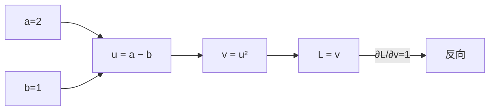
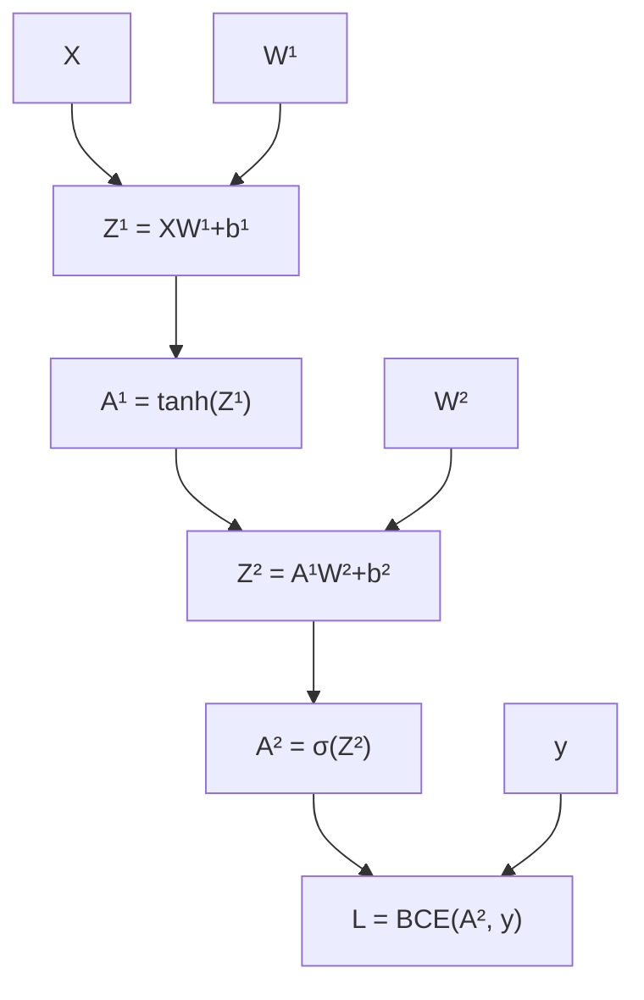

# 反向传播与优化

上一章手写了两层网络的反向传播，四行代码背后其实是链式法则沿着计算图的一次系统化反向遍历。这一章把这件事讲成理论：计算图是什么、自动微分怎么把"手工推导"变成"框架代劳"；然后从最朴素的梯度下降一路升级到 Adam、AdamW——今天几乎所有深度学习训练的默认起点；最后把学习率调度（Warmup、Cosine Decay）也补上。实验部分做两件事：手写梯度和 `torch.autograd` 对拍验证，再从零实现五个优化器在螺旋数据上对比。

## 计算图与链式法则

### 什么是计算图

任何复合函数，不管多复杂，都可以拆成一串"原子运算"的串联。把原子运算画成节点、数据流向画成边，得到的有向无环图就是**计算图**（computation graph）。

以 $L = (a - b)^2$ 为例，可以拆成 $u = a - b$，$v = u^2$，$L = v$ 三个原子步骤：



前向传播从输入往右算出 $L$；反向传播从 $L$ 出发往左推每个中间变量对损失的梯度。计算图的价值在于：**无论函数多复杂，反向传播都退化成在图上做一次拓扑逆序的遍历，每条边只用到一次链式法则**。

再看一个和上一章实验直接对应的例子。两层网络的损失 $L = \text{BCE}(\sigma(\mathbf{A}^{(1)}\mathbf{W}^{(2)}+\mathbf{b}^{(2)}),\, y)$，其中 $\mathbf{A}^{(1)} = \tanh(\mathbf{X}\mathbf{W}^{(1)}+\mathbf{b}^{(1)})$，图长这样：



上一章手写的 `backward` 函数，本质上就是把这张图的每条边的局部梯度写死成了代码。框架做的事，是把这张图记录下来、自动把局部梯度串起来。

### 链式法则

反向传播的全部数学基础就是微积分里的链式法则。标量形式：

$$
\frac{\partial L}{\partial x} = \frac{\partial L}{\partial y}\cdot\frac{\partial y}{\partial x}
$$

多变量时写成偏导数的连乘：

$$
\frac{\partial L}{\partial x_i} = \sum_j \frac{\partial L}{\partial y_j}\frac{\partial y_j}{\partial x_i}
$$

向量形式（Jacobian 矩阵）：

$$
\frac{\partial L}{\partial \mathbf{x}} = {\left(\frac{\partial \mathbf{y}}{\partial \mathbf{x}}\right)}^{\!\top} \frac{\partial L}{\partial \mathbf{y}}
$$

关键观察：反向传播时我们要算的是**标量损失对每个参数的梯度**，而不是中间变量之间完整的 Jacobian。这个"标量对向量"的结构，正是反向模式自动微分效率远高于前向模式的原因，下一节展开。

拿上一章 XOR 实验里的一个具体路径验算一遍。损失 $L$ 对 $\mathbf{W}^{(1)}$ 的梯度，沿路径 $L \to \mathbf{Z}^{(2)} \to \mathbf{A}^{(1)} \to \mathbf{Z}^{(1)} \to \mathbf{W}^{(1)}$：

$$
\frac{\partial L}{\partial \mathbf{W}^{(1)}}
= \frac{\partial L}{\partial \mathbf{Z}^{(2)}}
  \frac{\partial \mathbf{Z}^{(2)}}{\partial \mathbf{A}^{(1)}}
  \frac{\partial \mathbf{A}^{(1)}}{\partial \mathbf{Z}^{(1)}}
  \frac{\partial \mathbf{Z}^{(1)}}{\partial \mathbf{W}^{(1)}}
$$

代入每一步的局部导数，就还原出上一章那几行 NumPy 代码。手写反向传播看起来吓人，拆开全是链式法则。

### 从标量到计算图的心智模型

实际写代码时不需要每步都画图，但要养成两个习惯：

1. **每个张量知道自己的"生产者"**——它是从哪些输入、经过什么运算得来的；
2. **梯度从损失出发反向流动**——每个节点只需要知道"上游流下来的梯度"和"自己这一步的局部导数"，相乘再传给下游即可。

PyTorch 的动态图就是这个模型的工程实现：每次前向都会现场搭一张图，`backward()` 一调用，梯度就顺着这张图流回来，用完即弃（下次前向重新搭）。

## 自动微分原理

### 前向模式与反向模式

自动微分（automatic differentiation, AD）有两种基本模式，区别在于求导方向：

- **前向模式**（forward-mode）：沿着计算图从输入到输出传播 $\partial x / \partial (\text{自变量})$，适合"少量输入、大量输出"的场景，比如一个函数有 2 个输入、10000 个输出，前向跑两次就能得到全部梯度；
- **反向模式**（reverse-mode）：沿着计算图从输出到输入传播 $\partial L / \partial (\text{中间变量})$，适合"大量输入、少量输出"——深度学习正好是这个结构：参数有几百万到几千亿个（输入），损失就一个标量（输出）。

反向模式只需要**一次前向 + 一次反向**，就能拿到所有参数对损失的梯度，计算量大约是前向的 2~3 倍，与参数个数基本无关。这就是为什么深度学习全部采用反向模式——几亿参数和 10 个参数，反向传播的代价在同一个数量级。

算法骨架：

1. **前向阶段**：沿拓扑序计算所有中间变量的值，同时把计算图记录下来（或者在 tape 上记录每步运算）；
2. **反向阶段**：从损失节点出发，按拓扑逆序遍历；对每个节点，把上游传来的梯度和本地 Jacobian 相乘，继续传给前驱节点；
3. 遍历结束，所有叶子参数节点上就挂好了 $\partial L / \partial \theta$。

### PyTorch autograd 实际是怎么做的

PyTorch 用的是动态图 + tape 思路：张量带 `requires_grad=True` 时，所有涉及它的运算都会被记录；`loss.backward()` 触发反向遍历，梯度累加到叶子节点的 `.grad` 属性上。

```python
import torch

x = torch.tensor(2.0, requires_grad=True)
w = torch.tensor(3.0, requires_grad=True)

y = w * x + x ** 2          # y = 3*2 + 4 = 10
y.backward()
print(x.grad)   # tensor(7.)   dy/dx = w + 2x = 3 + 4
print(w.grad)   # tensor(2.)   dy/w = x = 2
```

`y.grad_fn` 会指向创建它的运算（`PowBackward0`、`MulBackward0` 之类），这是图被记录的直接证据。三个常见细节：

- **梯度累加**：叶子的 `.grad` 默认是累加的，所以训练循环里每次 `backward()` 前要 `optimizer.zero_grad()`（或 `x.grad.zero_()`）；
- **默认只对叶子求导**：中间变量的梯度算完就丢，除非你显式 `retain_graph=True` 或对中间变量 `retain_grad()`；
- **原地操作会破坏图**：对被追踪的张量做 in-place 修改（带 `_` 后缀）可能直接报错或产生错误梯度，上一章讲过这个坑。

`torch.autograd.grad` 是更精细的接口，可以指定对哪些变量求导、要不要保留中间图，做二阶梯度（比如 MAML、Fisher 信息）时会用到。

### 高阶导数与注意事项

理论上反向传播可以套娃：对反向过程再反向，就得到二阶导数。PyTorch 支持，但工程上要小心：

```python
x = torch.tensor(3.0, requires_grad=True)
y = x ** 3
grad_y, = torch.autograd.grad(y, x, create_graph=True)   # dy/dx = 3x²
grad2, = torch.autograd.grad(grad_y, x)                   # d²y/dx² = 6x
print(grad2)   # tensor(6.)
```

`create_graph=True` 会把梯度计算本身也记录进图里，这样才能对梯度再求导。默认关闭是因为绝大多数训练只需要一阶梯度，开着白白多占显存。二阶信息在自然梯度、牛顿法变体里有用，但真正的大规模训练还是靠一阶方法 + 一堆工程技巧，这也是为什么下面几节讲的全是"一阶优化器"。

## 从梯度下降到优化器

### 梯度下降与 SGD

优化的出发点是最朴素的一句话：沿着损失下降最快的方向走。这个方向就是负梯度方向：

$$
\theta \leftarrow \theta - \eta\,\nabla_\theta L(\theta)
$$

$\eta$ 是学习率（learning rate），整个深度学习最重要的一个超参。实际实现里几乎不会用全量数据算梯度（太贵），而是每次采一小批（mini-batch）：

$$
\theta \leftarrow \theta - \eta\,\nabla_\theta L_{\mathcal{B}}(\theta), \qquad \mathcal{B} \subset \mathcal{D},\ |\mathcal{B}| = B
$$

这就叫**随机梯度下降**（SGD，严格说是 mini-batch SGD）。小批量梯度是真实梯度的无偏估计，带噪声——这个噪声在实践中其实是好事：它帮模型跳出尖锐的局部极小值（sharp minima），落到更平坦、泛化更好的区域。很多论文里的"SGD 泛化好过自适应方法"的争论，本质都绕着这个噪声打转。

纯 SGD 有两个实际痛点：在病态曲率方向（某个方向梯度大、另一个方向梯度小）上会来回震荡、收敛慢；遇到局部极小值或鞍点容易卡住。优化器家族的演进，基本都是在解决这两个问题。

### Momentum

物理学里的动量：一个球从山上滚下来，不会在谷底立刻停住，惯性会带着它继续冲。动量法把这个直觉写进更新规则：

$$
\mathbf{v} \leftarrow \beta\,\mathbf{v} + \nabla_\theta L, \qquad
\theta \leftarrow \theta - \eta\,\mathbf{v}
$$

$\beta$ 通常取 0.9。$\mathbf{v}$ 是历史梯度的指数滑动平均——方向一致的梯度会不断累积（越滚越快），方向来回变的梯度互相抵消（震荡被平滑）。在峡谷状曲率里，动量法沿着峡谷方向的震荡被衰减、沿谷底方向的加速累积，收敛明显快于纯 SGD。

也可以改写成"速度 = 梯度 + 惯性"的形式：$\mathbf{v} \leftarrow \beta\mathbf{v} - \eta\nabla L$，然后 $\theta \leftarrow \theta + \mathbf{v}$，数学上等价，只是把学习率挪进了速度里。两种写法在不同框架里都出现过，读代码时留意区分。

### RMSProp

动量对所有参数一视同仁地加速，但不同参数的梯度量级可能差好几个数量级（深层网络很常见）。RMSProp（Hinton, 2012 年 Coursera 课程提出，未正式发表）给每个参数维护梯度平方的滑动平均，用它来归一化步长：

$$
\mathbf{s} \leftarrow \beta\,\mathbf{s} + (1-\beta)\,\nabla_\theta L \odot \nabla_\theta L, \qquad
\theta \leftarrow \theta - \eta\,\frac{\nabla_\theta L}{\sqrt{\mathbf{s}} + \epsilon}
$$

直觉：某个方向梯度一直很大 → $\mathbf{s}$ 累积得大 → 步长被除小；梯度一直很小 → $\mathbf{s}$ 小 → 步长被除大。相当于给每个参数配了一个自适应的等效学习率。$\epsilon$（通常 $10^{-8}$）防止除零。

### Adam

Adam（Adaptive Moment Estimation, Kingma & Ba, 2015）把 Momentum 和 RMSProp 揉在一起：一阶矩（梯度均值）+ 二阶矩（梯度平方均值），再加一个关键的偏差修正：

$$
\begin{aligned}
\mathbf{m} &\leftarrow \beta_1\mathbf{m} + (1-\beta_1)\,\nabla_\theta L \\
\mathbf{v} &\leftarrow \beta_2\mathbf{v} + (1-\beta_2)\,(\nabla_\theta L)^{\odot 2} \\
\hat{\mathbf{m}} &= \frac{\mathbf{m}}{1-\beta_1^t}, \qquad
\hat{\mathbf{v}} = \frac{\mathbf{v}}{1-\beta_2^t} \\
\theta &\leftarrow \theta - \eta\,\frac{\hat{\mathbf{m}}}{\sqrt{\hat{\mathbf{v}}}+\epsilon}
\end{aligned}
$$

默认 $\beta_1=0.9$、$\beta_2=0.999$、$\epsilon=10^{-8}$。偏差修正的原因：$\mathbf{m}$、$\mathbf{v}$ 初始化为零，前几步的估计会系统性偏向零；除以 $1-\beta^t$（$t$ 是步数）把这个偏置除掉，$t$ 大了之后 $\beta^t\to 0$，修正自然消失。

Adam 的默认学习率通常是 $10^{-3}$，对大多数问题开箱即用，这也是它成为"懒人默认优化器"的原因——不怎么调也能收敛。代价是自适应方法的通病：自适应步长会破坏梯度噪声的有益性质，某些视觉/语音任务上泛化不如精细调过的 SGD+Momentum，而且自适应分母本身也在不断变化，引入了新的非平稳性。

### AdamW：解耦的权重衰减

Adam 还有个经常被搞混的亲戚——权重衰减（weight decay）。它和 L2 正则化经常被说成一回事，在 SGD 下确实几乎等价：

$$
\text{L2: } \theta \leftarrow \theta - \eta\,(\nabla L + \lambda\theta)
= (1-\eta\lambda)\theta - \eta\,\nabla L
$$

可以看到 L2 惩罚项对参数的收缩就是 $\theta \leftarrow (1-\eta\lambda)\theta$，这正是权重衰减。但在 Adam 里情况变了：如果把 $\lambda\theta$ 加进梯度，它也会被二阶矩 $\hat{\mathbf{v}}$ 归一化——梯度大的参数（$\hat{\mathbf{v}}$ 大）收缩反而被除小了，收缩力度和参数的自适应步长搅在一起，正则化效果变得不可解释。

Loshchilov & Hutter（2019）提出的 AdamW 把这两件事拆开：

$$
\theta \leftarrow (1 - \eta\lambda)\,\theta \;-\; \eta\,\frac{\hat{\mathbf{m}}}{\sqrt{\hat{\mathbf{v}}}+\epsilon}
$$

权重衰减项直接乘在参数上，不经过自适应缩放。同样的 $\lambda$，AdamW 的正则化强度稳定得多，这也是今天大模型训练几乎清一色用 AdamW 的原因。

### 一图流对比

| 优化器 | 状态量 | 特点 | 典型 lr | 常见场景 |
|--------|--------|------|---------|----------|
| SGD | 无 | 噪声有益、泛化好、调参敏感 | 0.1 ~ 1e-1 | CV 经典训练（配 Momentum） |
| Momentum | 速度 $\mathbf{v}$ | 抗震荡、加速收敛 | 0.01 ~ 0.1 | CV、通用场景 |
| RMSProp | 二阶矩 $\mathbf{s}$ | 自适应步长 | 1e-3 ~ 1e-2 | RNN、稀疏特征 |
| Adam | $\mathbf{m},\mathbf{v}$ + 偏差修正 | 开箱即用、收敛快 | 1e-3 | 通用默认 |
| AdamW | 同 Adam + 解耦衰减 | 正则化稳定 | 1e-3 | Transformer、大模型 |

没有哪个优化器全面碾压。工程上的常见分工：视觉任务用 SGD+Momentum+阶梯衰减调到飞起，语言/多模态/大模型直接 AdamW+Cosine，RL 里 PPO 常用 Adam。选优化器先看领域默认，再考虑任务特性。

## 学习率调度

固定学习率有个天然矛盾：大学习率前期收敛快但后期震荡不收敛，小学习率前期慢但能精调。学习率调度（learning rate schedule）让 $\eta$ 随训练进程变化，兼顾两者。

### Warmup

训练刚开始时参数是随机初始化的，Adam 的 $\mathbf{m},\mathbf{v}$ 也接近零，此时梯度估计噪声大、方向不稳，大学习率一步就可能把参数甩飞。**Warmup** 的做法是：前 $T_w$ 步把学习率从接近 0 线性（或余弦）爬升到峰值 $\eta_{\max}$：

$$
\eta_t = \eta_{\max}\cdot\frac{t}{T_w}, \qquad t \le T_w
$$

Warmup 在 Transformer 训练里几乎是标配，原始《Attention Is All You Need》用的就是 $T_w = 4000$ 步的线性 warmup。直觉：让自适应优化器的动量估计先"热身"到大致正确的方向，再放开步子。大 batch 训练尤其依赖 warmup——batch 越大，初始几步的梯度方差带来的破坏越大。

### Cosine Decay

Warmup 结束后进入主衰减阶段。**余弦衰减**把学习率按余弦曲线从 $\eta_{\max}$ 降到接近 0：

$$
\eta_t = \eta_{\min} + \frac{1}{2}(\eta_{\max}-\eta_{\min})\left(1 + \cos\left(\pi\cdot\frac{t - T_w}{T - T_w}\right)\right), \qquad t > T_w
$$

$T$ 是总步数。前期衰减慢、后期衰减快，给模型足够时间在大步长下探索、再用小步长精修。GPT-3、ViT、LLaMA 系列的预训练全都用 warmup + cosine。相比之下，传统 CV 里的阶梯衰减（step decay，每 $k$ 个 epoch 乘 0.1）更简单粗暴，效果也不差，就是需要人工定衰减时机。

```python
import math

def warmup_cosine_lr(step, total, warmup, eta_max=1e-3, eta_min=1e-5):
    if step < warmup:
        return eta_max * step / max(warmup, 1)
    progress = (step - warmup) / max(total - warmup, 1)
    return eta_min + 0.5 * (eta_max - eta_min) * (1 + math.cos(math.pi * progress))
```

### 还有哪些调度方式

除了上述两个，还有几个值得混个脸熟：**线性衰减**（简单，小模型微调常用）；**OneCycle**（先升到峰值再余弦降到很低，配合大 lr 刻意制造震荡，Smith 2017）；**Polynomial decay**（T5 预训练用过）；**ReduceLROnPlateau**（验证指标不涨了再降，自适应但需要额外监控）。选择逻辑：预训练大模型 warmup+cosine 几乎不会错；小数据微调可以从固定 lr 或线性衰减起步；调参空间大时试 OneCycle。

## 实验：验证反向传播 + 对比优化器

这一节分三步：先把 NumPy 手写的梯度和 PyTorch autograd 对拍，确认反向传播写对了；然后从零实现五个优化器；最后在螺旋数据上让它们赛跑，把 Warmup+Cosine 的效果也画出来。

### 数据：双螺旋

XOR 只有四个点，优化器差异看不出来。换成经典的双螺旋（two spirals）：两类点各绕成一条螺旋，互相缠绕，线性模型完全没戏，必须学到足够弯的边界。

```python
import numpy as np
import matplotlib.pyplot as plt

np.random.seed(1)

def make_spirals(N=100, noise=0.2):
    """CS231n 经典双螺旋数据集"""
    X = np.zeros((N * 2, 2))
    y = np.zeros(N * 2, dtype=np.int64)
    for j in range(2):
        ix = range(N * j, N * (j + 1))
        r = np.linspace(0.0, 1, N)
        t = np.linspace(j * 4, (j + 1) * 4, N) + np.random.randn(N) * noise
        X[ix] = np.c_[r * np.sin(t), r * np.cos(t)]
        y[ix] = j
    return X, y

X, y = make_spirals()
print(X.shape, y.shape)   # (200, 2) (200,)

plt.figure(figsize=(5, 5))
plt.scatter(X[:, 0], X[:, 1], c=y, s=20, cmap='coolwarm')
plt.title('双螺旋数据集')
plt.gca().set_aspect('equal')
plt.show()
```

两类点像两条缠在一起的蚊香，肉眼都难分，模型不学出弯边界不可能分开。

### 手写反向传播 vs autograd 对拍

用上一章的两层网络（2 → 32 → 2，隐藏 Tanh，输出 Softmax + 交叉熵），先纯 NumPy 实现前向反向，再用 PyTorch 在同一组权重上算梯度，逐元素比对：

```python
import torch

def init_params(n_in=2, n_h=32, n_out=2, scale=0.5):
    return {
        'W1': np.random.randn(n_in, n_h) * scale,
        'b1': np.zeros((1, n_h)),
        'W2': np.random.randn(n_h, n_out) * scale,
        'b2': np.zeros((1, n_out)),
    }

def softmax(Z):
    Z = Z - Z.max(axis=1, keepdims=True)   # 数值稳定
    e = np.exp(Z)
    return e / e.sum(axis=1, keepdims=True)

def np_forward_backward(X, y_idx, P):
    """返回 loss 和各参数梯度（NumPy 手写）"""
    N = X.shape[0]
    Z1 = X @ P['W1'] + P['b1']
    A1 = np.tanh(Z1)
    Z2 = A1 @ P['W2'] + P['b2']
    A2 = softmax(Z2)

    loss = -np.mean(np.log(A2[np.arange(N), y_idx] + 1e-8))

    dZ2 = A2.copy()
    dZ2[np.arange(N), y_idx] -= 1.0
    dZ2 /= N
    dW2 = A1.T @ dZ2
    db2 = dZ2.sum(axis=0, keepdims=True)
    dA1 = dZ2 @ P['W2'].T
    dZ1 = dA1 * (1 - A1 ** 2)
    dW1 = X.T @ dZ1
    db1 = dZ1.sum(axis=0, keepdims=True)

    return loss, {'W1': dW1, 'b1': db1, 'W2': dW2, 'b2': db2}

def torch_gradients(X, y_idx, P):
    """同一组权重，用 torch.autograd 算梯度"""
    Xt = torch.tensor(X, dtype=torch.float64)
    yt = torch.tensor(y_idx, dtype=torch.long)
    params = {k: torch.tensor(v, dtype=torch.float64, requires_grad=True) for k, v in P.items()}

    Z1 = Xt @ params['W1'] + params['b1']
    A1 = torch.tanh(Z1)
    logits = A1 @ params['W2'] + params['b2']
    loss = torch.nn.functional.cross_entropy(logits, yt)
    loss.backward()

    return loss.item(), {k: params[k].grad.numpy() for k in P}

# 对拍
np_loss, np_grads = np_forward_backward(X, y, P := init_params())
th_loss, th_grads = torch_gradients(X, y, P)

print(f'loss  NumPy={np_loss:.8f}  torch={th_loss:.8f}')
for k in P:
    err = np.abs(np_grads[k] - th_grads[k]).max()
    print(f'{k}  最大梯度误差 = {err:.2e}')
```

跑出来 loss 完全一致（差值在 $10^{-12}$ 量级），每个参数梯度的最大绝对误差也在 $10^{-12}$ 以下——NumPy 手写的反向传播和框架自动微分算的是同一个东西。这个对拍流程强烈建议每次手写完新算子都跑一遍，它能抓住转置写反、漏除 batch size 这类经典笔误。

### 从零实现五个优化器

不依赖任何框架优化器接口，把更新规则直接写出来。所有优化器共享同一接口，后面换着用只需要换类名：

```python
class Optimizer:
    def __init__(self, params, lr):
        self.params = params          # dict of np arrays（就地更新）
        self.lr = lr

    def step(self, grads):
        raise NotImplementedError


class SGD(Optimizer):
    def step(self, grads):
        for k in self.params:
            self.params[k] -= self.lr * grads[k]


class Momentum(Optimizer):
    def __init__(self, params, lr, beta=0.9):
        super().__init__(params, lr)
        self.beta = beta
        self.v = {k: np.zeros_like(v) for k, v in params.items()}

    def step(self, grads):
        for k in self.params:
            self.v[k] = self.beta * self.v[k] + grads[k]
            self.params[k] -= self.lr * self.v[k]


class RMSProp(Optimizer):
    def __init__(self, params, lr, beta=0.99, eps=1e-8):
        super().__init__(params, lr)
        self.beta = beta
        self.eps = eps
        self.s = {k: np.zeros_like(v) for k, v in params.items()}

    def step(self, grads):
        for k in self.params:
            self.s[k] = self.beta * self.s[k] + (1 - self.beta) * grads[k] ** 2
            self.params[k] -= self.lr * grads[k] / (np.sqrt(self.s[k]) + self.eps)


class Adam(Optimizer):
    def __init__(self, params, lr, b1=0.9, b2=0.999, eps=1e-8):
        super().__init__(params, lr)
        self.b1, self.b2, self.eps = b1, b2, eps
        self.t = 0
        self.m = {k: np.zeros_like(v) for k, v in params.items()}
        self.v = {k: np.zeros_like(v) for k, v in params.items()}

    def step(self, grads):
        self.t += 1
        bc1 = 1 - self.b1 ** self.t
        bc2 = 1 - self.b2 ** self.t
        for k in self.params:
            self.m[k] = self.b1 * self.m[k] + (1 - self.b1) * grads[k]
            self.v[k] = self.b2 * self.v[k] + (1 - self.b2) * grads[k] ** 2
            m_hat = self.m[k] / bc1
            v_hat = self.v[k] / bc2
            self.params[k] -= self.lr * m_hat / (np.sqrt(v_hat) + self.eps)


class AdamW(Adam):
    """解耦权重衰减：直接收缩参数，不经过自适应缩放"""
    def __init__(self, params, lr, weight_decay=0.01, **kw):
        super().__init__(params, lr, **kw)
        self.wd = weight_decay

    def step(self, grads):
        for k in self.params:          # 先做权重衰减
            self.params[k] *= (1 - self.lr * self.wd)
        super().step(grads)            # 再走 Adam 更新
```

一个可以顺手验证的小实验：把 Adam 的 $\lambda\theta$ 换成"加进梯度里的 L2"再和 AdamW 比，会看到 Adam+L2 的正则化几乎不起作用（梯度被 $\hat{\mathbf{v}}$ 吃掉了），而 AdamW 的参数范数明显收缩。这是"解耦权重衰减"论文最核心的实验现象，自己跑一遍比读十遍论文都清楚。

### 五个优化器赛跑

统一网络结构 2 → 64 → 64 → 2（两隐藏层 ReLU），各优化器用各自比较舒服的学习率（Adam 系 1e-3，SGD 系 1e-1），训 2000 步，记录损失：

```python
def train(X, y, opt_cls, lr, total_steps=2000, seed=0, **kw):
    rng = np.random.RandomState(seed)
    P = {
        'W1': rng.randn(2, 64) * 0.5,  'b1': np.zeros((1, 64)),
        'W2': rng.randn(64, 64) * 0.5, 'b2': np.zeros((1, 64)),
        'W3': rng.randn(64, 2) * 0.5,  'b3': np.zeros((1, 2)),
    }
    # 同一 seed 下所有优化器起点完全相同，保证公平
    opt = opt_cls(P, lr=lr, **kw)
    losses = []
    for step in range(total_steps):
        Z1 = X @ P['W1'] + P['b1']; A1 = np.maximum(Z1, 0)
        Z2 = A1 @ P['W2'] + P['b2']; A2 = np.maximum(Z2, 0)
        logits = A2 @ P['W3'] + P['b3']
        probs = softmax(logits)
        loss = -np.mean(np.log(probs[np.arange(len(y)), y] + 1e-8))
        losses.append(loss)

        dZ3 = probs.copy()
        dZ3[np.arange(len(y)), y] -= 1.0; dZ3 /= len(y)
        dW3 = A2.T @ dZ3; db3 = dZ3.sum(0, keepdims=True)
        dA2 = dZ3 @ P['W3'].T; dZ2 = dA2 * (Z2 > 0)
        dW2 = A1.T @ dZ2; db2 = dZ2.sum(0, keepdims=True)
        dA1 = dZ2 @ P['W2'].T; dZ1 = dA1 * (Z1 > 0)
        dW1 = X.T @ dZ1; db1 = dZ1.sum(0, keepdims=True)
        grads = {'W1': dW1, 'b1': db1, 'W2': dW2, 'b2': db2, 'W3': dW3, 'b3': db3}

        opt.step(grads)
    return losses

results = {}
results['SGD (lr=0.1)']      = train(X, y, SGD,      lr=0.1)
results['Momentum (0.1)']    = train(X, y, Momentum, lr=0.1)
results['RMSProp (0.01)']    = train(X, y, RMSProp,  lr=0.01)
results['Adam (1e-3)']       = train(X, y, Adam,     lr=1e-3)
results['AdamW (1e-3, wd)']  = train(X, y, AdamW,    lr=1e-3, weight_decay=0.01)

plt.figure(figsize=(8, 4.5))
for name, losses in results.items():
    plt.plot(losses, label=name, linewidth=1.8)
plt.xlabel('step'); plt.ylabel('loss')
plt.title('优化器对比：双螺旋 2000 步')
plt.legend(); plt.ylim(0, 1.05)
plt.tight_layout(); plt.show()

for name, losses in results.items():
    print(f'{name:22s}  最终 loss = {losses[-1]:.4f}')
```

典型的输出大致是这样（seed 固定后可复现）：

```text
SGD (lr=0.1)            最终 loss = 0.6931   ← 基本没动
Momentum (0.1)          最终 loss = 0.2446
RMSProp (0.01)          最终 loss = 0.0907
Adam (1e-3)             最终 loss = 0.0536
AdamW (1e-3, wd)        最终 loss = 0.1130
```

几个可以亲手验证的现象：

- 纯 SGD 在这种缠绕数据上几乎不动弹，损失停在 $\ln 2\approx 0.693$（瞎猜的水平）；给它配 Momentum 才开始像样；
- Adam 前几百步下降最快，这是"自适应+动量"的直观体现；
- AdamW 因为权重衰减压制了参数幅度，最终损失比 Adam 略高——这是正则化的代价，在玩具数据集上是"缺点"，换成真实大数据就是泛化的来源。

### Warmup + Cosine 实战

最后把学习率调度接进 Adam 的训练循环，对比固定学习率：

```python
def train_with_schedule(X, y, lr_max=5e-3, total=2000, warmup=200):
    rng = np.random.RandomState(0)
    P = {
        'W1': rng.randn(2, 64) * 0.5,  'b1': np.zeros((1, 64)),
        'W2': rng.randn(64, 64) * 0.5, 'b2': np.zeros((1, 64)),
        'W3': rng.randn(64, 2) * 0.5,  'b3': np.zeros((1, 2)),
    }
    opt = Adam(P, lr=lr_max)
    losses, lrs = [], []
    for step in range(total):
        lr_t = warmup_cosine_lr(step, total, warmup, eta_max=lr_max)
        opt.lr = lr_t                      # 每步改优化器的学习率
        lrs.append(lr_t)
        # ... 前向、反向同 train() ...
        # opt.step(grads)
    return losses, lrs

# lrs 画出来就是：前 200 步线性爬升，之后一条平滑的余弦曲线降到近 0
plt.plot(lrs)
plt.xlabel('step'); plt.ylabel('lr')
plt.title('Warmup + Cosine Decay')
plt.show()
```

把 `lrs` 画出来是一条标准的"爬升+余弦滑梯"曲线。和固定 lr=5e-3 对比，调度版的损失曲线在后期会明显更平——大学习率快速下降阶段结束后，小学习率把最后的震荡压了下去。大模型训练里这条曲线的形状甚至要专门做 ablation，Warmup 多少步、最低降到多少，都是要扫的超参。

## 小结

这一章把上一章手写的四行 `backward` 还原成了理论：计算图 + 链式法则 = 反向模式自动微分，一次反向遍历拿全部参数梯度，这是深度学习在算法层面成立的根基。优化器家族沿着"抗震荡（Momentum）→ 自适应步长（RMSProp/Adam）→ 解耦正则（AdamW）"一路演化，学习率调度（Warmup + Cosine）则负责在训练时间维度上把步长安排妥当。

到这里，训练一个网络的所有核心组件都齐了：数据、模型结构、损失、反向传播、优化器、学习率。下一章进入真正的实战维度——同样的骨架，为什么有人训得动、有人训不动？答案在批归一化、Dropout、早停这些训练技巧和正则化手段里。
