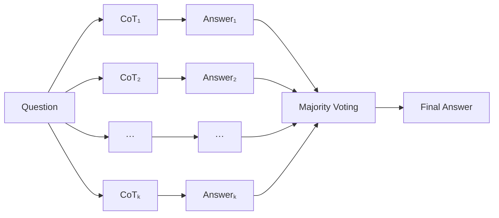
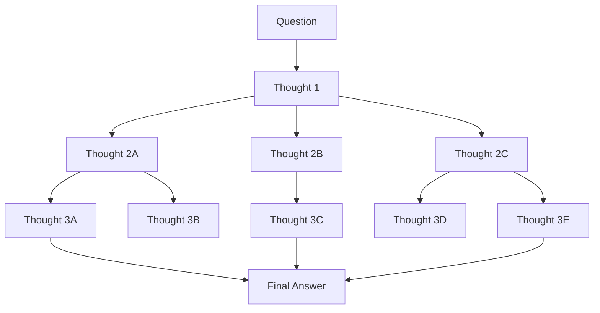
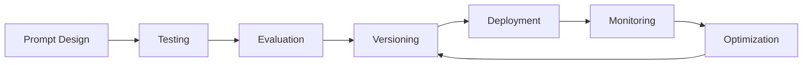

# 提示词工程（Prompt Engineering）

> 你有没有遇到过这种情况：明明给了 AI 一个问题，得到的回答却空泛、跑题、毫无用处？这不是 AI 的问题，往往是提问方式的问题。

提示词工程就是一门关于如何构造和精炼你的提示词的艺术和科学，目的是**最大化大语言模型模型的性能**，让它产出更符合你需求的、高质量的输出。

## Prompt 的基本组成结构

###  Prompt 的本质

Prompt 是开发者向模型描述任务、提供上下文、制定规则和约束的方式。在传统软件开发中，开发者通过代码告诉计算机应该如何执行，计算机会严格执行每一条代码指令，而在 LLM 应用中是概率性的，开发者通过 Prompt 告诉模型应该如何**思考和输出**。

这里推荐一个提示词工具：[https://www.jyshare.com/front-end/9127/](https://www.jyshare.com/front-end/9127/)

因此，Prompt 并不是简单的问题描述，而是一种**对模型行为进行引导和约束的方法**。开发者通过 Prompt 告诉模型：

- 需要完成什么任务（Task）；
- 当前任务所处的背景是什么（Context）；
- 应该遵循哪些规则和限制（Constraint）；
- 最终结果应该以什么形式输出（Output Format）。

换句话说，Prompt 的作用并不是直接告诉模型答案是什么，而是通过提供足够的信息，**引导模型采用合适的推理路径和表达方式**。

一个高质量 Prompt 通常由以下几个核心部分组成：

$$
\mathrm{Prompt} = Role + Context + Instruction + Constraint + Input + Output Format
$$

其中：

- **Role（角色）**：定义模型应该以什么身份和专业视角完成任务；
- **Context（上下文）**：提供任务相关的背景信息，帮助模型理解当前场景；
- **Instruction（指令）**：明确告诉模型需要完成的具体任务；
- **Constraint（约束）**：限制模型的行为范围，例如格式、长度、规则等；
- **Input（输入）**：提供需要模型处理的具体内容；
- **Output Format（输出格式）**：规定最终结果的组织形式。

在实际应用中，一个 Prompt 的质量通常取决于四个关键因素：

> 明确的任务目标 + 充分的上下文信息 + 合理的约束条件 + 稳定的输出格式 = 更准确、更可靠的模型输出
> 
### Role

Role（角色）是控制模型**身份、行为准则和对话上下文**的核心机制，是 Prompt 中控制模型输出风格和知识视角的重要组成部分。通过指定角色，可以让模型以特定领域专家的视角分析问题，而不是采用通用回答模式。例如你是一名机器学习研究员，模型会倾向于使用更加专业的术语、分析方法和表达方式。

Role 的主要作用包括：

- **限定模型的认知视角**：让模型以特定领域专家身份思考；
- **控制输出风格**：调整语言风格、专业程度和表达方式；
- **建立行为规范**：告诉模型应该如何完成任务。

需要注意的是，Role 并不会真正改变模型能力，它并不是让模型变成某个专家，而是通过上下文提示激活模型中已有的相关知识模式。在现代 LLM 对话系统中，一个完整的 Prompt 通常不是单一文本，而是由多个具有不同角色的消息组成，常见角色包括：
- System（系统提示词）
- User（用户提示词）
- Assistant
- Tool

不同角色承担不同职责，其中 System 负责定义模型行为规则，User 负责提出具体任务，Assistant 则表示模型自身生成的历史回复。


### Context

Context 用于**向模型提供任务背景和相关信息**，帮助模型理解当前问题所处的环境。由于大语言模型本身无法直接访问用户真实环境，因此需要通过上下文补充必要信息，例如用户背景、项目环境、数据资料、历史对话和任务目标等等。

从本质上看，Context 的作用是减少模型的不确定性，使模型生成结果更加贴近用户真实需求。

### Instruction

Instruction 是 Prompt 的核心部分，用于明确告诉模型需要执行什么任务。一个好的 Instruction 应该具有**明确的目标**、**清晰的任务范围**和**可执行的要求**。

Instruction 决定了模型需要解决的问题，是连接用户需求和模型输出之间的核心桥梁。

### Constraint

Constraint 用于**限制模型输出范围**，使结果满足特定要求，由于大语言模型具有较强的生成能力，如果缺少约束，模型可能产生内容过长、格式不符合要求或偏离任务目标的问题。因此，在实际应用中通常需要通过约束提高输出稳定性。
- 输出长度；
- 内容范围；
- 格式要求；
- 技术限制；
- 禁止事项。

约束的作用是降低模型输出的不确定性，提高结果稳定性。

### Input

Input 是**模型需要处理的具体内容**，是 Prompt 中面向任务对象的信息。在复杂应用中，Input 往往来自外部系统，例如 RAG 系统检索出的知识库内容，或者 Agent 调用工具获取的数据。

### Output Format

Output Format 用于**规定模型最终结果的组织方式**，默认情况下，大语言模型倾向于生成自然语言文本，但在实际应用中，很多系统需要对模型输出进行进一步处理，例如Agent 工具执行、API调用、数据存储等等，因此需要明确指定输出格式，大多数情况下强制模型输出结构化的`json`格式，结构化输出能够降低后处理成本，提高模型与其他系统之间的交互能力，是构建 Agent、RAG 和自动化工作流的重要基础。

## 基础 Prompt 技术

在深入学习各种 Prompt 技巧之前，有一个底层概念必须理解：**上下文窗口**。它决定了大语言模型一次能够接收和处理多少信息，也直接影响模型的记忆能力、任务复杂度以及使用成本。与传统程序不同，大语言模型并不是直接以字符、单词或者句子为单位理解文本，而是将输入内容转换为 **Token** 序列进行处理。Token 是模型处理文本的基本单位，它通常介于字符和单词之间，是连接人类语言与模型计算过程的桥梁。每个大语言模型都有一个固定大小的上下文窗口，可以理解为模型一次推理时能够看到的最大信息范围。例如，一个模型拥有 128K Token 的上下文窗口，意味着它最多只能同时处理约 128K 个 Token 的输入内容（包括系统提示词、用户输入、历史对话、检索文档以及工具返回结果等）。


当输入内容超过上下文窗口限制时，模型无法继续保留全部信息，系统通常会采用截断、压缩或者摘要等方式处理较早的内容。因此，所谓模型忘记之前的对话，并不是模型真正遗忘了知识，而是超出了当前推理时能够访问的信息范围。

在 Agent 系统中，上下文窗口的重要性更加突出。Agent 的运行过程本质上是不断向 Context Window 中注入新的信息：

$$
\mathrm{Context}_t + \mathrm{Action}_t + \mathrm{Observation}_t \rightarrow \mathrm{Context}_{t+1}
$$
其中包含用户任务、历史轨迹、工具调用结果、外部知识以及长期记忆等内容。因此，如何合理管理上下文，已经成为构建高性能 Agent 的核心问题之一。

### Zero-shot Prompt

Zero-shot Prompt 是最基础的一种提示方式，指**不给模型提供任何示例，仅通过自然语言指令直接要求模型完成任务**。其核心思想是利用大语言模型在预训练阶段学习到的通用知识和任务能力，通过简单的任务描述激活模型已有能力。基本形式为

$$\mathrm{Instruction}+\mathrm{Input}\to \mathrm{Output}$$

例如:
> 请总结以下文章的核心观点：{文章内容}

Zero-shot Prompt 的优势在于：

- **简单高效**：无需准备额外示例，Prompt 设计成本较低；
- **泛化能力强**：适用于大量开放领域任务；
- **Token 消耗较少**：不需要额外输入示例内容。

但它也存在一定局限：

- 模型可能无法准确理解复杂任务；
- 输出格式容易不稳定；
- 对任务边界和隐含要求的理解可能存在偏差。

对于复杂任务，通常需要进一步引入 Few-shot Prompt 或更明确的 Instruction 设计。

### Few-shot Prompt

Few-shot Prompt 是在 Prompt 中**加入少量任务示例**，让模型通过上下文学习理解任务模式，然后完成新的任务。与传统机器学习需要训练模型不同，Few-shot Prompt 不会更新模型参数，而是通过向模型展示示例，引导模型在当前上下文中临时学习任务规律。其基本形式为:

$$
\mathrm{Example1}:\mathrm{Input1}\to \mathrm{Output1} \\
\mathrm{Example2}:\mathrm{Input2}\to \mathrm{Output2} \\
\cdots \\
\mathrm{New Input}\to
$$

Few-shot Prompt 的核心价值在于：

- **提供任务示范**：降低模型对任务的理解难度；
- **约束输出格式**：通过示例让模型学习固定结构；
- **提升复杂任务稳定性**：减少模型自由发挥导致的不确定输出。

Few-shot Prompt 特别适用于：

- 文本分类；
- 信息抽取；
- 格式转换；
- 数据标注；
- 特定领域任务。

因此，Few-shot Prompt 的关键不是提供大量示例，而是提供**具有代表性、高质量的少量示例**。

### Role Prompting

Role Prompting 是通过**给模型指定一个身份或行为角色**，引导模型从特定视角理解问题并组织回答。其基本形式为：
> 你是一名 [角色]。请完成以下任务：[Task]

Role Prompting 的主要作用包括：

- **调整知识视角**：让模型从特定专业领域分析问题；
- **控制输出风格**：改变语言表达方式和专业程度；
- **增强任务匹配度**：使回答更加符合目标场景。

需要注意的是，Role Prompting 并不会增加模型真实能力，它不会让模型真正成为某个专家，而是通过上下文提示激活模型已有的相关知识模式。在 Agent 系统中，Role Prompting 进一步发展为 Agent 角色设计，例如：

- Planner Agent：负责任务规划；
- Research Agent：负责信息检索；
- Coding Agent：负责代码生成；
- Reviewer Agent：负责结果检查。

### Instruction Prompting

Instruction Prompting 是 Prompt Engineering 中最核心的方法之一，通过明确、具体的自然语言指令告诉模型**需要完成什么任务，以及应该如何完成任务。** 相比简单的问题描述，高质量 Instruction 会明确任务目标、执行方式和输出要求。一个完整的 Instruction 通常包含：
- **任务目标（Goal）**：明确模型需要完成什么；
- **任务范围（Scope）**：限定分析重点，避免回答偏离；
- **执行要求（Requirement）**：规定完成任务的方法；
- **输出要求（Output Format）**：规定结果形式。

Instruction Prompting 的核心作用是**降低任务歧义，提高模型输出的准确性和稳定性**。在实际 LLM 应用中，System Prompt、Agent Prompt、Tool Prompt 本质上都大量使用 Instruction Prompting，通过明确规则控制模型行为。

## 推理增强 Prompt 技术

### CoT

- 论文链接: [https://arxiv.org/pdf/2201.11903](https://arxiv.org/pdf/2201.11903)

2022 年，Google 在论文 《Chain-of-Thought Prompting Elicits Reasoning in Large Language Models》 中首次提出 Chain of Thought（CoT，思维链） 提示方法。其核心思想是**引导大语言模型将复杂问题拆解为多个可逐步求解的子问题，并按照一定的逻辑顺序完成推理，再得到最终答案**。模型在推理过程中产生的这些中间推理步骤，被称为 思维链（Chain of Thought，CoT）。


对于简单任务，大模型通常能够直接给出正确答案；然而面对数学计算、逻辑推理、多跳问答等复杂任务时，直接生成最终答案往往容易出现推理错误或遗漏关键步骤。CoT 的做法是在输出最终答案之前，引导模型**显式生成完整的中间推理过程**，使模型能够按照分析问题 → 分步推理 → 得出结论的方式进行求解，从而显著提升模型在数学推理、常识推理以及复杂逻辑推理等任务上的表现。除了提升模型性能之外，CoT 输出的中间推理过程还能帮助使用者理解模型是如何得到最终答案的，从而提高模型推理过程的可解释性。因此，思维链推理已经成为当前大语言模型处理复杂任务最重要、最常用的推理增强技术之一。


传统 Prompt 通常采用 Input → Output 的映射方式，即模型接收输入后直接生成最终答案。而 CoT 则在输入与输出之间引入了中间推理过程，将推理流程扩展为：

$$
\mathrm{Input} \to \mathrm{CoT} \to \mathrm{Output}
$$

也就是说，模型首先生成一系列逻辑推理步骤，再依据这些推理过程得到最终答案。大量研究已经证明，CoT 能够显著提升大语言模型在复杂推理任务上的性能。其优势主要体现在以下几个方面：
- **增强推理能力**：CoT 将复杂任务拆解为多个更容易求解的子问题，使模型能够逐步完成推理，有效降低因一步到位生成答案而忽略关键细节的问题，从而提升复杂任务的求解能力。
- **提高可解释性**：相比直接输出最终答案，CoT 会展示完整的推理过程，使用户能够理解模型的思考逻辑，并能够快速定位推理过程中可能出现的错误步骤。
- **增强可控性**：推理步骤的显式输出使用户能够对模型的推理过程进行干预和约束，例如限制推理方式、修正错误步骤或加入新的约束条件，从而降低模型完全作为黑盒工作的程度。
- **提升复杂任务的稳定性**：对于数学推导、代码生成、规划决策、多跳问答等需要连续推理的任务，CoT 能够减少推理跳跃和逻辑断裂，提高模型输出结果的一致性和可靠性。

尽管 CoT 能够显著提升大语言模型的推理能力，但它并非万能的方法，在实际应用中仍然存在一些不足。
- **推理质量高度依赖于模型自身的能力**。思维链本质上只是引导模型一步一步思考，并不会赋予模型新的知识或推理能力。如果模型本身的知识不足或推理能力较弱，那么生成的思维链也可能存在逻辑错误，甚至出现一本正经地推理错误的现象。换句话说，错误的推理步骤最终仍然会得到错误的答案;
- **单条思维链具有较强的路径依赖性**。CoT 通常沿着一条固定的推理路径逐步求解，一旦早期某一步出现错误，后续推理便会建立在错误的基础之上，导致错误不断累积，最终影响整个推理结果。这种现象也被称为误差传播;
- **增加模型的推理成本**。由于模型需要生成完整的中间推理过程，输出的 Token 数量显著增加，从而带来更高的推理延迟和 API 调用成本。在需要高吞吐量或低延迟的在线服务中，这种额外开销可能成为实际部署时的重要限制;
- **缺乏对推理过程的验证机制**。模型通常只生成一条推理链，并直接依据该推理链得到最终答案，而不会主动检查每一步是否正确，也不会尝试其他可能的推理路径。因此，当推理过程中出现错误时，模型往往难以及时发现并纠正。

这也促使研究者提出了 Self-Consistency With CoT、ToT、GoT等方法，通过生成多条推理路径、搜索不同推理分支或对推理结果进行投票，提高复杂推理任务的准确率和鲁棒性。

### Self-Consistency With CoT

Self-Consistency是 Google 在 2022 年论文 《Self-Consistency Improves Chain of Thought Reasoning in Language Models》 中提出的一种推理增强策略。它并不是一种新的 Prompt 方法，而是一种基于 CoT 的推理结果集成方法。

- 论文链接: [https://arxiv.org/pdf/2203.11171](https://arxiv.org/pdf/2203.11171)

Self-Consistency 的核心思想十分简单，**不要只相信模型生成的一条思维链，而是让模型生成多条不同的推理路径，再根据所有推理路径的最终答案进行投票，选择出现次数最多的答案作为最终输出**。传统 CoT 通常采用贪心解码的方式，对于一个问题只生成一条推理路径。这意味着模型一旦在某一步推理中出现错误，后续推理都会建立在错误的基础之上，最终导致整个推理过程失败。这种现象也被称为**误差传播**，也是 CoT 最主要的局限性之一。Self-Consistency 的提出正是为了缓解这一问题。它认为，对于大多数复杂推理任务而言，通向正确答案的推理路径通常不止一条。例如，同一道数学题可以采用不同的计算顺序，不同的逻辑题可以采用不同的分析思路，虽然中间推理过程存在差异，但最终答案往往是一致的。因此，模型没有必要只依赖一条推理路径，而应该探索更多可能的推理过程。


具体来说，Self-Consistency 首先采用带有随机性的采样策略（如 Temperature Sampling、Top-k Sampling 或 Top-p Sampling），让模型针对同一个问题生成多条不同的思维链。由于采样具有随机性，每条思维链的推理过程可能有所不同，甚至部分推理路径可能包含错误。然而，Self-Consistency 并不会比较这些思维链的具体内容，而是**仅统计每条思维链最终得到的答案**。最后，通过多数投票的方式，选择出现次数最多的答案作为最终输出。



与传统 CoT 相比，Self-Consistency 最大的区别在于，它将单路径推理扩展为了多路径推理。传统 CoT 更像是让模型选择一种思路一直做下去，而 Self-Consistency 则允许模型尝试多种不同的解题思路，再综合这些思路得到最终答案。这种思想与集成学习十分相似：单个推理结果可能存在误差，但多个相互独立的推理结果经过投票后，通常能够获得更加稳定和准确的预测。不过，Self-Consistency 并没有从根本上解决 CoT 的所有问题。由于需要为同一个问题生成多条思维链，它需要进行多次模型推理，因此推理时间和 Token 消耗都会明显增加。同时，多数投票机制默认假设正确答案更容易在不同推理路径中重复出现。如果模型本身推理能力较弱，或者多个推理路径都产生了相同的错误答案，那么投票结果仍然可能是错误的。此外，Self-Consistency 只关注最终答案是否一致，而不会验证每一步推理过程的正确性，因此它提高的是最终结果的可靠性，而非推理过程本身的正确性。

### ToT

- 论文链接: [https://arxiv.org/pdf/2305.10601](https://arxiv.org/pdf/2305.10601)

2023 年，论文 《Tree of Thoughts: Deliberate Problem Solving with Large Language Models》 中提出了 Tree of Thoughts（ToT，思维树） 推理框架。ToT 可以看作是对 CoT 和 Self-Consistency 的进一步扩展，它借鉴了经典人工智能中的**树搜索**思想，使大语言模型不再沿着单一路径完成推理，而是在多个可能的推理方向之间进行探索、评估和选择，从而获得更加可靠的推理结果。CoT 的推理方式可以理解为沿着一条固定路径不断向前推导，每一步都依赖于前一步的结果，一旦中间某一步出现错误，整个推理过程都会受到影响。Self-Consistency 虽然通过生成多条完整的思维链并采用多数投票提高了最终答案的准确率，但每一条思维链本质上仍然是独立的一次性推理，模型不会在推理过程中根据当前状态调整后续的推理方向，也不会主动放弃已经出现错误的推理路径。


ToT 的核心思想是**将推理过程表示为一棵搜索树**。在这棵树中，每一个节点表示当前推理过程中的一个中间状态，而不是最终答案；每一条边表示从当前状态继续扩展得到的新思路；从根节点不断向下扩展，最终形成多条不同的推理路径。模型可以像人类解决复杂问题一样，在多个候选思路之间不断尝试、比较和筛选，而不是一直沿着唯一的一条路径推导到底。整个推理过程可以表示为：




与 CoT 中一步对应一个 Token的细粒度推理不同，ToT 将**Thought**作为搜索的基本单位。一个 Thought 可以是一句话、一个公式、一段分析，甚至是多个连续的推理步骤，因此每次搜索都是在更高层次的语义空间中进行。这种设计能够有效降低搜索空间，同时使模型能够围绕一个完整的推理状态进行规划，而不是仅关注下一个 Token 应该生成什么。为了找到最优的推理路径，ToT 在每次扩展新的 Thought 后，还会对这些候选思路进行评估。论文提出了两种主要的评估方式。
- 一种是Value Evaluation，即让模型直接判断当前 Thought 是否具有继续探索的价值，并给予评分；
- 另一种是Vote Evaluation，即同时生成多个候选 Thought，再让模型投票选择最优的几个继续扩展。

通过不断地生成—评估—选择，模型能够主动保留高质量的推理路径，并及时剪枝那些明显错误或价值较低的分支，从而避免大量无意义的搜索。这种循环一直持续到搜索达到设定深度，或者找到满足条件的解为止。由于引入了搜索和回溯机制，ToT 已经不再是简单的 Prompt 技术，而更接近于传统人工智能中的启发式搜索算法。论文中分别采用 BFS 和 DFS 对推理树进行搜索，BFS 能够同时探索多个推理方向，适用于需要全局搜索的问题；DFS 则优先深入某一条推理路径，更适合搜索空间较大的任务。

不过，ToT 也带来了更高的推理成本。由于模型需要不断生成多个候选 Thought、评估每个 Thought 的质量，并反复进行搜索和剪枝，因此 Token 消耗和推理时间都远高于 CoT 和 Self-Consistency。此外，搜索树的规模会随着搜索深度呈指数级增长，如果缺乏合理的剪枝策略，计算成本会迅速增加。另一方面，ToT 的评估过程仍然依赖大语言模型自身，当模型无法准确判断 Thought 的优劣时，搜索过程仍可能偏离正确方向。

## Prompt 优化方法

随着大语言模型逐渐应用于生产环境，仅仅编写一个 Prompt 已经无法满足复杂应用的需求。实际开发中，一个 Prompt 往往需要经历设计、调试、版本迭代、参数配置、动态生成以及持续优化等多个环节。因此，Prompt Engineering 不仅包括各种提示策略，还包括 Prompt 的工程化管理。为了提高 Prompt 的复用性、可维护性和开发效率，业界逐渐形成了 **Prompt Template** 和 **Prompt Management** 等一系列工程实践，使 Prompt 能够像代码一样进行组织、维护和迭代。

### Prompt Template

Prompt Template是一种将 Prompt 参数化（Parameterized）的设计方式，其核心思想是将**固定的 Prompt 内容与动态输入解耦**，通过预先定义模板，再根据不同任务填充变量生成最终 Prompt。相比直接将完整 Prompt 写死在代码中，Prompt Template 能够显著提高 Prompt 的复用性和可维护性。例如，一个新闻摘要系统无需为每篇文章编写新的 Prompt，而只需定义统一的模板，再将文章内容动态填充即可。例如，一个简单的 Prompt 模板可以表示为：

```text
你是一位专业的新闻编辑。

请阅读下面的新闻内容，并完成摘要。

新闻内容：
{{article}}

要求：
1. 不超过200字；
2. 保留关键事件；
3. 使用正式书面语言。
```

其中，`{{article}}` 为动态变量，在运行时由具体的新闻内容替换。最终生成的 Prompt 由固定模板与动态数据共同组成。现代 Prompt 框架都提供了 Prompt Template 功能，本质上都是通过模板引擎实现 Prompt 的动态生成。

### Prompt 管理

随着应用规模不断扩大，一个项目中往往包含几十甚至上百个 Prompt。如果这些 Prompt 全部直接写在代码中，不仅难以维护，而且修改 Prompt 往往需要重新部署整个系统。因此，Prompt Management逐渐成为 Prompt Engineering 中的重要组成部分。Prompt 管理的目标是像**管理代码一样管理 Prompt**，包括 Prompt 的版本控制、分类组织、测试评估、在线配置以及持续优化等，使 Prompt 能够独立于业务代码进行维护。一个典型的 Prompt 生命周期如下：



随着 Prompt 数量的增加，越来越多的团队开始使用专门的 Prompt 管理平台，如 LangSmith、PromptLayer、PromptHub 等，对 Prompt 的设计、测试、评估和部署进行统一管理。这些平台通常还支持 Prompt 的可视化编辑、在线调试、版本回溯以及实验对比，进一步提升了 Prompt Engineering 的开发效率。

## 参考资料

1. [Chain-of-Thought Prompting Elicits Reasoning in Large Language Models](https://arxiv.org/pdf/2201.11903)
2. [SELF-CONSISTENCY IMPROVES CHAIN OF THOUGHT REASONING IN LANGUAGE MODELS](https://arxiv.org/pdf/2203.11171)
3. [Tree of Thoughts: Deliberate Problem Solving with Large Language Models](https://arxiv.org/pdf/2305.10601)
4. [Large Language Models are Zero-Shot Reasoners](https://arxiv.org/pdf/2205.11916)
5. [菜鸟教程-提示词工程](https://www.runoob.com/ai-agent/prompt-engineering.html)
