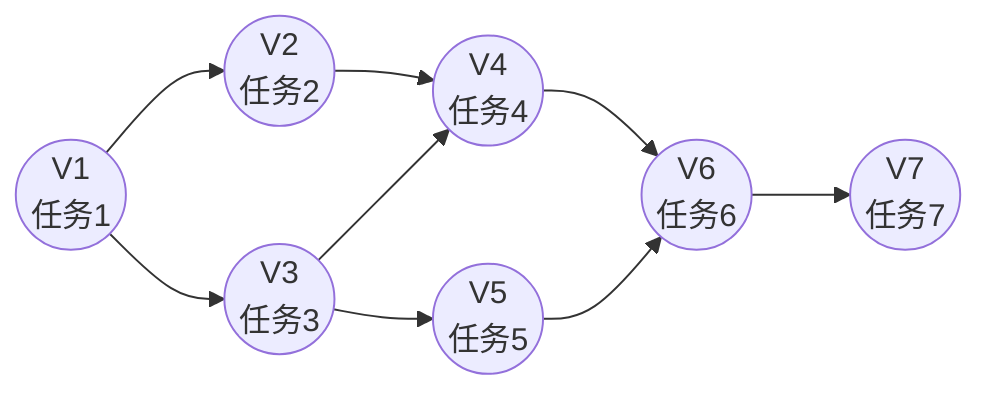

# Agent架构

随着大语言模型推理能力的不断提升，人们开始尝试让模型完成越来越复杂的任务。例如，让模型搜索互联网、分析文档、调用数据库、编写代码、执行脚本，甚至自主完成一个完整的软件开发流程。这些任务已经不再是简单的一次性问答，而是需要模型持续思考、调用工具、获取反馈，并根据新的信息不断调整后续决策。

然而，传统的大语言模型本质上仍然是一个**单轮推理系统**。它擅长根据已有上下文生成回答，但无法主动与外部环境交互，也不会自主规划任务，更不能根据执行结果动态修正自己的行为。对于"查询天气"、"搜索最新论文"、"运行代码并修复错误"等需要多轮决策和环境反馈的任务，仅依靠一次前向推理显然是不够的。

Agent 正是在这一背景下提出的一种新的系统架构。它不再将大语言模型视为最终的应用，而是将其作为整个智能系统的推理引擎，并进一步赋予模型规划（Planning）、工具调用（Tool Use）、环境感知（Observation）、记忆（Memory）以及自我反思（Reflection）等能力，使其能够像人类一样，在思考—行动—反馈的循环中逐步完成复杂任务。围绕这一目标，研究者提出了多种 Agent 推理架构
- **ReAct**: 通过交替执行推理和行动，使模型能够根据环境反馈动态决策；
- **Plan-and-Solve**: 将整体规划与任务执行分离，先制定完整计划，再逐步完成各个子任务；
- **Reflexion**: 进一步引入自我反思机制，使模型能够根据执行结果持续修正和优化自己的行为。

## ReAct框架：推理与行动交替

在 ReAct 提出之前，大语言模型更多地采用 Chain-of-Thought 等推理方式，即模型根据已有上下文直接生成完整的推理过程和最终答案。这种方式适用于数学推导、逻辑分析等完全依赖模型内部知识的任务，但面对需要获取实时信息或与外部环境交互的任务时，却存在天然的局限性。例如，当用户要求查询今天的天气、搜索最新论文、分析网页内容或执行一段代码时，模型无法凭借参数中存储的知识完成这些任务，因为这些信息并不存在于模型训练时的数据中。

ReAct（Reasoning and Acting）是目前 Agent 领域最具代表性的推理框架之一，由 Google Research 和 Princeton University 于 2022 年提出，其核心思想是在任务执行过程中，将**Reasoning与Acting**交替进行，让 Agent 能够像人类一样一边思考、一边行动，并根据环境反馈不断调整自己的决策，而不是一次性生成最终答案。

- ReAct Paper Link: [https://arxiv.org/pdf/2210.03629](https://arxiv.org/pdf/2210.03629)
- ReAct Github Link: [https://github.com/ysymyth/ReAct](https://github.com/ysymyth/ReAct)

在传统的大语言模型中，模型通常采用**一次性推理**的方式回答问题。对于一些简单的知识问答，这种方式已经足够，但面对需要联网搜索、数据库查询、代码执行或浏览网页等复杂任务时，仅依赖模型内部知识往往无法得到正确结果。ReAct 正是为了解决这一问题而提出，它将**推理与工具调用结合**起来，使 Agent 能够在推理过程中主动获取外部信息，再利用这些信息继续完成后续推理，从而形成一个完整的闭环。

整个过程中最重要的是 Thought、Action 和 Observation 三个阶段，它们共同构成了 Agent 的基本循环。

### ReAct的核心思想

ReAct的核心思想可以概括为一句话：让大语言模型在执行任务的过程中，将推理与行动交替进行，并利用环境反馈不断修正后续决策，而不是一次性生成最终答案。 

其中，Thought 表示**模型根据当前任务和已有信息进行分析，明确下一步应该采取什么行动**；Action 表示 **Agent 将推理结果转化为具体操作**，例如调用搜索引擎、访问数据库、执行代码或操作浏览器；Observation 则表示**环境返回的执行结果**，例如搜索结果、API 返回的数据、程序运行输出或网页内容。这些 Observation 不会直接作为最终答案，而是重新输入给模型，成为下一轮推理的重要依据。这种设计使 ReAct 不再依赖模型内部已有的知识，而是能够通过持续与外部环境交互，不断获取新的信息并修正自己的决策。例如，在回答今天的天气如何时，传统 LLM 可能直接根据训练数据进行猜测，而 ReAct 会先推理出需要查询实时天气，再调用天气 API 获取最新数据，最后根据返回结果生成回答。整个过程始终以真实环境反馈作为依据，从而提高回答的准确性和可靠性。

从更高的角度来看，ReAct 本质上是一种**闭环决策机制**（Closed-loop Decision Making）。模型不再一次性规划整个任务，而是在每一次行动之后重新评估当前状态，根据新的环境信息动态调整执行策略。这种边思考、边行动、边观察的工作方式，使 Agent 能够处理开放环境中的复杂任务，也是现代 Agent 基本循环的理论基础。

### ReAct的优势

相比传统的 AI 推理方式，ReAct 并不是一次性完成思考，而是在任务执行过程中不断进行推理—行动—观察循环，因此能够更好地应对复杂、动态且充满不确定性的任务环境。其优势主要体现在以下几个方面
- **动态决策能力**： 传统 Workflow 的执行流程通常在设计阶段就已经固定，每一步该做什么、什么时候调用工具都由开发者提前编排。而 **ReAct 将决策权交给了大语言模型**，Agent 会根据每一次 Observation 的结果重新进行推理，动态决定下一步行动。当环境发生变化、工具调用失败或获取到新的信息时，Agent 可以及时调整执行策略，而不是机械地按照预设流程继续执行，因此具有更强的环境适应能力;
- **显式推理过程**： ReAct 在执行行动之前，会先生成 Thought阶段，对当前问题进行分析，并说明为什么要采取下一步行动。这种先思考、再执行的方式，使 Agent 的决策过程具有较好的可解释性;
- **降低模型幻觉**： 传统 LLM 的回答主要依赖训练数据中的知识，对于实时信息或未知内容容易产生事实幻觉。ReAct 则能够主动调用搜索引擎、数据库、浏览器、代码执行器等外部工具获取真实数据，再结合 Observation 的结果继续推理，使模型的判断建立在客观反馈之上，而不是完全依赖参数记忆，从而有效提升回答的准确性和可靠性。
- **复杂任务分解能力**：ReAct 并不会一次性规划整个复杂任务，而是将问题逐步拆解为多个可以独立完成的子任务。每完成一个 Action，都会结合最新的 Observation 决定下一步操作，从而避免一次性推理带来的逻辑跳跃和信息遗漏。

### ReAct的局限性

尽管 ReAct 极大增强了 Agent 的自主决策能力，但它仍然存在一定局限性。
- 由于 ReAct 采用**边思考、边执行**的策略，每一步决策都依赖当前 Observation，因此缺乏全局规划能力。当任务流程较长时，模型可能过于关注当前局部信息，而忽略整体目标，导致执行路径偏离或重复调用工具。
- ReAct 的执行效率受到工具调用次数的影响。对于需要大量搜索或频繁访问外部 API 的任务，每一次 Action 都需要等待环境返回结果，整体执行时间会明显增加。此外，工具调用失败、接口异常或返回信息质量较低，也可能直接影响后续推理的正确性。

随着任务复杂度不断提升，仅依靠 ReAct 的局部决策已经难以满足需求。因此，近年来研究者进一步提出了 Plan-and-Solve 等架构，分别引入**任务规划**机制，在 ReAct 的基础上进一步增强 Agent 的全局规划能力。

## Plan-and-Solve框架：先规划，再执行

随着 Agent 需要处理的任务越来越复杂，单纯依赖 ReAct 的推理—行动—观察循环逐渐暴露出一些问题。ReAct 最大的特点是根据当前环境反馈动态决定下一步行动，这使 Agent 具有很强的灵活性，但它本质上仍然是一种**局部决策**机制，模型每一次行动时关注的是当前状态，而不是整个任务的长期目标。例如，当用户要求“帮我完成一篇关于大语言模型发展的综述。” 一个 ReAct Agent 可能会按照当前需求不断循环，这种方式虽然能够动态适应环境，但对于长流程任务容易出现一些问题，**例如重复搜索相同内容、遗漏关键步骤、任务执行顺序不合理，甚至在执行过程中逐渐偏离最初目标**。

为了解决这一问题，研究者提出了 [Plan-and-Solve](https://arxiv.org/pdf/2305.04091) 框架。顾名思义，Plan-and-Solve 的核心思想就是：**先规划（Plan），再执行（Solve）**，首先由大语言模型根据用户目标生成一个完整的任务计划，将复杂目标分解为多个可执行的子任务；随后 Agent 按照计划逐步执行这些任务，而不是每完成一步才重新思考下一步应该做什么。

从形式上看，一个复杂任务可以表示为：

$$T\to P=\{p_1,p_2,...,p_n\}$$

其中 $T$ 表示用户提出的目标任务，$P$ 表示模型生成的任务计划，$p_i$表示计划中的一个子任务。

### Plan-and-Solve 的整体流程

Plan-and-Solve 的执行流程通常可以分为两个阶段，如图所示。
- **规划阶段**：模型首先对用户目标进行整体分析，识别需要完成哪些子任务，以及这些任务之间的依赖关系，并生成一份完整的执行计划;
- **执行阶段**: 模型不再重新规划，而是按照既定计划依次完成各个子任务。如果某个子任务需要调用搜索引擎、数据库、浏览器或代码解释器等外部工具，则在执行过程中完成对应的工具调用，并将结果用于当前子任务的求解.

与 ReAct 最大的区别在于，Plan-and-Solve 将任务规划和“任务执行进行了显式分离，使 Agent 在执行过程中始终保持对整体目标的理解，而不会因为局部反馈不断改变执行方向。

$$
Goal \rightarrow Planning \rightarrow Execution \rightarrow Result
$$

### 规划阶段

规划阶段是 Plan-and-Solve 区别于 ReAct 的核心部分，其主要目标是将用户提出的复杂目标转换为一个结构化任务计划。首先，模型需要理解用户目标，包括任务要求、限制条件以及最终输出形式。随后，模型会进行**任务分解**，将复杂问题拆分为多个相互关联的子任务。

$$
Task \rightarrow \{Task_1,Task_2,...,Task_n\}
$$

除此之外，规划阶段还需要考虑任务之间的依赖关系。某些任务必须在其他任务完成之后才能执行，Agent 需要建立合理的执行顺序。因此，规划阶段本质上是在构建一个**任务执行图$G(V,E)$**，为后续执行提供明确路径。

因为复杂任务通常不是简单的线性流程，而是存在前置依赖、并行任务等等，在大多数 Agent 系统中，都会使用有向无环图（Directed Acyclic Graph, DAG)来表示任务执行图。一个示例DAG如下图所示：

其中每一个节点$V_i$代表一个任务，每一条边$E_i$代表任务之间的依赖关系，对应的数学表示为：

$$
G=(V,E) \\
V=\{V_1,V_2,V_3,V_4,V_5,V_6,V_7\} \\
E=\{(V_1,V_2),(V_1,V_3),(V_2,V_4),(V_3,V_4),(V_3,V_5),(V_4,V_6),(V_5,V_6),(V_6,V_7)\}
$$

### 执行阶段

完成任务规划后，Agent 进入执行阶段。在这一阶段，模型不再重新决定整体任务方向，而是按照已有计划逐步完成每一个子任务。假设规划阶段生成：

$$
P=\{p_1,p_2,...,p_n\}
$$

与传统 Workflow 不同的是，Plan-and-Solve 并不要求所有执行步骤完全固定。如果执行过程中发现新的信息或者环境发生变化，Agent 仍然可以重新调整计划，即：
$$
Plan_t \rightarrow Execute_t \rightarrow Feedback_t \rightarrow Plan_{t+1}
$$

因此，现代 Agent 系统通常并不是简单地采用规划一次，执行到底的模式，而是兼顾了 Plan-and-Solve 的全局规划能力和 ReAct 的动态适应能力，也是目前复杂 Agent 系统中常见的设计方式。

### Plan-and-Solve的优势

Plan-and-Solve框架最大的价值在于，它改变了大语言模型处理复杂任务的方式。传统 ReAct 更强调根据当前环境不断进行推理—行动—观察，模型每一步都根据最新反馈决定下一步操作，这种方式具有较强的灵活性，但本质上属于一种局部决策机制。相比之下，Plan-and-Solve 首先让模型从全局角度理解任务目标，将复杂问题拆解为多个具有明确依赖关系的子任务，再按照规划结果逐步执行，因此能够显著提升 Agent 对长流程任务的处理能力。
- **提高执行过程的稳定性和一致性**：大语言模型在长时间交互过程中容易出现上下文偏移，即随着任务不断推进，模型逐渐关注当前细节而忽略最初目标；Plan-and-Solve 通过提前生成任务计划，相当于为整个执行过程提供了一条明确路线，使 Agent 始终受到目标约束；
- **结构化任务图使 Agent 更容易进行任务管理和调度**：例如保存任务状态、暂停恢复任务、并行执行无依赖任务，甚至将不同子任务分配给不同 Agent。在多智能体系统中，Planner 可以充当任务管理者，将不同阶段的工作分配给不同的 Agent，从而形成更加复杂的协作系统。

### Plan-and-Solve的局限性

尽管Plan-and-Solve框架显著提升了对长流程任务的处理能力，但其仍然存在一定的局限性。
- **规划质量直接决定最终结果质量**：由于执行过程高度依赖初始计划，如果 Planner 对任务理解错误，或者任务拆解存在遗漏，那么后续执行即使完全按照计划完成，也可能得到错误结果。例如，一个科研 Agent 在分析论文时，如果规划阶段错误地认为问题核心是数据处理，而实际上关键在模型结构，那么后续所有搜索、分析和总结都会偏离正确方向。因此，Plan-and-Solve 存在明显的误差传播问题；
- **动态适应能力弱于ReAct**：现实环境通常是不确定的，例如工具调用失败、数据库不存在目标信息、用户临时修改需求等情况，都可能导致原始计划无法继续执行。如果 Agent 仍然按照旧计划推进，就可能陷入无效执行，因此实际系统通常会加入**重新规划机制**；
- **引入额外的推理成本**：相比直接使用 ReAct，Plan-and-Solve 多了一次规划过程，这意味着需要额外消耗 Token 和模型调用次数。对于简单任务，例如翻译一句话、回答一个事实问题，提前规划反而会增加不必要的开销。因此，Plan-and-Solve 更适合目标明确、步骤较多、执行周期较长的复杂任务，而不是所有场景；
- **任务粒度的设计**：任务拆解过于粗略那么计划无法真正指导执行；但如果拆解过细又会导致计划过于复杂，降低执行效率。

## Reflection框架：自我反思与迭代优化

在实际任务执行过程中，即使 Agent 具备了规划能力和工具调用能力，仍然可能由于推理错误、信息不足、执行偏差等原因产生低质量结果。传统的 Agent 通常在生成答案后直接结束任务，缺少对自身输出进行检查和改进的能力。而人类在解决复杂问题时，往往会经历完成初稿—检查问题—修改优化的过程，因此研究者进一步提出了 **Reflection框架**，希望赋予 Agent 类似的自我评估和自我改进能力。

- Reflection Paper Link: [https://arxiv.org/pdf/2303.11366.pdf](https://arxiv.org/pdf/2303.11366.pdf)

Reflection 的核心思想是**让 Agent 在完成任务后，对自身的推理过程和输出结果进行评估，根据发现的问题进行修正，并通过多轮迭代不断提升最终结果质量。** 与 ReAct 关注如何行动、Plan-and-Solve 关注如何规划不同，Reflection 关注的是如何发现错误，并从错误中持续优化。因此，Reflection 可以看作是在 Agent 执行流程中增加了一个自我评价与反馈的闭环机制，使 Agent 不再是一次性的任务执行器，而成为一个能够不断修正自身行为的系统。

### Reflection 的整体流程

Reflection 通常包含三个核心阶段：
- **生成阶段**：首先，Agent 根据用户目标完成任务，生成初始结果。这个过程可以结合 ReAct、Plan-and-Solve 等其他推理框架完成；
- **反思阶段**：完成任务后，Agent 不会立即输出最终结果，而是对当前结果进行评估，分析其中可能存在的问题，包括：
  - 是否满足用户需求；
  - 推理过程是否合理；
  - 是否存在事实错误；
  - 是否遗漏关键内容；
  - 是否达到预期质量。
- **修改阶段**：根据 Reflection 阶段产生的反馈，Agent 对原始结果进行修改优化，随后再次进行评估，形成循环直到结果满足要求或者达到最大迭代次数。

通过这种闭环结构，Agent 能够在执行过程中不断发现问题并进行修正，而不是一次生成后直接结束。

### Reflection 的核心机制

Reflection 的关键并不是简单地让模型重新回答一次，而是引入一个**独立的评价过程**，使模型能够站在更高层次审视自己的输出。通常情况下，Reflection 可以从三个方面进行：
- **结果评估**：Agent 首先需要判断当前输出是否满足任务目标，例如内容是否完整、逻辑是否连贯、格式是否符合要求；
- **错误分析**：如果结果存在问题，Reflection 模块需要进一步分析错误原因，例如推理链条是否存在漏洞、使用的信息是否可靠、是否缺少必要步骤和是否违反任务约束，相比直接重新生成答案，错误分析能够帮助 Agent 明确修改方向；
- **策略优化**：Reflection 不仅修改当前输出，还可以总结执行过程中出现的问题，并调整后续行为策略。

### Reflection的局限性

Reflection 本质上是一种**元认知机制**，即模型不仅能够完成任务，还能够评价自己的任务完成质量，很明显通过增加反思过程，Agent 能够在输出之前发现部分错误，从而降低幻觉、逻辑错误以及遗漏问题，提高最终结果质量，另一方面对于需要多轮推理的任务，单次生成往往难以保证正确性，而 Reflection 通过不断迭代优化，使 Agent 能够逐渐逼近更优解。虽然 Reflection 提升了 Agent 的自我优化能力，但它仍然存在一些限制。
- **高度依赖模型自身能力**：如果模型本身无法正确判断错误，那么生成的反馈可能同样存在问题，导致错误反思错误；
- **额外的推理成本**：相比一次生成，反思机制需要额外调用模型进行反思和优化；

Reflection 机制是一种典型的**以成本换质量**的策略。它非常适合那些对最终结果的质量、准确性和可靠性有极高要求，且对任务完成的实时性要求相对宽松的场景。

## 框架分析

- ReAct 通过将推理、行动和环境反馈交替结合，使 Agent 能够根据实时信息动态调整决策，从而具备调用工具和处理开放环境任务的能力。它解决了大语言模型只会生成答案、无法主动与外部环境交互的问题；
- Plan-and-Solve 通过将任务规划与任务执行进行解耦，让 Agent 首先从全局角度分析目标并生成任务计划，再按照计划逐步完成具体子任务。它提升了 Agent 对复杂长流程任务的组织能力和整体目标保持能力；
- Reflection 通过在任务执行完成后引入自我评估和反馈修正机制，使 Agent 能够发现自身推理或执行过程中的问题，并通过迭代优化不断提升结果质量。它赋予 Agent 类似人类检查—反思—改进的能力，提高任务完成的可靠性。

| 框架                              | 适合任务特点                                     | 应用场景                               |
| ------------------------------- | ------------------------------------------ | ---------------------------------- |
| **ReAct** | 任务路径不确定，需要根据实时环境反馈动态调整；通常需要调用外部工具获取信息或执行操作 | 搜索问答、智能客服、网页浏览、数据库查询、代码执行、实时信息分析   |
| **Plan-and-Solve**          | 目标明确、流程较长、包含多个子任务，需要提前规划执行顺序并保持整体目标一致      | 论文写作、科研分析、软件开发、项目管理、数据分析、复杂流程自动化   |
| **Reflection**                  | 任务结果需要不断检查、评估和优化；存在明确评价标准，需要通过反馈修正错误       | 代码生成与调试、文本润色、数学推理、方案评审、内容生成、结果质量优化 |

## 参考资料

1. [React: Synergizing reasoning and acting in language models](https://arxiv.org/pdf/2210.03629)
2. [Plan-and-Solve Prompting: Improving Zero-Shot Chain-of-Thought Reasoning by Large Language Models](https://arxiv.org/pdf/2305.04091)
3. [Reflexion: Language Agents with Verbal Reinforcement Learning](https://arxiv.org/pdf/2303.11366)
