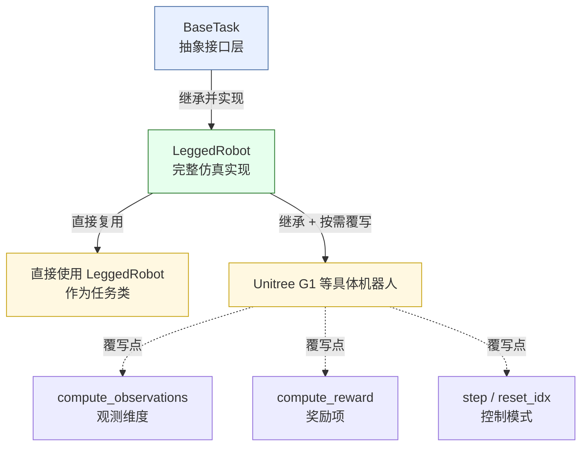

# 训练框架代码结构精读

前面的章节讲过了`Legged Gym`是建立在底层仿真之上的任务包，专门定义了四足、人形机器人的步态奖励、状态观测空间、动作空间以及复杂的随机地形，`RSL-RL`专为大规模向量化环境深度定制的高性能 RL 库，代码极简、迭代速度极快，对 PPO 算法进行了极致的显存与计算优化。

这一期重点介绍一下`Legged Gym`[^1]和`RSL-RL`[^2]的代码结构。

## 项目目录结构

`Legged Gym`与`RSL-RL`的代码分布在两个独立的 Python 包中，通过 `pip install -e .` 以可编辑模式安装，职责边界清晰。

### Legged Gym：环境与任务层


```text
legged_gym/
├── legged_gym/
│   ├── envs/
│   │   ├── base/
│   │   │   ├── base_task.py          # BaseTask：环境抽象基类
│   │   │   ├── legged_robot.py       # LeggedRobot：核心仿真循环
│   │   │   └── legged_robot_config.py# LeggedRobotCfg / LeggedRobotCfgPPO
│   │   ├── anymal/  a1/  cassie/  go2/  g1/ ...
│   │   └── __init__.py               # 所有 task 的注册入口
│   ├── utils/
│   │   ├── task_registry.py          # TaskRegistry与全局 task_registry
│   │   ├── helpers.py                # 配置类、路径解析、class_to_dict
│   │   ├── math.py                   # wrap_to_pi、四元数工具
│   │   └── terrain.py                # 地形生成
│   └── scripts/
│       ├── train.py                  # 训练入口
│       └── play.py                   # 推理、评估入口
└── resources/
    └── robots/
        ├── g1/  g1_description/  ...
        │   ├── *.urdf 或 *.xml       # 机器人模型
        │   └── meshes/
        └── ...
```

`envs/base/legged_robot.py` 承载了绝大部分逻辑，每个具体任务通常只包含两个文件：
- 一个继承 `LeggedRobot` 的 `env` 类，往往只是覆写少量方法或直接复用基类；
- 一个定义 `Cfg` 和 `CfgPPO` 的配置文件。

具体机器人资产放在 `resources/robots/<robot_name>/` 下，配置类中通过 `asset.file` 指向对应的 `URDF/MJCF` 路径。

### RSL-RL：算法层

```text
rsl_rl/
└── rsl_rl/
    ├── algorithms/
    │   ├── ppo.py                    # PPO 实现
    │   └── distillation.py           # 蒸馏（本章不展开）
    ├── modules/
    │   ├── actor_critic.py           # ActorCritic（MLP）
    │   └── actor_critic_recurrent.py # 含历史编码的变体
    ├── runners/
    │   └── on_policy_runner.py       # OnPolicyRunner：训练循环编排
    ├── storage/
    │   └── rollout_storage.py        # RolloutStorage + Transition
    └── env/
        └── vec_env.py                # VecEnv 抽象接口
```

`RSL-RL` 不依赖 `Isaac Gym`，也不依赖任何具体的机器人任务，它面对的是一个 `VecEnv` 接口：只要对象提供 `get_observations()`、`step(actions)`、`reset()` 等方法，`OnPolicyRunner` 就能驱动它。这种解耦是 `RSL-RL` 能被 `Legged Gym`、`Isaac Lab` 等多个上层框架复用的原因。

## 环境初始化

### 继承关系

`BaseTask` 是一个极薄的抽象层，定义环境必须提供的接口（`step、reset、get_observations` 等），本身不包含仿真逻辑。
```python
import sys
from isaacgym import gymapi
from isaacgym import gymutil
import numpy as np
import torch

class BaseTask():
    def __init__((self, cfg, sim_params, physics_engine, sim_device, headless):
        ...

    def get_observations(self):
        return self.obs_buf
    
    def get_privileged_observations(self):
        return self.privileged_obs_buf

    def reset_idx(self, env_ids):
        """Reset selected robots"""
        raise NotImplementedError

    def reset(self):
        """ Reset all robots"""
        self.reset_idx(torch.arange(self.num_envs, device=self.device))
        obs, privileged_obs, _, _, _ = self.step(torch.zeros(self.num_envs, self.num_actions, device=self.device, requires_grad=False))
        return obs, privileged_obs

    def step(self, actions):
        raise NotImplementedError
    
    def render(self, sync_frame_time=True):
        ...

```

`LeggedRobot(BaseTask)` 是真正干活的地方，具体机器人如Unitree G1 通常继承 `LeggedRobot`，只在需要修改**观测维度**、**奖励项**或**控制模式**时覆写对应方法；如果完全复用，可以直接使用 `LeggedRobot` 作为任务类。



### 初始化顺序

`LeggedRobot`的初始化顺序是基本上固定的：
1. `_parse_cfg`：把`LeggedRobotCfg`中的嵌套类展开为可访问的属性，设置 `num_envs、num_actions、num_observations、dt` 等派生量，并建立 `reward_functions` 与 `reward_scales` 的映射，配置中每一个非零的 `reward scale`，都会对应一个同名 `reward` 函数被加入求和列表；

```python
def _parse_cfg(self, cfg):
    # 计算策略的控制周期，抽帧数 x 物理引擎的仿真步长
    self.dt = self.cfg.control.decimation * self.sim_params.dt 
    # 缓存观测归一化系数
    self.obs_scales = self.cfg.normalization.obs_scales
    # 把奖励缩放配置从类转成普通字典并缓存
    self.reward_scales = class_to_dict(self.cfg.rewards.scales)
    # 把速度、姿态命令的取值范围转成字典
    self.command_ranges = class_to_dict(self.cfg.commands.ranges)
    # 根据地形类型决定是否强制关闭地形课程学习
    if self.cfg.terrain.mesh_type not in ['heightfield', 'trimesh']:
        self.cfg.terrain.curriculum = False
    # 缓存回合长度
    self.max_episode_length_s = self.cfg.env.episode_length_s
    # 把回合长度从秒换算成策略步数
    self.max_episode_length = np.ceil(self.max_episode_length_s / self.dt)
    self.cfg.domain_rand.push_interval = np.ceil(self.cfg.domain_rand.push_interval_s / self.dt)
```

2. `create_sim`：创建 Isaac Gym 的仿真实例，设置物理后端为 PhysX、仿真步长 dt、求解器迭代次数，并调用 Terrain 生成地形，此时还没有任何机器人实例，场景中只有地面和可选的障碍物；

```python
def create_sim(self):
    # 设置z轴朝上
    self.up_axis_idx = 2 # 2 for z, 1 for y -> adapt gravity accordingly
    # 使用PhysX创建仿真实例
    self.sim = self.gym.create_sim(self.sim_device_id, self.graphics_device_id, self.physics_engine, self.sim_params)
    # 准备地形数据
    mesh_type = self.cfg.terrain.mesh_type
    if mesh_type in ['heightfield', 'trimesh']:
        self.terrain = Terrain(self.cfg.terrain, self.num_envs)
    if mesh_type=='plane':
        self._create_ground_plane()
    elif mesh_type=='heightfield':
        self._create_heightfield()
    elif mesh_type=='trimesh':
        self._create_trimesh()
    elif mesh_type is not None:
        raise ValueError("Terrain mesh type not recognised. Allowed types are [None, plane, heightfield, trimesh]")
    # 创建机器人
    self._create_envs()
```

3. `_create_envs`：加载机器人资产，把同一份 `URDF` 克隆 `num_envs` 份放入场景，并为每一份实例建立 `collision filter`，使它们互不碰撞但共享同一个物理场景，同时查找关键 link 和 DOF 的索引，足端、需要惩罚的躯干 link、终止判定涉及的关节等，这些索引后续会被反复使用；

```python
def _create_envs(self):
    """ 创建环境:
            1. 加载机器人的URDF/MJCF模型,
            2. 对于每一个环境
                2.1 创建环境 
                2.2 调用 DOF和刚体形状属性的回调
                2.3 使用这些属性创建 actor，并将其添加到环境中
            3. 存储机器人各刚体的索引
    """
    asset_path = self.cfg.asset.file.format(LEGGED_GYM_ROOT_DIR=LEGGED_GYM_ROOT_DIR)
    asset_root = os.path.dirname(asset_path)
    asset_file = os.path.basename(asset_path)
    asset_options = gymapi.AssetOptions()
    asset_options.default_dof_drive_mode = self.cfg.asset.default_dof_drive_mode
    asset_options.collapse_fixed_joints = self.cfg.asset.collapse_fixed_joints
    asset_options.replace_cylinder_with_capsule = self.cfg.asset.replace_cylinder_with_capsule
    asset_options.flip_visual_attachments = self.cfg.asset.flip_visual_attachments
    asset_options.fix_base_link = self.cfg.asset.fix_base_link
    asset_options.density = self.cfg.asset.density
    asset_options.angular_damping = self.cfg.asset.angular_damping
    asset_options.linear_damping = self.cfg.asset.linear_damping
    asset_options.max_angular_velocity = self.cfg.asset.max_angular_velocity
    asset_options.max_linear_velocity = self.cfg.asset.max_linear_velocity
    asset_options.armature = self.cfg.asset.armature
    asset_options.thickness = self.cfg.asset.thickness
    asset_options.disable_gravity = self.cfg.asset.disable_gravity
    robot_asset = self.gym.load_asset(self.sim, asset_root, asset_file, asset_options)
    self.num_dof = self.gym.get_asset_dof_count(robot_asset)
    self.num_bodies = self.gym.get_asset_rigid_body_count(robot_asset)
    dof_props_asset = self.gym.get_asset_dof_properties(robot_asset)
    rigid_shape_props_asset = self.gym.get_asset_rigid_shape_properties(robot_asset)
    body_names = self.gym.get_asset_rigid_body_names(robot_asset)
    self.dof_names = self.gym.get_asset_dof_names(robot_asset)
    self.num_bodies = len(body_names)
    self.num_dofs = len(self.dof_names)
    feet_names = [s for s in body_names if self.cfg.asset.foot_name in s]
    penalized_contact_names = []
    for name in self.cfg.asset.penalize_contacts_on:
        penalized_contact_names.extend([s for s in body_names if name in s])
    termination_contact_names = []
    for name in self.cfg.asset.terminate_after_contacts_on:
        termination_contact_names.extend([s for s in body_names if name in s])

    base_init_state_list = self.cfg.init_state.pos + self.cfg.init_state.rot + self.cfg.init_state.lin_vel + self.cfg.init_state.ang_vel
    self.base_init_state = to_torch(base_init_state_list, device=self.device, requires_grad=False)
    start_pose = gymapi.Transform()
    start_pose.p = gymapi.Vec3(*self.base_init_state[:3])

    self._get_env_origins()
    env_lower = gymapi.Vec3(0., 0., 0.)
    env_upper = gymapi.Vec3(0., 0., 0.)
    self.actor_handles = []
    self.envs = []
    for i in range(self.num_envs):
        env_handle = self.gym.create_env(self.sim, env_lower, env_upper, int(np.sqrt(self.num_envs)))
        pos = self.env_origins[i].clone()
        pos[:2] += torch_rand_float(-1., 1., (2,1), device=self.device).squeeze(1)
        start_pose.p = gymapi.Vec3(*pos)
            
        rigid_shape_props = self._process_rigid_shape_props(rigid_shape_props_asset, i)
        self.gym.set_asset_rigid_shape_properties(robot_asset, rigid_shape_props)
        actor_handle = self.gym.create_actor(env_handle, robot_asset, start_pose, self.cfg.asset.name, i, self.cfg.asset.self_collisions, 0)
        dof_props = self._process_dof_props(dof_props_asset, i)
        self.gym.set_actor_dof_properties(env_handle, actor_handle, dof_props)
        body_props = self.gym.get_actor_rigid_body_properties(env_handle, actor_handle)
        body_props = self._process_rigid_body_props(body_props, i)
        self.gym.set_actor_rigid_body_properties(env_handle, actor_handle, body_props, recomputeInertia=True)
        self.envs.append(env_handle)
        self.actor_handles.append(actor_handle)

    self.feet_indices = torch.zeros(len(feet_names), dtype=torch.long, device=self.device, requires_grad=False)
    for i in range(len(feet_names)):
        self.feet_indices[i] = self.gym.find_actor_rigid_body_handle(self.envs[0], self.actor_handles[0], feet_names[i])

    self.penalised_contact_indices = torch.zeros(len(penalized_contact_names), dtype=torch.long, device=self.device, requires_grad=False)
    for i in range(len(penalized_contact_names)):
        self.penalised_contact_indices[i] = self.gym.find_actor_rigid_body_handle(self.envs[0], self.actor_handles[0], penalized_contact_names[i])

    self.termination_contact_indices = torch.zeros(len(termination_contact_names), dtype=torch.long, device=self.device, requires_grad=False)
    for i in range(len(termination_contact_names)):
        self.termination_contact_indices[i] = self.gym.find_actor_rigid_body_handle(self.envs[0], self.actor_handles[0], termination_contact_names[i])
```
4. `_init_buffers`：在 GPU 上预分配所有状态张量（`root_states、dof_pos、dof_vel、contact_forces、commands、actions` 等），形状的第一个维度统一为 `num_envs`，这一步的显存分配策略直接决定了后续能否在全 GPU 管线上运行而不触发主机同步。

```python
def _init_buffers(self):
    """ Initialize torch tensors which will contain simulation states and processed quantities
    """
    # get gym GPU state tensors
    actor_root_state = self.gym.acquire_actor_root_state_tensor(self.sim)
    dof_state_tensor = self.gym.acquire_dof_state_tensor(self.sim)
    net_contact_forces = self.gym.acquire_net_contact_force_tensor(self.sim)
    self.gym.refresh_dof_state_tensor(self.sim)
    self.gym.refresh_actor_root_state_tensor(self.sim)
    self.gym.refresh_net_contact_force_tensor(self.sim)

    # create some wrapper tensors for different slices
    self.root_states = gymtorch.wrap_tensor(actor_root_state)
    self.dof_state = gymtorch.wrap_tensor(dof_state_tensor)
    self.dof_pos = self.dof_state.view(self.num_envs, self.num_dof, 2)[..., 0]
    self.dof_vel = self.dof_state.view(self.num_envs, self.num_dof, 2)[..., 1]
    self.base_quat = self.root_states[:, 3:7]

    self.contact_forces = gymtorch.wrap_tensor(net_contact_forces).view(self.num_envs, -1, 3) # shape: num_envs, num_bodies, xyz axis

    # initialize some data used later on
    self.common_step_counter = 0
    self.extras = {}
    self.noise_scale_vec = self._get_noise_scale_vec(self.cfg)
    self.gravity_vec = to_torch(get_axis_params(-1., self.up_axis_idx), device=self.device).repeat((self.num_envs, 1))
    self.forward_vec = to_torch([1., 0., 0.], device=self.device).repeat((self.num_envs, 1))
    self.torques = torch.zeros(self.num_envs, self.num_actions, dtype=torch.float, device=self.device, requires_grad=False)
    self.p_gains = torch.zeros(self.num_actions, dtype=torch.float, device=self.device, requires_grad=False)
    self.d_gains = torch.zeros(self.num_actions, dtype=torch.float, device=self.device, requires_grad=False)
    self.actions = torch.zeros(self.num_envs, self.num_actions, dtype=torch.float, device=self.device, requires_grad=False)
    self.last_actions = torch.zeros(self.num_envs, self.num_actions, dtype=torch.float, device=self.device, requires_grad=False)
    self.last_dof_vel = torch.zeros_like(self.dof_vel)
    self.last_root_vel = torch.zeros_like(self.root_states[:, 7:13])
    self.commands = torch.zeros(self.num_envs, self.cfg.commands.num_commands, dtype=torch.float, device=self.device, requires_grad=False) # x vel, y vel, yaw vel, heading
    self.commands_scale = torch.tensor([self.obs_scales.lin_vel, self.obs_scales.lin_vel, self.obs_scales.ang_vel], device=self.device, requires_grad=False,) # TODO change this
    self.feet_air_time = torch.zeros(self.num_envs, self.feet_indices.shape[0], dtype=torch.float, device=self.device, requires_grad=False)
    self.last_contacts = torch.zeros(self.num_envs, len(self.feet_indices), dtype=torch.bool, device=self.device, requires_grad=False)
    self.base_lin_vel = quat_rotate_inverse(self.base_quat, self.root_states[:, 7:10])
    self.base_ang_vel = quat_rotate_inverse(self.base_quat, self.root_states[:, 10:13])
    self.projected_gravity = quat_rotate_inverse(self.base_quat, self.gravity_vec)
    if self.cfg.terrain.measure_heights:
        self.height_points = self._init_height_points()
    self.measured_heights = 0

    # joint positions offsets and PD gains
    self.default_dof_pos = torch.zeros(self.num_dof, dtype=torch.float, device=self.device, requires_grad=False)
    for i in range(self.num_dofs):
        name = self.dof_names[i]
        angle = self.cfg.init_state.default_joint_angles[name]
        self.default_dof_pos[i] = angle
        found = False
        for dof_name in self.cfg.control.stiffness.keys():
            if dof_name in name:
                self.p_gains[i] = self.cfg.control.stiffness[dof_name]
                self.d_gains[i] = self.cfg.control.damping[dof_name]
                found = True
        if not found:
            self.p_gains[i] = 0.
            self.d_gains[i] = 0.
            if self.cfg.control.control_type in ["P", "V"]:
                print(f"PD gain of joint {name} were not defined, setting them to zero")
    self.default_dof_pos = self.default_dof_pos.unsqueeze(0)
```

### 环境数量

`num_envs` 是**同时并行运行的独立仿真环境实例的数量**，增大这个值，意味着让更多份机器人世界在 GPU 上同时推进，而不仅仅是在单个环境里跑得更久，每一个环境里的机器人**共享同一个策略网络**，但拥有各自独立的初始状态（关节角度、速度等）和交互轨迹。因此，`num_envs` 的本质是**在单次策略推理中，批量生成多少条独立的经验数据**。它的核心收益就是采样吞吐量和数据多样性：
- **线性提升数据采集吞吐量**：在 PPO 等 on-policy 算法中，每一步你需要收集一批数据来更新策略，`num_envs=4096` 时，每步就能同时收集 4096 条经验；
- ICML 2025 的一项系统性研究[^3]专门对比了并行数据采集的两个维度：**环境数量**与**单环境轨迹长度**，结论是**在总交互步数固定时，增加并行环境数量比增加每条轨迹的长度更有效**。

但是 `num_envs` 不能随意调大，因为每一个环境都需要在 `GPU` 上分配状态张量（观测缓冲、奖励缓冲、物理状态等），LeggedGym 在初始化时会根据 `num_envs` 预先分配这些张量以避免训练循环中的动态内存开销，因此显存占用会随 `num_envs` **近似线性增长**。

## 仿真循环

### step骨架

`LeggedRobot.step(actions)` 是训练循环中调用频率最高的方法，它的结构可以压缩为：

```python
def step(self, actions):
    self.pre_physics_step(actions)          # 1. 动作 → 力矩
    for _ in range(self.cfg.control.decimation):
        self.torques = self._compute_torques(self.actions)
        self.gym.set_dof_actuation_force_tensor(...)
        self.gym.simulate(self.sim)          # 2. 物理推进
        if self.device == 'cpu':
            self.gym.fetch_results(self.sim, True)
    self.post_physics_step()                 # 3. 状态刷新 + obs/reward/done
    return self.obs_buf, self.privileged_obs_buf, self.rew_buf, self.reset_buf, self.extras
```

`step(actions)` 是训练循环中每个环境步调用的核心方法，负责：
- 接收策略输出的动作并做安全裁剪；
- 在 `decimation` 个物理步内推进仿真；
- 调用 `post_physics_step()` 完成状态刷新、终止判断、奖励计算、重置和观测计算;
- 返回裁剪后的观测、特权观测、奖励、重置标志和附加信息。

#### 动作的语义转换

`step` 中的动作处理主要包括：
1. **裁剪**：将策略原始动作限制在`[-clip_actions, clip_actions]`，防止极端值导致数值不稳定或力矩过大;

```python
self.actions = torch.clip(actions, -clip_actions, clip_actions).to(self.device)
```
2. **存储**：裁剪后的动作写入 `self.actions`，供后续力矩计算、观测、奖励和 `last_actions` 缓存使用；
3. 物理量转换由 `_compute_torques` 完成：
   1. 对位置控制叠加默认关节位姿：$q_{\mathrm{target}}=q_{\mathrm{default}}+action_{\mathrm{scale}} \times a$
   2. 通过 PD 控制器计算力矩


#### 状态刷新与派生量

```python
def post_physics_step(self):
    self.gym.refresh_actor_root_state_tensor(self.sim)
    self.gym.refresh_net_contact_force_tensor(self.sim)

    self.episode_length_buf += 1
    self.common_step_counter += 1

    self.base_quat[:] = self.root_states[:, 3:7]
    self.base_lin_vel[:] = quat_rotate_inverse(
        self.base_quat, self.root_states[:, 7:10]
    )
    self.base_ang_vel[:] = quat_rotate_inverse(
        self.base_quat, self.root_states[:, 10:13]
    )
    self.projected_gravity[:] = quat_rotate_inverse(
        self.base_quat, self.gravity_vec
    )

    self._post_physics_step_callback()

    self.check_termination()
    self.compute_reward()
    env_ids = self.reset_buf.nonzero(as_tuple=False).flatten()
    self.reset_idx(env_ids)
    self.compute_observations()

    self.last_actions[:] = self.actions[:]
    self.last_dof_vel[:] = self.dof_vel[:]
    self.last_root_vel[:] = self.root_states[:, 7:13]

    if self.viewer and self.enable_viewer_sync and self.debug_viz:
        self._draw_debug_vis()
```


## 观测、奖励与终止条件

`post_physics_step()` 中依次调用 `check_termination()`、`compute_reward()`、`reset_idx(env_ids)`、`compute_observations()`，三者的输出分别进入 `reset_buf`、`rew_buf` 和 `obs_buf`，最终由 `step()` 一并返回给 `OnPolicyRunner`。

### 观测构造

`compute_observations()` 将本体感知、指令与可选的 height scan 拼接为策略输入，每一项乘以对应的 `obs_scales`，最后按 `noise_scale_vec` 注入噪声。标准观测向量的组成如下：

| 分量 | 含义 | 缩放 |
|---|---|---|
| `base_lin_vel` | 基座线速度（机体系） | `lin_vel` |
| `base_ang_vel` | 基座角速度（机体系） | `ang_vel` |
| `projected_gravity` | 重力在机体系投影 | 1.0 |
| `commands` | 速度指令 `(vx, vy, ωz)` | `commands_scale` |
| `dof_pos - default_dof_pos` | 关节位置偏差 | `dof_pos` |
| `dof_vel` | 关节速度 | `dof_vel` |
| `last_actions` | 上一步动作 | 1.0 |
| `height_measurements` | 地形高度采样（`measure_heights` 开启时） | `height_measurements` |

代码骨架可以压缩为：

```python
def compute_observations(self):
    self.obs_buf = torch.cat((
        self.base_lin_vel * self.obs_scales.lin_vel,
        self.base_ang_vel * self.obs_scales.ang_vel,
        self.projected_gravity,
        self.commands[:, :3] * self.commands_scale,
        (self.dof_pos - self.default_dof_pos) * self.obs_scales.dof_pos,
        self.dof_vel * self.obs_scales.dof_vel,
        self.actions,
        self.measured_heights,          # 可选
    ), dim=-1)
    if self.add_noise:
        self.obs_buf += (2 * torch.rand_like(self.obs_buf) - 1) * self.noise_scale_vec
```

`obs_scales` 和 `noise_scale_vec` 均由 `_parse_cfg` / `_get_noise_scale_vec` 从 `LeggedRobotCfg.normalization` 中读出，因此**改动观测维度时，必须同步修改 `env.num_observations`**，否则 ActorCritic 的输入层会对不上。

### 奖励的配置驱动机制

奖励系统的核心设计是“**配置中写 scale，代码中写同名 `_reward_*` 方法**”。`_parse_cfg` 中：

```python
self.reward_scales = class_to_dict(self.cfg.rewards.scales)
```

随后 `_prepare_reward_function()` 遍历 `reward_scales`，只保留非零项，并将 scale 乘以 `dt`，建立 `reward_functions` 与 `reward_names` 两个列表。`compute_reward()` 的骨架因此非常短：

```python
def compute_reward(self):
    self.rew_buf[:] = 0.
    for i in range(len(self.reward_functions)):
        name = self.reward_names[i]
        rew = self.reward_functions[i]() * self.reward_scales[name]
        self.rew_buf += rew
        self.episode_sums[name] += rew
    if self.cfg.rewards.only_positive_rewards:
        self.rew_buf[:] = torch.clip(self.rew_buf[:], min=0.)
```

奖励项按功能可分为四组：

- **运动任务奖励**：`tracking_lin_vel`、`tracking_ang_vel` 以指数形式惩罚指令跟踪误差；`feet_air_time` 在足端首次触地时奖励足够的腾空时间；`stand_still` 在指令接近零时惩罚关节偏离默认位姿。
- **正则化**：`torques`、`dof_vel`、`dof_acc`、`action_rate` 分别对力矩、关节速度、关节加速度和相邻动作变化做平方惩罚。
- **稳定性**：`lin_vel_z` 抑制竖直弹跳，`ang_vel_xy` 抑制 roll/pitch 角速度，`orientation` 惩罚机身倾斜，`base_height` 将机身高度拉向目标值。
- **安全性**：`collision` 对 `penalize_contacts_on` 中的刚体接触力超过阈值的次数计数并惩罚；`termination` 在非超时终止时施加额外负奖励。

如果希望**新增奖励**，只需在 `LeggedRobot` 子类中定义 `_reward_my_term(self)`，并在对应 `Cfg.rewards.scales` 中增加 `my_term = weight`，无需改动 `compute_reward()` 本身。

### 终止条件与延迟重置

`check_termination()` 的判定逻辑包含两类：

1. **超时终止**：`episode_length_buf > max_episode_length`；
2. **失败终止**：`termination_contact_indices` 所列刚体的接触力超过阈值，或 `root_states` 的位姿/速度超出合理范围。

为了避免单步接触噪声导致提前重置，配置中提供了 `env.fail_to_terminal_time_s`：`check_termination` 维护一个 `fail_buf` 计数器，只有失败状态**持续超过** `fail_to_terminal_time_s / dt` 个策略步后，才真正写入 `reset_buf`。这一机制在崎岖地形或高动态步态训练中尤其重要。

`reset_idx(env_ids)` 只对传入的环境子集执行重置：将 `dof_pos` 置为 `default_dof_pos`、清零 `dof_vel`、`root_states` 回到初始位姿，并清零 `episode_length_buf`、`actions`、`last_actions`、`feet_air_time` 等回合内状态。由于 `reset_buf` 可能每步只包含少量环境，**`reset_idx` 必须支持向量化索引**，避免触发 GPU-CPU 同步。

## 机器人模型加载

### 资产格式与路径

`Cfg.asset.file` 是一个带 `{LEGGED_GYM_ROOT_DIR}` 占位符的路径字符串，`_create_envs` 中先做 `format`，再拆成 `asset_root` 和 `asset_file` 传给 `gym.load_asset`。Isaac Gym 同时支持 URDF 和 MJCF，但 Legged Gym 的默认配置以 URDF 为主；部分项目会使用简化后的 URDF（例如只保留可控自由度的版本），以保证 `num_actions` 与 `dof_names` 一一对应。

资产加载时的 `AssetOptions` 直接来自 `Cfg.asset`，其中与后续逻辑强相关的有：

- `collapse_fixed_joints`：合并固定关节，影响 `body_names` 和刚体索引；
- `fix_base_link`：固定基座（用于调试或机械臂式任务）；
- `default_dof_drive_mode`：默认驱动模式，但 Legged Robot 通常在 `_compute_torques` 中自行施加 PD 力矩，因此该选项更多影响资产初始化行为。

### DOF 配置与索引对齐

`_create_envs` 在资产加载后立即提取 `dof_names` 和 `num_dofs`，这是整个控制链的“索引基准”：

```python
self.dof_names = self.gym.get_asset_dof_names(robot_asset)
self.num_dofs = len(self.dof_names)
```

随后 `_init_buffers()` 按 `dof_names` 的顺序填充 `default_dof_pos` 和 `p_gains / d_gains`。PD 增益的匹配采用**子串匹配**：

```python
for i in range(self.num_dofs):
    name = self.dof_names[i]
    for dof_name in self.cfg.control.stiffness.keys():
        if dof_name in name:
            self.p_gains[i] = self.cfg.control.stiffness[dof_name]
            self.d_gains[i] = self.cfg.control.damping[dof_name]
```

这意味着 `Cfg.control.stiffness` 的键不需要与 URDF 中的关节名完全一致，只要关节名包含该键即可。但**如果 URDF 的关节顺序发生变化，`default_dof_pos` 和 PD 增益的对齐就会错位**，因此自定义机器人时应优先确认 `dof_names` 的实际顺序。

### Actuator 配置与力矩计算路径

`_compute_torques(actions)` 是动作到力矩的唯一入口，根据 `Cfg.control.control_type` 走不同分支：

- **`control_type="P"`（位置控制，最常用）** ：
  \[
  q_{\text{target}} = q_{\text{default}} + \text{action\_scale} \cdot a,
  \quad
  \tau = K_p (q_{\text{target}} - q) - K_d \dot{q}
  \]
- **`"V"`（速度控制）** ：目标为速度，PD 误差项相应改为速度误差；
- **`"T"`（力矩控制）** ：`action_scale` 直接缩放为力矩，不经过 PD。

代码骨架：

```python
def _compute_torques(self, actions):
    actions_scaled = actions * self.cfg.control.action_scale
    if self.cfg.control.control_type == "P":
        q_target = self.default_dof_pos + actions_scaled
        torques = self.p_gains * (q_target - self.dof_pos) - self.d_gains * self.dof_vel
    elif self.cfg.control.control_type == "V":
        torques = self.p_gains * (actions_scaled - self.dof_vel) - self.d_gains * self.dof_acc
    else:
        torques = actions_scaled
    return torch.clip(torques, -self.torque_limits, self.torque_limits)
```

`torque_limits` 通常来自 `dof_props` 的 `effort` 字段，在 `_process_dof_props` 中按环境随机化后写入。部分项目还会用 **Actuator Network** 替换解析 PD，此时 `_compute_torques` 会调用网络前向，但接口保持不变。

## 强化学习算法执行链

### OnPolicyRunner

`OnPolicyRunner` 是 `Legged Robot` 与 `RSL-RL` 之间的适配层。它接收一个满足 `VecEnv` 接口的环境对象，在 `learn()` 中交替执行**数据收集**和**策略更新**：

```python
def learn(self, num_learning_iterations):
    obs = self.env.get_observations()
    for it in range(start_it, total_it):
        with torch.no_grad():
            for _ in range(self.num_steps_per_env):
                actions = self.alg.act(obs)
                obs, rewards, dones, infos = self.env.step(actions)
                self.alg.process_env_step(rewards, dones, infos)
                self.storage.add_transition(...)
        self.alg.compute_returns(obs)
        loss_dict = self.alg.update()
        if it % self.save_interval == 0:
            self.save(os.path.join(self.log_dir, f"model_{it}.pt"))
```

关键参数在 `LeggedRobotCfgPPO.runner` 中：`num_steps_per_env` 决定每次更新前每个环境收集多少步，`max_iterations` 控制总迭代数，`save_interval` 控制 checkpoint 频率。`OnPolicyRunner` 本身不依赖 Isaac Gym，也不 import 任何机器人任务，这是 `RSL-RL` 能被 Isaac Lab 等上层框架复用的直接原因。

### ActorCritic 与 MLPModel

`RSL-RL` 当前主线的网络实现是 `MLPModel`，`PPO` 分别持有 `actor: MLPModel` 和 `critic: MLPModel`。`MLPModel` 的职责是：按 `obs_set` 从观测字典中选择观测组、可选归一化、经 MLP 前向，并决定输出是确定性值还是随机动作分布。

Legged Robot 默认的 ActorCritic 结构通常可以概括为：

```text
actor:  obs_dim → hidden_dims → action_dim (mean)
critic: obs_dim (或 privileged_obs_dim) → hidden_dims → 1
```

`CfgPPO.policy.actor_hidden_dims` 和 `critic_hidden_dims` 定义隐藏层维度，`activation` 选择 ELU/ReLU 等。当 `Cfg.env.num_privileged_obs` 不为 `None` 时，Critic 可以接收特权观测，形成**非对称 Actor-Critic**，但 Actor 的输入维度仍由 `num_observations` 决定。

### RolloutStorage

`RolloutStorage` 以环境步为单位存储 `Transition`，字段包括 `observations`、`actions`、`actions_log_prob`、`values`、`rewards`、`dones` 以及可选的 `privileged_observations`。它的生命周期严格对应一次 on-policy 采样：`OnPolicyRunner` 收集完 `num_steps_per_env` 后，`PPO.compute_returns()` 从最后一步反向计算 GAE 和 returns，然后 `update()` 按 `num_learning_epochs` 和 `num_mini_batches` 遍历存储。由于存储完全在 GPU 上，`RSL-RL` 的 `storage` 不需要任何主机同步，这也是其“极简、快速迭代”的关键。

### PPO

`PPO` 的初始化接收 `actor`、`critic`、`storage` 和超参数。核心超参数与标准 PPO 一致：`clip_param`（默认 0.2）、`num_learning_epochs`、`num_mini_batches`、`gamma`、`lam`（GAE λ），以及可选的 `desired_kl` 自适应学习率。`update()` 的流程可以压缩为：

```python
for epoch in range(self.num_learning_epochs):
    for batch in self.storage.mini_batch_generator(self.num_mini_batches):
        values = self.critic(batch.observations)
        advantages = batch.returns - values
        ratio = torch.exp(batch.actions_log_prob - self.actor(batch.observations).log_prob(batch.actions))
        surrogate = torch.min(
            ratio * advantages,
            torch.clamp(ratio, 1 - clip_param, 1 + clip_param) * advantages
        )
        loss = -surrogate.mean() + value_loss_coef * (batch.returns - values).pow(2).mean() - entropy_coef * entropy.mean()
        self.optimizer.zero_grad()
        loss.backward()
        self.optimizer.step()
```

`RSL-RL` 的 PPO 在实现上做了大量向量化处理，但**算法语义与标准 PPO 一致**；它的“极致优化”主要体现在全 GPU 存储、避免 Python 循环内的同步，以及 `MLPModel` 的统一抽象，而不是对 PPO 本身的数学改动。

## 训练入口

### train.py

`train.py` 是命令行入口，典型调用形式为：

```bash
python legged_gym/scripts/train.py --task=g1 --num_envs=4096 --headless
```

`get_args()` 解析参数后，`train.py` 并不直接实例化环境类，而是把 `args.task` 交给 `task_registry`，由注册器返回 `(env, env_cfg)` 和 `(runner, train_cfg)`。这样 `train.py` 本身可以保持极薄，任务差异完全下沉到注册器和配置中。

### 任务注册器

`TaskRegistry` 维护三个字典：`task_classes`、`env_cfgs`、`train_cfgs`。注册接口为：

```python
task_registry.register(
    name="my_robot",
    task_class=MyRobot,
    env_cfg=MyRobotCfg(),
    train_cfg=MyRobotCfgPPO(),
)
```

`make_env(name, args)` 从 `task_classes` 取出类，合并 `env_cfg` 与命令行覆盖，调用 `_parse_sim_params` 和 `_parse_cfg`，完成 Isaac Gym 仿真实例创建和 `_create_envs` / `_init_buffers`。`make_alg_runner(env, name)` 则根据 `train_cfg` 创建 `OnPolicyRunner`，并设置日志目录和可选的 checkpoint 恢复。任务注册通常放在 `legged_gym/envs/__init__.py` 中，所有预注册任务（`anymal_c_rough`、`a1`、`go2`、`g1` 等）都在那里一次性完成。

## 自定义任务

### 新建环境类

继承 `LeggedRobot`，只覆写需要改变的部分：

```python
from legged_gym.envs.base.legged_robot import LeggedRobot

class MyRobot(LeggedRobot):
    def _reward_my_term(self):
        return torch.exp(-torch.norm(self.base_lin_vel[:, :2] - self.commands[:, :2], dim=1) ** 2 / 0.25)

    def compute_observations(self):
        super().compute_observations()
        # 如需增加观测，在这里拼接并同步修改 Cfg.env.num_observations
```

如果观测维度、奖励项、控制模式都完全复用基类，可以直接将 `LeggedRobot` 作为 `task_class` 注册，不需要写空子类。

### 新建配置类

配置类必须继承 `LeggedRobotCfg` 和 `LeggedRobotCfgPPO`，只覆盖差异项：

```python
from legged_gym.envs.base.legged_robot_config import LeggedRobotCfg, LeggedRobotCfgPPO

class MyRobotCfg(LeggedRobotCfg):
    class env(LeggedRobotCfg.env):
        num_observations = 48
        num_actions = 12
        episode_length_s = 20
    class asset(LeggedRobotCfg.asset):
        file = "{LEGGED_GYM_ROOT_DIR}/resources/robots/my_robot/urdf/my_robot.urdf"
        foot_name = "foot"
        terminate_after_contacts_on = ["base", "thigh"]
    class control(LeggedRobotCfg.control):
        control_type = "P"
        stiffness = {"hip": 40., "knee": 40.}
        damping = {"hip": 1., "knee": 1.}
        action_scale = 0.25
        decimation = 4
    class rewards(LeggedRobotCfg.rewards):
        class scales(LeggedRobotCfg.rewards.scales):
            tracking_lin_vel = 1.0
            tracking_ang_vel = 0.5
            torques = -1e-5
            my_term = 0.5          # 与 _reward_my_term 对应

class MyRobotCfgPPO(LeggedRobotCfgPPO):
    class policy(LeggedRobotCfgPPO.policy):
        actor_hidden_dims = [512, 256, 128]
        critic_hidden_dims = [512, 256, 128]
    class runner(LeggedRobotCfgPPO.runner):
        num_steps_per_env = 24
        max_iterations = 1500
        save_interval = 100
```

`Cfg.control.stiffness` 的键采用子串匹配，所以可以用 `"hip"` 同时命中 `hip_pitch`、`hip_roll`、`hip_yaw`；但需要不同增益时，应写更具体的键（如 `"hip_pitch"`）并注意匹配顺序。

### 注册任务

在 `legged_gym/envs/__init__.py` 中追加：

```python
from legged_gym.utils.task_registry import task_registry
from my_robot.my_robot import MyRobot
from my_robot.my_robot_config import MyRobotCfg, MyRobotCfgPPO

task_registry.register("my_robot", MyRobot, MyRobotCfg(), MyRobotCfgPPO())
```

注册必须发生在 `train.py` 调用 `task_registry.make_env(args.task)` 之前。

### 启动训练与验证

训练：

```bash
python legged_gym/scripts/train.py --task=my_robot --num_envs=4096 --headless
```

`--num_envs` 会覆盖 `Cfg.env.num_envs`；`--headless` 关闭 viewer 以减少显存和渲染开销。`play.py` 使用同一套注册器，通过 `--task` 和 `--checkpoint` 加载训练好的权重进行推理。如果训练中修改了 `num_observations`、`num_actions` 或奖励 scale 的键名，应从头训练或重新导出策略，避免 checkpoint 与配置维度不一致。


[^1]:[https://github.com/leggedrobotics/legged_gym](https://github.com/leggedrobotics/legged_gym)
[^2]:[https://github.com/leggedrobotics/rsl_rl](https://github.com/leggedrobotics/rsl_rl)
[^3]:[The Impact of On-Policy Parallelized Data Collection on Deep Reinforcement Learning Networks](https://arxiv.org/abs/2506.03404)