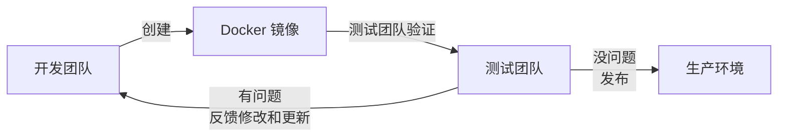

# Docker快速入门

> 本文示例统一使用WSL安装的Docker 29.6.2进行编写，开始前请确保完成[[第三章：Docker安装与基础配置]]，并确认`docker version`与`docker run hello-world`可以正常运行。


## 快速上手

本小节会通过一个简单的`Caddy+HTML`的例子来快速体验Docker的核心流程，包括构建镜像、运行容器等等。这个入门案例其实是一个非常经典的设计，它比很多其他例子更适合作为 Docker 第一个实践案例，原因在于它同时覆盖了 Docker 最核心的概念，而且复杂度极低，Docker的核心生命周期为：

-  **镜像定义**：通过 `Dockerfile` 描述如何把应用打包成一个自包含的单元；
-  **镜像构建**：执行 `docker build`，Docker 会根据 Dockerfile 逐层构建镜像；
-  **容器运行**：通过 `docker run` 启动容器实例,应用真正开始提供服务。

`Caddy`是一个现代化的Web服务器和反向代理服务器，类似于`Nginx`，但它最大的特点是默认自动启用 HTTPS，并且配置非常简单。

### 准备Dockerfile

首先使用`mkdir hello-docker`创建一个名为 hello-docker 的文件夹，并在其中使用`vim index.html`创建一个 index.html 文件。

```html
<!DOCTYPE html>
<html>
<head>
    <title>The first Docker demo</title>
    <meta charset="UTF-8">
</head>

<body>
    <h1>Hello Docker</h1>
</body>

</html>
```
在同级目录下使用`vim Dockerfile`创建一个名为 `Dockerfile` 的文件：

```bash
FROM caddy:2-alpine
COPY index.html /usr/share/caddy/index.html
EXPOSE 80
```

### 构建镜像

在终端中打开该目录并执行构建镜像的命令：

```bash
ubuntu@wsl-client:~/hello-docker$ docker build -t caddy-web .
[+] Building 18.2s (7/7) FINISHED                                                                                                             docker:default
 => [internal] load build definition from Dockerfile                                                                                                    0.2s
 => => transferring dockerfile: 113B                                                                                                                    0.0s
 => [internal] load metadata for docker.io/library/caddy:2-alpine                                                                                       2.2s
 => [internal] load .dockerignore                                                                                                                       0.7s
 => => transferring context: 2B                                                                                                                         0.0s
 => [internal] load build context                                                                                                                       1.5s
 => => transferring context: 196B                                                                                                                       0.0s
 => [1/2] FROM docker.io/library/caddy:2-alpine@sha256:5f5c8640aae01df9654968d946d8f1a56c497f1dd5c5cda4cf95ab7c14d58648                                 3.5s
 => => resolve docker.io/library/caddy:2-alpine@sha256:5f5c8640aae01df9654968d946d8f1a56c497f1dd5c5cda4cf95ab7c14d58648                                 0.7s
 => [2/2] COPY index.html /usr/share/caddy/index.html                                                                                                   0.8s
 => exporting to image                                                                                                                                  8.1s
 => => exporting layers                                                                                                                                 3.9s
 => => exporting manifest sha256:1d46089f73c341761424f2072c947e6a76009919f7ab7c4880ca3e1f6f1efd8f                                                       0.6s
 => => exporting config sha256:24aa509c0954cf794924a8155addcc8e7d28187b9d3117408606840cd2278f6b                                                         0.6s
 => => exporting attestation manifest sha256:eecb42e04b0067067ad2b5011964f0925a4c27918b8ee22db5b3a29d2176b1e4                                           1.0s
 => => exporting manifest list sha256:a301a8a7b13389a98a6e198edb698a4b6b6c3387a45739aa712dcf771f4fec28                                                  0.5s
 => => naming to docker.io/library/caddy-web:latest                                                                                                     0.1s
 => => unpacking to docker.io/library/caddy-web:latest                                                                                                  0.7s
```
这样就完成了构建镜像的任务，下面使用构建好的镜像来启动一个容器。

### 运行容器

使用刚才构建的镜像启动一个容器：

```bash
ubuntu@wsl-client:~/hello-docker$ docker run -d -p 8000:80 caddy-web
564e2ca8352f325c34fbf8097f9f2a9ba034564babeae94db53865ab6a2b5be0
```

这里的`-d`参数表示后台运行，`-p`参数表示将宿主机的 8000 端口映射到容器的 80 端口，打开浏览器访问[http://localhost:8000](http://localhost:8000)，你应该能看到Hello Docker。

### 删除容器

如果你不需要这个容器，可以选择删除并清理，具体流程如下：

```bash
ubuntu@wsl-client:~/hello-docker$ docker ps #  查看正在运行的容器 ID
ubuntu@wsl-client:~/hello-docker$  docker stop <CONTAINER_ID> # 停止该容器
ubuntu@wsl-client:~/hello-docker$  docker rm <CONTAINER_ID> # 删除该容器
```

## 为什么要使用Docker

假设你的公司正在秘密研发下一代电商平台，我们暂且称它为未来商城。项目开始后，开发人员首先需要在自己的电脑上搭建开发环境。他需要安装指定版本的 Java、配置数据库、部署 Redis 缓存、安装消息队列、配置各种依赖组件……经过几个小时的折腾，终于可以开始编写代码。开发完成后，代码需要交给测试团队进行功能验证。

然而，测试同学拿到代码后，并不能直接运行，因为他的电脑上没有开发人员那套环境。于是，他又需要重新安装相同版本的软件、配置数据库、调整系统参数，重新搭建一套测试环境。如果测试过程中出现问题，开发人员可能会说：“这个功能在我的电脑上明明运行正常。”测试同学只能无奈地回复：“但是我的环境运行不了啊。”

经过反复沟通和修改，系统终于通过测试，准备迎接双十一大促上线。这时，运维工程师需要将系统部署到生产服务器上。但生产环境和测试环境又存在差异：服务器操作系统版本不同、依赖软件版本不同、配置参数不同，甚至数据库环境也可能存在细微差别。运维同学再次开始配置环境、安装组件、部署服务。然而，上线之后系统出现异常。开发人员又拿出了那句经典台词：“我本地真的可以正常运行。”

从整个过程可以发现，传统的软件交付方式存在一个核心问题：**应用程序本身并不能独立运行，它依赖大量外部环境，包括操作系统、软件版本、系统配置以及各种第三方组件。** 只要开发、测试、生产环境存在差异，就可能出现“代码一样，但运行结果不同”的问题。因此，软件工程师开始思考：有没有一种方式，可以把应用程序以及它所依赖的整个运行环境一起打包？这样，开发人员只需要构建一次，测试和运维就可以直接使用同一个环境，而不需要重复安装和配置。于是，容器技术应运而生。

当然，有同学可能会提出疑问：“我们不是已经有虚拟机了吗？比如 VMware。提前创建一台配置好的虚拟机，然后复制给测试和生产环境使用，不也可以解决环境一致性问题吗？”实际上，在容器技术出现之前，虚拟机确实是一种非常重要的解决方案。如今云计算的发展，也离不开虚拟化技术。云服务厂商购买大量物理服务器，建设数据中心，然后通过虚拟机技术将一台物理服务器的 CPU、内存、存储等资源进行虚拟化切分。例如，一台物理服务器可以被划分成几十台甚至上百台虚拟机，每台虚拟机拥有独立的操作系统和运行环境，云厂商再将这些虚拟机资源提供给不同用户使用。这种方式提高了硬件资源利用率，也成为现代云计算基础设施的重要组成部分。但是，虚拟机本质上仍然是一台完整的计算机。每启动一个虚拟机，都需要运行完整的操作系统，因此会占用大量资源，启动速度也相对较慢。而容器技术采用了另一种思路：**它不再模拟一整台计算机，而是在操作系统层面实现隔离。多个容器可以共享宿主机操作系统内核，但每个容器拥有独立的文件系统、网络环境和进程空间。** 因此，一个应用可以连同它所需要的依赖一起被打包成一个容器镜像，并且可以在开发、测试、生产等不同环境中保持一致运行。

## Docker是什么

Docker就是在这样的背景下应运而生， **Docker** 使用 `Google` 公司推出的 [Go 语言](https://golang.google.cn/) 进行开发实现，基于 `Linux` 内核的 [cgroup](https://zh.wikipedia.org/wiki/Cgroups)，[namespace](https://en.wikipedia.org/wiki/Linux_namespaces)，以及 [OverlayFS](https://docs.docker.com/storage/storagedriver/overlayfs-driver/) 类的 [Union FS](https://en.wikipedia.org/wiki/Union_mount) 等技术，对进程进行封装隔离，属于 [操作系统层面的虚拟化技术](https://en.wikipedia.org/wiki/Operating-system-level_virtualization)。由于隔离的进程独立于宿主和其它的隔离的进程，因此也称其为容器。作为一种新兴的虚拟化方式，`Docker` 跟传统的虚拟化方式相比具有众多的优势。

- **更高效的利用系统资源**：由于容器不需要进行硬件虚拟以及运行完整操作系统等额外开销，`Docker` 对系统资源的利用率更高；
- **更快速的启动时间**：传统的虚拟机技术启动应用服务往往需要数分钟，而 `Docker` 容器应用，由于直接运行于宿主内核，无需启动完整的操作系统，因此可以做到秒级、甚至毫秒级的启动时间；
- **一致的运行环境**：`Docker` 的镜像提供了除内核外完整的运行时环境，确保了应用运行环境一致性，从而不会再出现 “这段代码在我机器上没问题啊"这类问题；
- **持续交付和部署**：使用 `Docker` 可以通过定制应用镜像来实现持续集成、持续交付、部署；
- **更轻松的迁移**：`Docker` 可以在很多平台上运行，无论是物理机、虚拟机、公有云、私有云，甚至是笔记本，其运行结果是一致的，因此用户可以很轻易的将在一个平台上运行的应用，迁移到另一个平台上。

Docker通过 **一次构建，到处运行** 的核心理念，从根本上改变了软件交付的方式。


## 本章小结

- Docker 基于 Linux 内核的 Namespace、Cgroups 和 Union FS 技术，是一种轻量级虚拟化技术，核心价值是**环境一致性**。
- 与虚拟机相比,Docker 更轻量、更快速、资源利用率更高。

> 如果发现内容中存在错误，或有任何改进建议，欢迎随时交流与反馈。