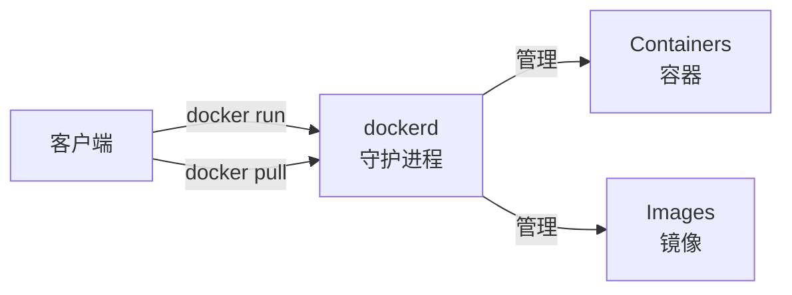
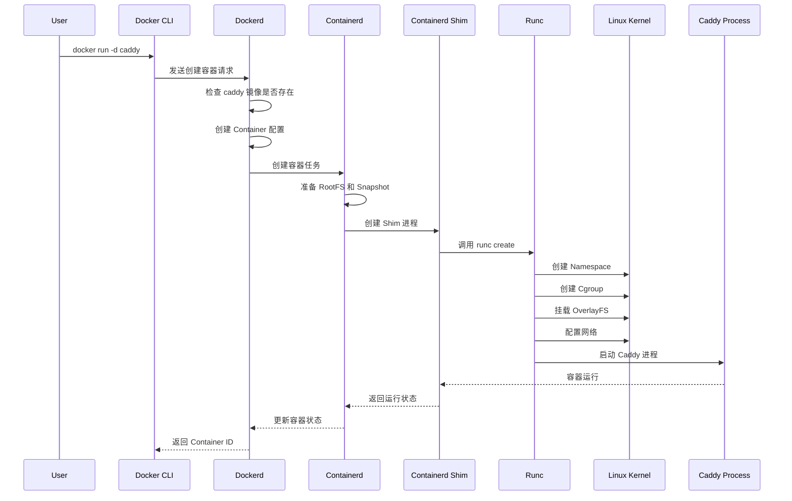
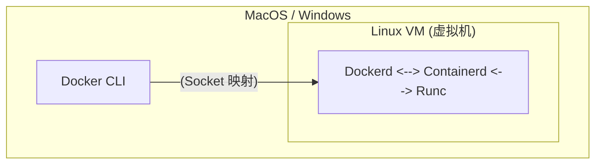
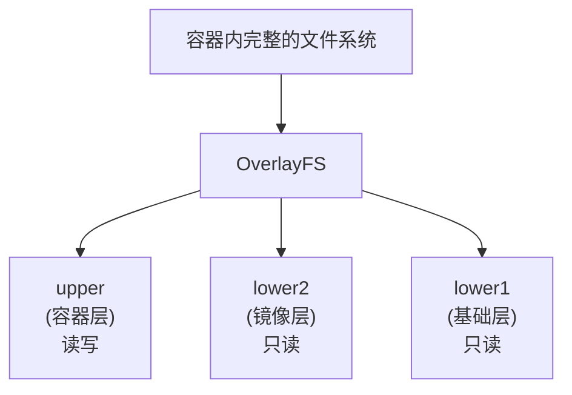
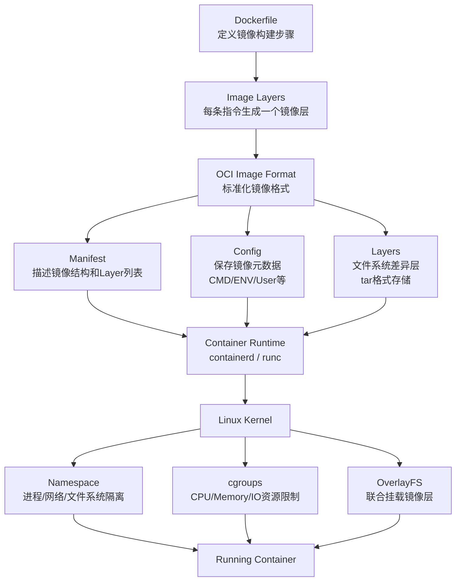

# Docker底层实现


> 写在前面的话：本文的全部命令均在WSL2配置Ubuntu 26系统下进行完成，系统详细信息如下图所示，如有错误或问题欢迎随时指出！


Docker 底层的核心技术包括 Linux 上的命名空间（Namespaces）、控制组（Control groups）、联合文件系统（Union file systems）和容器格式（Container format）。

传统的虚拟机通过**在宿主主机中运行 hypervisor 来模拟一整套完整的硬件环境**提供给虚拟机的操作系统。虚拟机系统看到的环境是可限制的，也是彼此隔离的，这种直接的做法实现了对资源最完整的封装，但很多时候往往意味着系统资源的浪费。 例如，以宿主机和虚拟机系统都为 Linux 系统为例，虚拟机中运行的应用其实可以利用宿主机系统中的运行环境。在操作系统中，包括内核、文件系统、网络、PID、UID、IPC、内存、硬盘、CPU 等等，所有的资源都是应用进程直接共享的。 要想实现虚拟化，除了要实现对内存、CPU、网络IO、硬盘IO、存储空间等的限制外，还要实现文件系统、网络、PID、UID、IPC等等的相互隔离。

Docker 并不是通过虚拟化硬件来运行完整操作系统，而是利用 Linux Kernel 提供的进程隔离和资源控制能力，让一个普通 Linux 进程拥有独立的运行环境。Docker 的核心思想可以概括为：**利用 Namespace 实现环境隔离，利用 Cgroups 实现资源限制，利用 Union File System 实现镜像管理，利用 Container Runtime 管理容器生命周期**

## 基本架构

Docker采用了 C/S 架构，包括客户端和服务端。客户端通过命令行工具与服务端进行交互，服务端负责构建、运行和分发镜像。



Docker 内部采用分层架构，每一层负责不同的职责。从用户输入命令，到最终 Linux Kernel 创建容器，中间经过多个组件协作。
- Docker CLI： Docker CLI 是用户与 Docker 交互的入口，负责接收用户命令将命令转换成 Docker API 请求并发送给 Dockerd；
- Dockerd： Docker 的核心管理服务，负责接收 API 请求，并统一管理镜像、容器、网络、存储等资源，但它并不直接调用 Linux Kernel 创建容器，而是将具体的容器生命周期管理任务交给 Containerd；
- Containerd：Docker 与底层容器运行时之间的管理组件，负责镜像拉取、容器生命周期管理、存储快照以及运行状态维护等工作，但它同样不会直接创建 Linux 容器，而是进一步调用 Containerd Shim 和 Runc 完成底层执行；
- Runc：作为 OCI（Open Container Initiative）标准运行时真正创建容器环境，它通过调用 Linux Kernel 提供的 Namespace、Cgroups、Mount 等机制完成进程隔离、资源限制、文件系统挂载和网络配置，并启动容器中的应用进程；
- Shim： Containerd 与实际容器进程之间的中间层，它负责管理容器进程的生命周期、处理标准输入输出以及信号转发，同时使得即使 Containerd 崩溃，已经运行的容器仍然能够保持运行状态；


例如当用户输入`docker run -d caddy`时，Docker会执行以下步骤：



在MacOS和Windows上，因为内核差异，其架构稍微复杂一些，Windows 和 MacOS 上的 Docker 结构与 Linux 不同，因为 Windows和MacOS 本身不是 Linux Kernel，无法直接运行 Docker 容器，所以 Docker Desktop 会自动创建一个 Linux 虚拟机，然后在 Linux VM 中运行 Docker Engine。



## 命名空间

命名空间（Namespace）是 Linux 内核提供的资源隔离机制，它让容器内的进程仿佛运行在独立的操作系统中，命名空间是Linux内核的一个基础特性，提供了不同层次的隔离和虚拟化，用于隔离资源和进程。名称空间允许不同的进程拥有自己独立的系统视图，包括各种资源的隔离实例。这种隔离对于创建容器、虚拟机和其他轻量级虚拟化技术非常重要。

Linux内核一共提供8种不同的namespace，Docker容器默认使用7种namespace，其中`Time` namespace可以选择性使用。

| Namespace             | 隔离内容                                                    | 效果                                                               | Flag              |
| --------------------- | ------------------------------------------------------- | ---------------------------------------------------------------- | ----------------- |
| **Mount Namespace**   | 文件系统挂载点（Filesystem Mount Points）                        | 让不同进程看到不同的文件系统层级，例如容器拥有独立的 `/` 根目录，无法看到宿主机其他挂载                   | `CLONE_NEWNS`     |
| **UTS Namespace**     | 主机名（hostname）和域名（domain name）                           | 允许容器拥有独立 hostname，例如宿主机叫 `ubuntu-server`，容器可以叫 `nginx-container` | `CLONE_NEWUTS`    |
| **IPC Namespace**     | 进程间通信资源（System V IPC、POSIX Message Queue、Shared Memory） | 隔离共享内存、信号量、消息队列等 IPC 资源，不同容器之间无法通信                               | `CLONE_NEWIPC`    |
| **PID Namespace**     | 进程 ID（Process ID）                                       | 让容器拥有独立的进程编号空间，容器内的第一个进程成为 PID 1，宿主机和容器看到的 PID 不同                | `CLONE_NEWPID`    |
| **Network Namespace** | 网络设备、IP 地址、路由表、端口、iptables 规则                           | 为容器创建独立网络环境，例如独立 `eth0`、独立 IP、独立路由规则                             | `CLONE_NEWNET`    |
| **User Namespace**    | 用户 ID（UID）、组 ID（GID）                                    | 实现用户身份映射，例如容器中的 root（UID 0）可以映射为宿主机普通用户 UID 100000，提高安全性         | `CLONE_NEWUSER`   |
| **Cgroup Namespace**  | Cgroup 层级结构（Control Group View）                         | 隔离容器看到的 cgroup 信息，使容器内部只能看到自己的资源限制，而不是宿主机完整 cgroup 树             | `CLONE_NEWCGROUP` |
| **Time Namespace**    | 系统时间（Boot Time、Monotonic Time）                          | 允许容器拥有独立的时间视图，例如修改容器时间不会影响宿主机时间                                  | `CLONE_NEWTIME`   |
### PID Namespace

PID的作用是隔离进程 ID，让每个容器有自己的进程编号空间，例如在宿主机上启动一个名为`caddy`的容器并同时在宿主机内和容器内查看进程ID。

```bash
ubuntu@wsl-client:~$ docker run -d --name caddy caddy                                                                                                       
Unable to find image 'caddy:latest' locally                                                                                                                 
latest: Pulling from library/caddy                                                                                                                          
4f4fb700ef54: Pull complete                                                                                                                                 
ee31d5a470f0: Pull complete                                                                                                                                 
f8432a27d075: Pull complete                                                                                                                                 
e6f31ffc071e: Pull complete                                                                                                                                 
a0449c657909: Pull complete                                                                                                                                 
7fccd04675d0: Download complete                                                                                                                             
a39a20466be4: Download complete                                                                                                                             
Digest: sha256:844f60b64e4724a5aa8245e019dace0d3f199f7433ce6c57676cb30a920dbad9                                                                             
Status: Downloaded newer image for caddy:latest                                                                                                             af52490000c768c2997808a54a2814e042f37a225d33bee81b9f1377885a2ae6
```
Docker 会创建一个新的 PID Namespace，并将 Caddy 进程放入该 Namespace 中，首先在宿主机内查看该进程，从宿主机视角来看，Caddy 就是一个普通 Linux 进程，它拥有宿主机分配的 PID。
```bash                                                                                         
ubuntu@wsl-client:~$ ps aux | grep caddy                                                                                                                    
root     4059194  0.4  0.5 1309076 44412 ?       Ssl  22:48   0:00 caddy run --config /etc/caddy/Caddyfile --adapter caddyfile                              
ubuntu   4059349  0.0  0.0   4128  2416 pts/4    S+   22:49   0:00 grep --color=auto caddy  
```
但是进入容器内部查看，同一个 Caddy 进程在容器内的PID Namespace的PID为1，容器内的 PID 1 进程特殊重要，它表示作为容器初始化进程，退出则容器停止。

```bash                                      
ubuntu@wsl-client:~$ docker exec caddy ps aux                                                                                                               
PID   USER     TIME  COMMAND                                                                                                                                
    1 root      0:00 caddy run --config /etc/caddy/Caddyfile --adapter caddyfile                                                                            
   18 root      0:00 ps aux
```

不难发现宿主机与容器的PID Namespace遵循这样的规则：
- 容器内无法看到宿主机或其他容器的进程；
- 宿主机可以看到所有容器内的进程，但PID不同。
### NET Namespace

NET namespace 的核心功能就是让不同进程拥有独立的网络协议栈，使它们可以拥有自己的网卡、IP、端口和路由规则，从而实现容器之间以及容器与宿主机之间的网络隔离。简单来说，Linux 默认所有进程共享同一个网络协议栈，包括网卡、IP 地址、路由表、iptables 规则、端口空间以及 socket 等资源，而 NET namespace 可以把这些网络资源复制一份，创建一个独立的虚拟网络世界，使其中运行的程序认为自己拥有一套完整的网络环境。

在普通 Linux 系统中，执行`ip addr`命令可以看到宿主机的网络设备：

```bash
ubuntu@wsl-client:~$ ip addr                                                                                                                               
1: lo: mtu 65536 qdisc noqueue state UNKNOWN group default qlen 1000                                                                  
    link/loopback 00:00:00:00:00:00 brd 00:00:00:00:00:00                                                                                                   
    inet 127.0.0.1/8 scope host lo                                                                                                                          
       valid_lft forever preferred_lft forever                                                                                                              
    inet 10.255.255.254/32 brd 10.255.255.254 scope global lo                                                                                               
       valid_lft forever preferred_lft forever                                                                                                              
    inet6 ::1/128 scope host proto kernel_lo                                                                                                                
       valid_lft forever preferred_lft forever                                                                                                              
2: eth0: mtu 1500 qdisc mq state UP group default qlen 1000                                                                
    link/ether 00:15:5d:15:18:43 brd ff:ff:ff:ff:ff:ff                                                                                                      
    altname enx00155d151843                                                                                                                                 
    inet 172.28.47.11/20 brd 172.28.47.255 scope global eth0                                                                                                
       valid_lft forever preferred_lft forever                                                                                                              
    inet6 fe80::215:5dff:fe15:1843/64 scope link proto kernel_ll                                                                                            
       valid_lft forever preferred_lft forever                                                                                                              
3: docker0: mtu 1500 qdisc noqueue state UP group default                                                                  
    link/ether 3e:f5:7e:41:29:41 brd ff:ff:ff:ff:ff:ff                                                                                                      
    inet 172.17.0.1/16 brd 172.17.255.255 scope global docker0                                                                                              
       valid_lft forever preferred_lft forever                                                                                                              
    inet6 fe80::3cf5:7eff:fe41:2941/64 scope link proto kernel_ll                                                                                           
       valid_lft forever preferred_lft forever                                                                                                              
```

这里的网络就包括
- lo：本地回环网络接口；
- eth0：WSL 的主网络接口；
- docker0：Docker的默认网桥网络；

所有进程访问网络时都会经过这个网络栈。如果启动两个 nginx 服务，它们都监听 `80` 端口，就会发生端口冲突，因为它们共享同一个网络命名空间。而使用 NET namespace 后，可以创建两个完全隔离的网络环境，为了让 namespace 之间通信，Linux 提供了 `veth pair`，它类似一根虚拟网线，两端分别连接两个网络命名空间，这样就可以保证两个网络空间通过虚拟网卡连接起来，例如运行一个`caddy`容器作为示例。

```bash
ubuntu@wsl-client:~$ docker run -d --name caddy caddy                                                                                                       
Unable to find image 'caddy:latest' locally                                                                                                                 
latest: Pulling from library/caddy                                                                                                                          
4f4fb700ef54: Pull complete                                                                                                                                 
f8432a27d075: Pull complete                                                                                                                                 
e6f31ffc071e: Pull complete                                                                                                                                 
a0449c657909: Pull complete                                                                                                                                 
ee31d5a470f0: Pull complete                                                                                                                                 
7fccd04675d0: Download complete                                                                                                                             
a39a20466be4: Download complete                                                                                                                             
Digest: sha256:844f60b64e4724a5aa8245e019dace0d3f199f7433ce6c57676cb30a920dbad9                                                                             
Status: Downloaded newer image for caddy:latest                                                                                                             
c81a6b19b6ee925df88591438a4232def9f9caf4245802e20d7aa1883f587c6d
```

通过`ip addr`来分别查看宿主机和容器内的网络设备：

```bash
ubuntu@wsl-client:~$ ip addr
1: lo: <LOOPBACK,UP,LOWER_UP> mtu 65536 qdisc noqueue state UNKNOWN group default qlen 1000
    link/loopback 00:00:00:00:00:00 brd 00:00:00:00:00:00
    inet 127.0.0.1/8 scope host lo
       valid_lft forever preferred_lft forever
    inet 10.255.255.254/32 brd 10.255.255.254 scope global lo
       valid_lft forever preferred_lft forever
    inet6 ::1/128 scope host proto kernel_lo 
       valid_lft forever preferred_lft forever
2: eth0: <BROADCAST,MULTICAST,UP,LOWER_UP> mtu 1500 qdisc mq state UP group default qlen 1000
    link/ether 00:15:5d:15:18:43 brd ff:ff:ff:ff:ff:ff
    altname enx00155d151843
    inet 172.28.47.11/20 brd 172.28.47.255 scope global eth0
       valid_lft forever preferred_lft forever
    inet6 fe80::215:5dff:fe15:1843/64 scope link proto kernel_ll 
       valid_lft forever preferred_lft forever
3: docker0: <BROADCAST,MULTICAST,UP,LOWER_UP> mtu 1500 qdisc noqueue state UP group default 
    link/ether 3e:f5:7e:41:29:41 brd ff:ff:ff:ff:ff:ff
    inet 172.17.0.1/16 brd 172.17.255.255 scope global docker0
       valid_lft forever preferred_lft forever
    inet6 fe80::3cf5:7eff:fe41:2941/64 scope link proto kernel_ll 
       valid_lft forever preferred_lft forever
73: veth8396ce0@if2: <BROADCAST,MULTICAST,UP,LOWER_UP> mtu 1500 qdisc noqueue master docker0 state UP group default 
    link/ether 8e:ec:f6:23:1e:dc brd ff:ff:ff:ff:ff:ff link-netnsid 0
    inet6 fe80::8cec:f6ff:fe23:1edc/64 scope link proto kernel_ll 
       valid_lft forever preferred_lft forever
ubuntu@wsl-client:~$ docker exec caddy ip addr
1: lo: <LOOPBACK,UP,LOWER_UP> mtu 65536 qdisc noqueue state UNKNOWN qlen 1000
    link/loopback 00:00:00:00:00:00 brd 00:00:00:00:00:00
    inet 127.0.0.1/8 scope host lo
       valid_lft forever preferred_lft forever
    inet6 ::1/128 scope host 
       valid_lft forever preferred_lft forever
2: eth0@if73: <BROADCAST,MULTICAST,UP,LOWER_UP,M-DOWN> mtu 1500 qdisc noqueue state UP 
    link/ether ba:80:be:11:41:37 brd ff:ff:ff:ff:ff:ff
    inet 172.17.0.2/16 brd 172.17.255.255 scope global eth0
       valid_lft forever preferred_lft forever
```

不难发现 caddy 容器运行在独立的 NET namespace 中，它通过一对 veth 虚拟网卡连接到宿主机的 docker0 bridge 网络，并获得了独立 IP 172.17.0.2，如果再运行一个 caddy容器会发生什么呢，可以来尝试一下：

```bash
ubuntu@wsl-client:~$ docker run -d --name caddy2 caddy
bf027f2d9fe0adb1ea800547c7fae053afb7c6aa49c56629d578e9af2fb8d842
ubuntu@wsl-client:~$ docker ps -a
CONTAINER ID   IMAGE     COMMAND                  CREATED         STATUS         PORTS                                NAMES
bf027f2d9fe0   caddy     "caddy run --config …"   5 seconds ago   Up 3 seconds   80/tcp, 443/tcp, 2019/tcp, 443/udp   caddy2
c81a6b19b6ee   caddy     "caddy run --config …"   5 minutes ago   Up 4 minutes   80/tcp, 443/tcp, 2019/tcp, 443/udp   caddy
```

可以看到两个caddy容器都运行起来了，且运行在不同的 NET namespace 中，它们拥有完全独立的网络协议栈和端口空间。

### MNT Namespce

MNT Namespce负责隔离文件系统挂载视图，让不同进程看到不同的文件系统目录结构。多个进程可以使用同一块硬盘，但是由于处于不同的 MNT Namespace，它们看到的 `/`、`/proc`、`/sys`、挂载点等可以完全不同。

```bash
宿主机文件系统：                  容器内看到的：
/                               /  ← 容器的根目录
├── bin/                        ├── bin/
├── home/                       ├── home/
├── var/                        ├── var/
│   └── lib/                    │   └── lib/
│       └── docker/             │
│           └── rootfs/       │
│               └── overlayfs/ ─┼─── 这个目录成为容器的 /
└── ...                         └── ...
```

|   对比项   |    chroot    |        MNT Namespace        |
| :-----: | :----------: | :-------------------------: |
|   本质    | 一个改变根目录路径的机制 | Linux Namespace 机制，用于隔离挂载视图 |
|  隔离对象   |    文件路径解析    |          文件系统挂载关系           |
| 是否隔离挂载点 |     不隔离      |            完全隔离             |
|  隔离强度   |     可以逃逸     |             更安全             |
### UTS Namespace

UTS Namespace 用于隔离**系统标识信息**的一种机制，主要负责隔离主机名（hostname）和域名（domain name）。在没有 UTS Namespace 的情况下，同一个 Linux 内核中的所有进程共享系统的 hostname，例如执行 `hostname` 查看的是同一个值；而通过 UTS Namespace，可以让不同的进程组看到不同的 hostname，使它们感觉自己运行在不同的主机上。

UTS Namespace 是实现容器像一台独立服务器的重要组成部分。例如宿主机 hostname 是 `ubuntu-host`，启动一个 Docker 容器后，可以通过 `docker run --hostname web-server nginx` 设置容器 hostname 为 `web-server`。此时宿主机执行 `hostname` 仍然显示 `ubuntu-host`，而容器内部执行 `hostname` 显示 `web-server`。实际上它们共享同一个 Linux Kernel，但是由于处于不同的 UTS Namespace，看到的系统身份信息不同。可以使用`unshare`命令来简单体验一下UTS Namespace：
```bash
ubuntu@wsl-client:~$ sudo unshare --uts /bin/bash  # 创建新的 UTS namespace 并启动 shell
root@wsl-client:/home/ubuntu# hostname container  # 修改hostname，只在UTS Namespace范围内受影响
root@wsl-client:/home/ubuntu# hostname # 查看hostname
container
root@wsl-client:/home/ubuntu# exit
exit
ubuntu@wsl-client:~$ hostname  # 退出后查看宿主机的主机名未改变
wsl-client
```

### IPC Namespace

IPC Namespace用于隔离 Linux 系统中的**进程间通信资源**，主要包括 System V IPC（如共享内存、消息队列、信号量）以及 POSIX 消息队列等。它的作用是让不同 Namespace 中的进程无法看到或访问其他 Namespace 创建的 IPC 对象，从而避免多个容器之间因为共享同一个 IPC 资源而产生冲突。例如，在没有 IPC Namespace 时，一个进程创建了 System V 共享内存段，其他进程可以通过 ID 查找到并访问；而使用 IPC Namespace 后，每个容器拥有独立的 IPC 资源空间，即使两个容器创建相同 ID 的共享内存，也互相不可见。

例如运行两个数据库容器时，每个数据库实例可能会使用共享内存进行缓存或进程协调，如果没有 IPC 隔离，不同容器中的数据库可能访问到对方的共享内存资源，导致数据冲突或安全问题。Docker 默认会为每个容器创建独立的 IPC Namespace，因此容器内的 PostgreSQL、MySQL 等服务可以像运行在独立主机上一样使用自己的共享内存、信号量和消息队列。
### User Namespace

User Namespace 用于隔离**用户和用户组身份映射关系**的机制，它可以让同一个进程在不同 Namespace 中拥有不同的 UID和 GID视图。简单来说，User Namespace 允许进程在容器内部看起来是 `root` 用户（UID 0），但在宿主机上实际上对应一个普通用户（例如 UID 1000），从而实现容器内 root，宿主机非 root的权限隔离。它通过 UID/GID 映射表完成身份转换，例如容器中的 UID 0 可以映射到宿主机 UID 100000，这样容器内执行 `apt install`、修改系统文件等 root 操作时，并不会获得宿主机真正的 root 权限。

传统 Docker 容器虽然隔离了文件系统、网络和进程，但如果容器内以 root 身份运行，一旦发生容器逃逸漏洞，攻击者可能获得宿主机 root 权限。启用 User Namespace 后，容器中的 root 被限制在一个映射后的普通用户范围内，即使容器进程拥有 UID 0 权限，也无法直接操作宿主机受保护资源。例如 Docker 的 `--userns-remap` 功能可以让容器 root 用户映射到宿主机的非特权用户，从而降低容器运行时的安全风险。
### TIME Namespace

Time Namespace用于隔离**系统时间视图**的机制，它允许不同的进程组看到不同的系统时间。传统情况下，同一个 Linux Kernel 中的所有进程共享同一个系统时间，例如通过 `date` 命令查看的是同一个时间；而 Time Namespace 可以让容器拥有独立的时间偏移（time offset），使容器内部看到的时间与宿主机时间不同。它主要隔离两类时间：`CLOCK_MONOTONIC`（单调时间，用于计算系统运行时间，不能被手动修改）和 `CLOCK_BOOTTIME`（包含系统休眠时间的启动时间）。需要注意的是，Time Namespace **不会改变真实硬件时钟（RTC）或者宿主机时间，只是改变进程读取时间时内核返回的值**。

Time Namespace 主要用于需要模拟时间变化、测试时间相关逻辑以及运行多个具有不同时间环境的容器场景。例如，一个容器可以通过 Time Namespace 设置时间偏移，让应用程序认为系统已经运行了 30 天，而宿主机仍然保持真实时间。这样可以方便测试数据库过期机制、定时任务、证书有效期等功能。目前 Docker 默认并不会大量使用 Time Namespace，但 Linux 内核已经提供支持，容器运行时（如 Kubernetes、CRIU 等）可以利用它实现更高级的时间隔离和迁移能力。

## 控制组

控制组 (Control Groups,简称 cgroups) 是 Linux 内核的一个特性，用于限制、记录和隔离进程组的资源使用 (CPU、内存、磁盘 I/O、网络等)。其核心作用是让多个容器公平共享宿主机资源，防止单个容器耗尽系统资源。

cgroups 可以控制多种系统资源，其中最重要的是 **CPU、内存、Block IO、网络、进程数量等**。对于 CPU 资源，cgroups 可以限制 CPU 使用比例、CPU 时间片以及绑定 CPU 核心，例如限制一个容器最多使用 2 个 CPU。对于内存资源，可以限制容器最大可使用内存，例如限制到 512MB，超过限制后 Kernel 会触发 OOM（Out Of Memory）机制，通常会杀死容器中的进程。对于 Block IO，可以限制磁盘读写速度，例如限制某个容器每秒只能读取 10MB 数据，避免高 IO 应用影响其他服务。对于 PID 资源，可以限制一个容器最多创建多少进程，防止 fork bomb（进程炸弹）耗尽宿主机资源。

在 CPU 控制方面，cgroups 主要通过 `cpu` 和 `cpuset` 子系统实现。例如，一个服务器有 32 个 CPU 核心，可以通过 cgroups 限制某个服务只能运行在指定 CPU 上，或者限制它只能占用一定比例的 CPU 时间。Linux cgroups v2 中对应的控制文件主要在目录`/sys/fs/cgroup/`下。

```bash
ubuntu@wsl-client:~$ ls -l /sys/fs/cgroup/
-r--r--r--  1 root root 0 Aug  7 22:43 cgroup.controllers
-rw-r--r--  1 root root 0 Aug  7 22:43 cgroup.max.depth
-rw-r--r--  1 root root 0 Aug  7 22:43 cgroup.max.descendants
-rw-r--r--  1 root root 0 Aug  7 22:43 cgroup.pressure
-rw-r--r--  1 root root 0 Aug  7 22:43 cgroup.procs
-r--r--r--  1 root root 0 Aug  7 22:43 cgroup.stat
-rw-r--r--  1 root root 0 Jul 31 22:04 cgroup.subtree_control
-rw-r--r--  1 root root 0 Aug  7 22:43 cgroup.threads
-rw-r--r--  1 root root 0 Aug  7 22:43 cpu.pressure
-r--r--r--  1 root root 0 Aug  7 22:43 cpu.stat
-r--r--r--  1 root root 0 Aug  7 22:43 cpu.stat.local
-r--r--r--  1 root root 0 Aug  7 22:43 cpuset.cpus.effective
-r--r--r--  1 root root 0 Aug  7 22:43 cpuset.cpus.isolated
-r--r--r--  1 root root 0 Aug  7 22:43 cpuset.mems.effective
drwxr-xr-x+ 2 root root 0 Jul 30 22:16 dev-hugepages.mount
drwxr-xr-x+ 2 root root 0 Jul 30 22:16 dev-mqueue.mount
drwxr-xr-x  2 root root 0 Jul 30 22:16 init.scope
-rw-r--r--  1 root root 0 Aug  7 22:43 io.pressure
-r--r--r--  1 root root 0 Aug  7 22:43 io.stat
-r--r--r--  1 root root 0 Aug  7 22:43 memory.numa_stat
-rw-r--r--  1 root root 0 Aug  7 22:43 memory.pressure
--w-------  1 root root 0 Aug  7 22:43 memory.reclaim
-r--r--r--  1 root root 0 Aug  7 22:43 memory.stat
drwxr-xr-x+ 2 root root 0 Jul 30 22:16 sys-fs-fuse-connections.mount
drwxr-xr-x+ 2 root root 0 Jul 30 22:16 sys-kernel-config.mount
drwxr-xr-x+ 2 root root 0 Jul 30 22:16 sys-kernel-debug.mount
drwxr-xr-x+ 2 root root 0 Jul 30 22:16 sys-kernel-tracing.mount
drwxr-xr-x 25 root root 0 Aug  7 22:38 system.slice
drwxr-xr-x+ 3 root root 0 Jul 30 22:16 user.slice
```

这些文件由 Kernel 直接读取，当进程运行时，调度器和内存管理子系统会根据 cgroup 配置进行限制。在 Docker 中，每启动一个容器，Docker Engine 都会自动创建对应的 cgroup，并把容器内所有进程加入该 cgroup，Docker 提供了丰富的参数来配置容器的资源限制,主要包括内存、CPU、磁盘 I/O 等。

|          参数          |                说明                 |
| :------------------: | :-------------------------------: |
|       --memory       |          内存硬限制，超过会导致OOM           |
|    --memory-swap     |            内存+Swap总限制             |
| --memory-reservation |         内存竞争限制，超过不会导致OOM          |
|  --oom-kill-disable  | 禁止 OOM Killer 杀死容器进程，可能会导致宿主机内存耗尽 |
| --memory-swappiness  |     控制容器使用 Swap 的权重，范围为0-100      |
|      --shm-size      | 设置 `/dev/shm` 共享内存大小，常用于数据库、AI 任务 |
|        --cpus        |             限制cpu核心数量             |
|    --cpuset-cpus     |            绑定到特定的cpu核心            |
|     --cpu-shares     |             cpu时间片权重              |
|     --cpu-period     |             精细控制cpu配额             |
|  --device-write-bps  |             控制磁盘写入吞吐量             |
|  --device-read-bps   |             控制磁盘读取吞吐量             |
| --device-write-iops  |            限制磁盘写入 IOPS            |
|  --device-read-iops  |            限制磁盘读取 IOPS            |
|     --pids-limit     |             控制进程最大数量              |
|       --ulimit       |     设置进程资源限制，例如最大文件打开数量、最大进程数     |
例如启动一个使用cgroup限制资源的`caddy`容器

```bash
docker run -d \
  --name limited-caddy \
  --memory=512m \
  --memory-swap=1g \
  --cpus=2 \
  --cpuset-cpus="0,1" \
  --pids-limit=100 \
  --device-write-bps=/dev/sda:10mb \
  --device-read-bps=/dev/sda:20mb \
  --shm-size=256m \
  caddy
```
## 联合文件系统

联合文件系统（Union File System，UnionFS）是一种**将多个不同文件系统目录层联合挂载成一个统一视图**的文件系统技术。它的核心思想是把多个目录层叠加在一起，对用户呈现一个完整的文件系统，而不需要真正复制所有文件。例如，可以将一个只读的基础系统目录和一个可写目录叠加，最终用户看到的是一个完整的 `/` 文件系统。当访问某个文件时，联合文件系统会按照层级顺序查找，如果上层存在该文件，则优先使用上层版本；如果上层不存在，则继续向下查找。



Docker 镜像就是利用联合文件系统实现分层存储的。一个 Docker 镜像并不是一个完整复制的文件系统，而是由多个只读层（image layers）组成，通过联合文件系统叠加后形成容器看到的完整根目录，Docker 中最常用的联合文件系统实现是 **OverlayFS**，OverlayFS 将多个目录合并为一个统一视图，其中只读镜像层称为 `lowerdir`，容器可写层称为 `upperdir`，最终用户看到的是 `merged` 目录。当容器修改文件时，并不会修改底层镜像层，而是采用 **Copy-on-Write（写时复制，CoW）机制**：如果修改一个来自镜像层的文件，OverlayFS 会先将该文件复制到可写层，然后在可写层中进行修改；删除文件时，则通过 whiteout 文件标记隐藏底层文件。

联合文件系统带来的最大优势是**镜像复用和快速创建容器**。例如多个容器都基于 Ubuntu 镜像运行时，它们可以共享相同的 Ubuntu 基础层，而每个容器只保存自己的写入变化，因此大幅减少磁盘占用并提高启动速度。同时，镜像构建过程中的每个 Dockerfile 指令都会生成一个新的只读层。例如可以通过`docker history`来查看镜像的层信息。

```bash
ubuntu@wsl-client:~$ docker history caddy:latest 
IMAGE          CREATED       CREATED BY                                      SIZE      COMMENT
844f60b64e47   6 weeks ago   CMD ["caddy" "run" "--config" "/etc/caddy/Ca…   0B        buildkit.dockerfile.v0
<missing>      6 weeks ago   WORKDIR /srv                                    4.1kB     buildkit.dockerfile.v0
<missing>      6 weeks ago   EXPOSE map[2019/tcp:{}]                         0B        buildkit.dockerfile.v0
<missing>      6 weeks ago   EXPOSE map[443/udp:{}]                          0B        buildkit.dockerfile.v0
<missing>      6 weeks ago   EXPOSE map[443/tcp:{}]                          0B        buildkit.dockerfile.v0
<missing>      6 weeks ago   EXPOSE map[80/tcp:{}]                           0B        buildkit.dockerfile.v0
<missing>      6 weeks ago   LABEL org.opencontainers.image.source=https:…   0B        buildkit.dockerfile.v0
<missing>      6 weeks ago   LABEL org.opencontainers.image.licenses=Apac…   0B        buildkit.dockerfile.v0
<missing>      6 weeks ago   LABEL org.opencontainers.image.vendor=Light …   0B        buildkit.dockerfile.v0
<missing>      6 weeks ago   LABEL org.opencontainers.image.documentation…   0B        buildkit.dockerfile.v0
<missing>      6 weeks ago   LABEL org.opencontainers.image.url=https://c…   0B        buildkit.dockerfile.v0
<missing>      6 weeks ago   LABEL org.opencontainers.image.description=a…   0B        buildkit.dockerfile.v0
<missing>      6 weeks ago   LABEL org.opencontainers.image.title=Caddy      0B        buildkit.dockerfile.v0
<missing>      6 weeks ago   LABEL org.opencontainers.image.version=v2.11…   0B        buildkit.dockerfile.v0
<missing>      6 weeks ago   ENV XDG_DATA_HOME=/data                         0B        buildkit.dockerfile.v0
<missing>      6 weeks ago   ENV XDG_CONFIG_HOME=/config                     0B        buildkit.dockerfile.v0
<missing>      6 weeks ago   RUN /bin/sh -c set -eux;  apkArch="$(apk --p…   48.5MB    buildkit.dockerfile.v0
<missing>      6 weeks ago   ENV CADDY_VERSION=v2.11.4                       0B        buildkit.dockerfile.v0
<missing>      6 weeks ago   RUN /bin/sh -c set -eux;  mkdir -p   /config…   65.5kB    buildkit.dockerfile.v0
<missing>      6 weeks ago   RUN /bin/sh -c apk add --no-cache  ca-certif…   6.75MB    buildkit.dockerfile.v0
<missing>      6 weeks ago   CMD ["/bin/sh"]                                 0B        buildkit.dockerfile.v0
<missing>      6 weeks ago   ADD alpine-minirootfs-3.23.5-x86_64.tar.gz /…   9.07MB    buildkit.dockerfile.v0
```
## 容器格式

容器格式（Container Format）是用于描述、打包和分发容器镜像的一套标准规范，它定义了**容器镜像如何存储文件系统、元数据以及如何被运行时加载执行**。它类似于传统软件中的 `.zip`、`.tar` 或虚拟机中的磁盘镜像格式，但容器格式不是简单打包一个完整操作系统，而是将应用程序、依赖环境、配置文件以及镜像层信息组织成标准化结构。现代容器生态主要遵循 **OCI（Open Container Initiative，开放容器标准）规范**，由镜像格式（Image Specification）、运行时规范（Runtime Specification）和分发规范（Distribution Specification）组成。

一个 OCI 镜像主要由三类核心数据组成：**Manifest（镜像清单）、Image Configuration（镜像配置）和 Layers（文件系统层）**。Manifest 描述镜像由哪些 layer 组成以及配置文件的位置；Config 文件保存镜像运行所需的元数据，例如默认启动命令、环境变量、工作目录、用户信息等；Layers 则保存实际的文件系统变化。例如执行 `docker run nginx` 时，Docker 首先读取 Manifest 找到所有 layer，然后通过 OverlayFS 合并这些 layer，读取 Config 中的启动命令，最后创建 Namespace 和 cgroup 并启动容器进程。

容器格式与虚拟机镜像最大的区别在于：虚拟机镜像通常包含完整 Guest OS，包括 Kernel、驱动和系统服务，而容器镜像只包含用户空间（User Space）。例如 Docker 的 Ubuntu 镜像中包含 `/bin`、`/usr`、`/etc` 等目录，但不包含 Linux Kernel，容器启动时直接共享宿主机 Kernel。因此容器格式更加轻量，可以快速传输和启动。整个流程可以概括为：



最初,Docker 采用了 LXC 中的容器格式。从 0.7 版本以后开始去除 LXC 的依赖,转而使用自行开发的 libcontainer。从 1.11 开始,则进一步演进为使用 runC 和 containerd。
## 网络

Docker 网络是 Docker 容器实现**网络隔离和通信能力**的核心机制，它主要依赖 Linux Kernel 提供的 **Network Namespace、虚拟网络设备（veth）、Linux Bridge、iptables/NAT 等技术**。与普通进程不同，容器默认并不直接使用宿主机网络栈，而是在启动时创建独立的 Network Namespace，使容器拥有自己的网络设备、IP 地址、路由表、iptables 规则以及端口空间。这样，不同容器之间可以拥有独立的网络环境，就像运行在不同机器上一样。例如两个容器都可以监听自己的 `80` 端口，因为它们处于不同的 Network Namespace 中，不会发生端口冲突。

Docker 默认使用 **bridge 网络模式**。当安装 Docker 后，Docker 会自动创建一个名为 `docker0` 的 Linux Bridge：


每启动一个容器，Docker 会创建一对 **veth（virtual ethernet pair）虚拟网卡**。其中一端放入容器的 Network Namespace 内，作为容器中的 `eth0`；另一端留在宿主机中，并连接到 `docker0` 网桥。这样，容器发送的数据会经过 `veth → docker0 → 宿主机网卡 → 外部网络`，多个容器也可以通过 docker0 网桥进行二层通信。

容器访问外部网络时，Docker 使用 **iptables + NAT（Network Address Translation）实现地址转换**。由于容器通常使用私有地址，外部网络无法直接访问 `172.17.0.2`。Docker 会在宿主机上配置 MASQUERADE 规则，将容器发送的数据包源地址转换成宿主机地址，返回的数据包再由 iptables 根据连接状态恢复目标地址，并转发回对应容器。因此容器可以主动访问互联网，例如执行 `apt update`、访问 API 等，而外部默认无法直接访问容器。

Docker 提供多种网络模式，用于满足不同场景需求。其中最常用的是 **bridge、host、none 和 container**。
- bridge 是默认模式，每个容器拥有独立网络 Namespace，通过虚拟网桥通信；
- host 模式直接共享宿主机 Network Namespace，容器没有独立 IP，性能更高但隔离性降低；
- none 模式表示创建容器时不配置网络，通常用于高度定制化网络环境；
- container 模式允许多个容器共享同一个 Network Namespace，例如 sidecar 模式中的代理容器与业务容器共享网络。

Docker 还支持自定义网络（Custom Bridge Network），这是生产环境最常用的方式。例如：

```bash
ubuntu@wsl-client:~$ docker network create app-net
ubuntu@wsl-client:~$ docker run -d \
  --name mysql \
  --network app-net \
  mysql
ubuntu@wsl-client:~$ docker run -d \
  --name backend \
  --network app-net \
  backend
```

Docker 会为该网络创建独立的 bridge，并提供内置 DNS 服务，使容器之间可以直接通过容器名通信，因此后端服务可以直接通过`mysql:3306`连接数据库，而不需要知道 MySQL 容器具体 IP 地址。

## 本章小结

- Docker 的底层实现原理围绕 Namespace、Cgroups、UnionFS 和 Container Format 四大核心技术，分析了容器如何实现进程隔离、资源限制、镜像管理以及标准化运行；
- Docker 并不是通过虚拟化硬件运行完整操作系统，而是依托 Linux Kernel 提供的隔离与控制能力，使普通进程拥有独立的运行环境；
- Docker 从 CLI、Dockerd、Containerd、Shim 到 Runc 的完整调用链，进一步理解了容器创建过程中 Namespace、Cgroups、OverlayFS 等底层机制的协同工作。

> 如果发现内容中存在错误，或有任何改进建议，欢迎随时交流与反馈。