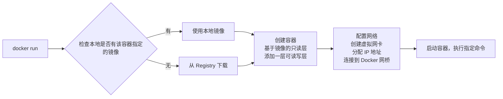
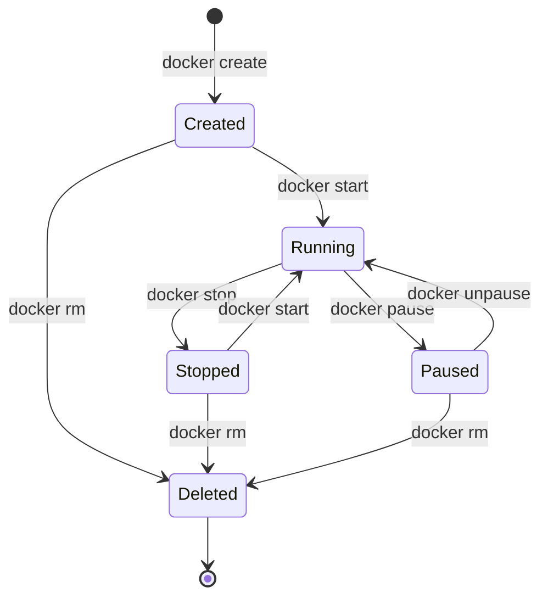

# Docker基础概念

> 写在前面的话：本文的全部命令均在WSL2配置Ubuntu 26系统下进行完成，系统详细信息如下图所示，如有错误或问题欢迎随时指出！


Docker包括三个核心概念：

- **镜像（image）**：Docker 镜像是一个特殊的文件系统，除了提供容器运行时所需的程序、库、资源、配置等文件外，还包含了一些为运行时准备的一些配置参数，镜像不包含任何动态数据，其内容在构建之后也不会被改变；
- **容器（container）**：镜像是静态的定义，容器是镜像运行时的实体，容器可以被创建、启动、停止、删除、暂停等；
- **仓库（repository）**：镜像构建完成后，可以很容易的在当前宿主机上运行，但是，如果需要在其它服务器上使用这个镜像，我们就需要一个集中的存储、分发镜像的服务，Docker 仓库 就是这样的服务。

## 镜像

**Docker 镜像是一个只读的模板，包含了运行应用所需的一切：代码、运行时、库、环境变量和配置文件。** 如果用一个类比：**镜像就像是一张光盘或 ISO 文件**。你可以用同一张光盘在不同电脑上安装系统，而光盘本身不会被修改。同样，一个镜像可以创建多个容器，而镜像本身保持不变。

操作系统分为 **内核** 和 **用户空间**，对于 Linux 而言，内核启动后会挂载 `root` 文件系统来提供用户空间支持。**Docker 镜像** 本质上就是一个 `root` 文件系统，主要包含以下内容：
- **程序文件**：应用二进制文件、Python/Node 解释器；
- **库文件**：libc、OpenSSL、各种依赖库；
- **配置文件**：nginx.conf、my.cnf 等；
- **环境变量**：PATH、LANG 等预设值；
- **元数据**：启动命令、暴露端口、数据卷定义。
### 分层存储机制

Docker 镜像最大的特点是采用了分层存储（Layer）的设计。一个镜像并不是一个完整的大文件，而是由**多个只读层叠加**组成。例如，一个 Python 应用镜像可能包含最底层的 Ubuntu 基础镜像层，上面是 Python 运行环境层，再上面是通过 pip 安装的依赖库层，最后是应用代码层。Docker 利用 Union File System（联合文件系统）将这些 Layer 组合成一个完整的文件系统。容器启动时，Docker 会在镜像的只读 Layer 之上增加一个可写 Layer，所有运行时产生的修改都会写入这个新的 Layer，而不会影响原始镜像。

这种分层结构带来了几个重要优势。

- **它极大减少了存储空间**。例如两个镜像都基于 Ubuntu，那么 Ubuntu 基础层只需要保存一次，其他镜像可以直接复用这一层。
- **它提高了镜像构建速度**，因为 Docker 会缓存已经构建完成的 Layer，当 Dockerfile 中某一步没有变化时，可以直接使用缓存，而不需要重新执行。
- **它使镜像分发更加高效**，因为 Docker 拉取镜像时只需要下载本地不存在的 Layer，而不是每次下载完整镜像。

> 每一层的文件变化会被记录，但 **删除操作只是标记，不会真正减小镜像体积**，避免构建出臃肿的镜像。

```bash
## 错误示范 ❌
FROM python:3.11-slim
RUN apt-get update
RUN apt-get install -y gcc python3-dev   # 安装编译环境（约几十到几百 MB）
RUN pip install numpy pandas
RUN apt-get remove -y gcc python3-dev    # 删除编译工具，镜像仍然会保留这些内容

## 正确做法 ✅
FROM python:3.11-slim
RUN apt-get update && \
    apt-get install -y gcc python3-dev && \
    pip install numpy pandas && \
    apt-get remove -y gcc python3-dev && \
    apt-get autoremove -y && \
    rm -rf /var/lib/apt/lists/*  ## 在同一层完成安装、使用、清理
```

如果需要查看镜像每层的构建记录，可以使用`docker history`命令，需要注意的是`CMD`、`EXPOSE`、`LABEL`、`ENV`这样的命令是在配置元数据和环境变量，因此不需要占用镜像空间。

```bash
ubuntu@wsl-client:~$ docker history caddy:latest
IMAGE          CREATED       CREATED BY                                      SIZE      COMMENT
844f60b64e47   6 weeks ago   CMD ["caddy" "run" "--config" "/etc/caddy/Ca…   0B        buildkit.dockerfile.v0
<missing>      6 weeks ago   WORKDIR /srv                                    4.1kB     buildkit.dockerfile.v0
<missing>      6 weeks ago   EXPOSE map[2019/tcp:{}]                         0B        buildkit.dockerfile.v0
<missing>      6 weeks ago   EXPOSE map[443/udp:{}]                          0B        buildkit.dockerfile.v0
<missing>      6 weeks ago   EXPOSE map[443/tcp:{}]                          0B        buildkit.dockerfile.v0
<missing>      6 weeks ago   EXPOSE map[80/tcp:{}]                           0B        buildkit.dockerfile.v0
<missing>      6 weeks ago   LABEL org.opencontainers.image.source=https:…   0B        buildkit.dockerfile.v0
<missing>      6 weeks ago   LABEL org.opencontainers.image.licenses=Apac…   0B        buildkit.dockerfile.v0
<missing>      6 weeks ago   LABEL org.opencontainers.image.vendor=Light …   0B        buildkit.dockerfile.v0
<missing>      6 weeks ago   LABEL org.opencontainers.image.documentation…   0B        buildkit.dockerfile.v0
<missing>      6 weeks ago   LABEL org.opencontainers.image.url=https://c…   0B        buildkit.dockerfile.v0
<missing>      6 weeks ago   LABEL org.opencontainers.image.description=a…   0B        buildkit.dockerfile.v0
<missing>      6 weeks ago   LABEL org.opencontainers.image.title=Caddy      0B        buildkit.dockerfile.v0
<missing>      6 weeks ago   LABEL org.opencontainers.image.version=v2.11…   0B        buildkit.dockerfile.v0
<missing>      6 weeks ago   ENV XDG_DATA_HOME=/data                         0B        buildkit.dockerfile.v0
<missing>      6 weeks ago   ENV XDG_CONFIG_HOME=/config                     0B        buildkit.dockerfile.v0
<missing>      6 weeks ago   RUN /bin/sh -c set -eux;  apkArch="$(apk --p…   48.5MB    buildkit.dockerfile.v0
<missing>      6 weeks ago   ENV CADDY_VERSION=v2.11.4                       0B        buildkit.dockerfile.v0
<missing>      6 weeks ago   RUN /bin/sh -c set -eux;  mkdir -p   /config…   65.5kB    buildkit.dockerfile.v0
<missing>      6 weeks ago   RUN /bin/sh -c apk add --no-cache  ca-certif…   6.75MB    buildkit.dockerfile.v0
<missing>      6 weeks ago   CMD ["/bin/sh"]                                 0B        buildkit.dockerfile.v0
<missing>      6 weeks ago   ADD alpine-minirootfs-3.23.5-x86_64.tar.gz /…   9.07MB    buildkit.dockerfile.v0
```

### 镜像标识符

Docker镜像的标识符有多种形式，包括以下三种类型：

- **镜像名称和标签**：格式为`[仓库地址/]仓库名[:标签]`

```bash
## 完整格式 
registry.example.com/myproject/myapp:v1.2.3 
## 若简写，则默认使用 Docker Hub官方仓库地址
nginx:1.28 
ubuntu:24.04 
## 省略标签，则默认等同于使用latest，即nginx:latest
nginx
```

- **镜像 ID**：每个镜像有一个基于内容计算的唯一 ID

```bash
ubuntu@wsl-client:~$ docker images
IMAGE                ID             DISK USAGE   CONTENT SIZE   EXTRA
caddy:latest         844f60b64e47       88.7MB         24.3MB        
hello-world:latest   c3cbe1cc1aa5       25.9kB         9.49kB    U   
nginx:latest         5a88c9c45479        241MB           66MB        
ubuntu:24.04         4fbb8e6a8395        119MB         31.7MB        
ubuntu:latest        3131b4cc82a7        161MB         45.3MB    U   
```

- **镜像sha256哈希值**：基于镜像内容的 SHA256 哈希值，这个值是不可变的

```bash
ubuntu@wsl-client:~$ docker image ls --digests
REPOSITORY    TAG       DIGEST                                                                    IMAGE ID       CREATED        SIZE
nginx         latest    sha256:5a88c9c45479443d7be2eadc894b4ed0a9801bae03d97a5760ae13b5c2005942   5a88c9c45479   2 weeks ago    241MB
ubuntu        latest    sha256:3131b4cc82a783df6c9df078f86e01819a13594b865c2cad47bd1bca2b7063bb   3131b4cc82a7   2 weeks ago    161MB
ubuntu        24.04     sha256:4fbb8e6a8395de5a7550b33509421a2bafbc0aab6c06ba2cef9ebffbc7092d90   4fbb8e6a8395   5 weeks ago    119MB
caddy         latest    sha256:844f60b64e4724a5aa8245e019dace0d3f199f7433ce6c57676cb30a920dbad9   844f60b64e47   5 weeks ago    88.7MB
hello-world   latest    sha256:c3cbe1cc1aa588a64951ac6286e0df7b27fe2e6324b1001c619bb358770c0178   c3cbe1cc1aa5   4 months ago   25.9kB

```

### 获取镜像

获取镜像的方式有很多种，包括**从镜像仓库拉取**、**使用`Dockerfile`自定义镜像**、**从容器中提交镜像**和**从文件中导入镜像**。

从镜像仓库获取镜像的命令是 `docker pull`

```bash
docker pull [选项] [Registry地址/]仓库名[:标签]
```

Docker镜像名称的标准格式由 Registry 地址、用户名、仓库名和标签组成。

```bash
docker.io / library / ubuntu : 24.04
────┬────   ───┬───   ──┬───   ──┬──
    │         │        │        │
Registry地址  用户名    仓库名    标签
 (可省略)    (可省略)
```

当我们执行 `docker pull` 命令时，Docker 会输出详细的下载进度。让我们以 `alpine:3.22` 为例来解析这些信息。

```bash
ubuntu@wsl-client:~$ docker pull alpine:3.22
3.22: Pulling from library/alpine
f7ee36c9aa34: Pull complete 
28abb80ea162: Download complete 
4ee6343e28a9: Download complete 
Digest: sha256:14358309a308569c32bdc37e2e0e9694be33a9d99e68afb0f5ff33cc1f695dce
Status: Downloaded newer image for alpine:3.22
docker.io/library/alpine:3.22
```

由于 Docker 镜像采用分层存储结构，一个镜像并不是一个完整文件，而是由多个只读 Layer 叠加组成，因此输出中的 `f7ee36c9aa34`、`28abb80ea162`、`4ee6343e28a9` 等表示不同的镜像层 ID，Docker 会逐层下载、校验并存储到本地。

`docker pull`命令支持多种选项来满足不同的下载需求,例如下载所有标签、指定平台架构等。

|      选项       |    描述     |                     示例                      |
| :-----------: | :-------: | :-----------------------------------------: |
| --all-tags,-a | 拉取所有的镜像标签 |            docker pull -a alpine            |
|  --platform   |  指定平台架构   | docker pull --platform<br>linux/arm64 nginx |
|  --quiet,-q   | 静默模式拉取镜像  |            docker pull -q caddy             |

> 生产环境建议使用sha256哈希值来保证版本固定不变，因为标签可能会被覆盖，而哈希值是固定不变的。

```bash
ubuntu@wsl-client:~$ docker pull ubuntu@sha256:561618e2c15bf2397621dd04f96926663a3b5616c189cf7e38db7e82f5c538ea
```
### 查看镜像

在下载了镜像后，我们可以使用 `docker image ls` 命令列出本地主机上的镜像，`docker image ls` 命令默认输出的列表包含仓库名、标签、镜像 ID、创建时间和占用空间等信息。

```bash
ubuntu@wsl-client:~$ docker image ls
IMAGE                                              ID             DISK USAGE   CONTENT SIZE   EXTRA
alpine:3.22                                        14358309a308       12.8MB         3.88MB        
caddy:latest                                       844f60b64e47       88.7MB         24.3MB        
hello-world:latest                                 c3cbe1cc1aa5       25.9kB         9.49kB    U   
miniprogram-cms:latest                             eea9755ddf38       94.4MB         26.4MB    U   
miniprogram-server:latest                          5d434f113b78        374MB         88.4MB    U   
nginx:latest                                       5a88c9c45479        241MB           66MB        
registry.lovetulin.cn/library/postgres:16-alpine   79950da386bd        395MB          110MB    U   
ubuntu:24.04                                       4fbb8e6a8395        119MB         31.7MB        
ubuntu:latest                                      3131b4cc82a7        161MB         45.3MB    U   
```

> `docker images` 是 `docker image ls` 的简写，两者等效

查看镜像的所有命令参数包括以下几个：

|     参数      |            说明            |                        示例                         |
| :---------: | :----------------------: | :-----------------------------------------------: |
|  -a,--all   |   显示所有的镜像，包括中间镜像和虚悬镜像    |                 docker images -a                  |
| -f,--filter | 高级过滤选项，可以根据多种条件进行查看指定的镜像 |          docker images -f dangling=true           |
| -q,--quiet  |         只输出镜像ID          |                 docker images -q                  |
|  --format   |        自定义格式化输出结果        | <code v-pre>docker images --format "{{.ID}}: {{.Repository}}"</code> |
|  --digests  |      输出镜像的sha256哈希值      |              docker images --digests              |
|   --tree    |  将多个平台的镜像展示为树形结构（实验性功能）  |               docker images --tree                |

Docker 镜像的大小可能与我们通常理解的文件大小有所不同，这涉及到分层存储的概念，由于镜像是分层存储，不同镜像可能共享相同的层，因此，`docker image ls` 中各镜像大小之和会大于实际磁盘占用，实际磁盘空间占用可以通过`docker system df`命令来查看。

```bash
ubuntu@wsl-client:~$ docker system df
TYPE            TOTAL     ACTIVE    SIZE      RECLAIMABLE
Images          9         5         1.472GB   461.4MB (31%)
Containers      5         3         946.2kB   16.38kB (1%)
Local Volumes   1         1         48.37MB   0B (0%)
Build Cache     32        0         891.7MB   806.4MB
```

若想显示更详细的sha256哈希值信息，可以使用`docker image ls --digests`命令

```bash
ubuntu@wsl-client:~$ docker image ls --digests
REPOSITORY                               TAG         DIGEST                                                                    IMAGE ID       CREATED          SIZE
miniprogram-server                       latest      sha256:5d434f113b784b214f5765010c165f744d22cdbc6ba165f45ff3392571a36664   5d434f113b78   25 minutes ago   374MB
miniprogram-cms                          latest      sha256:eea9755ddf38a7fee923026ec1adcc660583bd2829d5e367b9ec039f89ff14bf   eea9755ddf38   25 minutes ago   94.4MB
nginx                                    latest      sha256:5a88c9c45479443d7be2eadc894b4ed0a9801bae03d97a5760ae13b5c2005942   5a88c9c45479   2 weeks ago      241MB
ubuntu                                   latest      sha256:3131b4cc82a783df6c9df078f86e01819a13594b865c2cad47bd1bca2b7063bb   3131b4cc82a7   2 weeks ago      161MB
ubuntu                                   24.04       sha256:4fbb8e6a8395de5a7550b33509421a2bafbc0aab6c06ba2cef9ebffbc7092d90   4fbb8e6a8395   5 weeks ago      119MB
caddy                                    latest      sha256:844f60b64e4724a5aa8245e019dace0d3f199f7433ce6c57676cb30a920dbad9   844f60b64e47   5 weeks ago      88.7MB
alpine                                   3.22        sha256:14358309a308569c32bdc37e2e0e9694be33a9d99e68afb0f5ff33cc1f695dce   14358309a308   5 weeks ago      12.8MB
registry.lovetulin.cn/library/postgres   16-alpine   sha256:79950da386bda7fcc9d57aa9aa9be6c6d7407596a9b8f68014b09a778a9ab316   79950da386bd   2 months ago     395MB
hello-world                              latest      sha256:c3cbe1cc1aa588a64951ac6286e0df7b27fe2e6324b1001c619bb358770c0178   c3cbe1cc1aa5   4 months ago     25.9kB
```

随着本地镜像数量的增加,我们需要更有效的方式来查找特定的镜像，Docker 提供了多种过滤方式：
- 按镜像名称进行过滤

```bash
ubuntu@wsl-client:~$ docker image ls caddy # 列出所有的caddy镜像
IMAGE                                                                           ID             DISK USAGE   CONTENT SIZE   EXTRA
caddy:2                                                                         844f60b64e47       88.7MB         24.3MB    U   
caddy:latest                                                                    844f60b64e47       88.7MB         24.3MB    U   
caddy@sha256:844f60b64e4724a5aa8245e019dace0d3f199f7433ce6c57676cb30a920dbad9   844f60b64e47       88.7MB         24.3MB    U   
```

- 按镜像名称与标签进行过滤

```bash
ubuntu@wsl-client:~$ docker image ls caddy:2
IMAGE     ID             DISK USAGE   CONTENT SIZE   EXTRA
caddy:2   844f60b64e47       88.7MB         24.3MB    U   
```

- 高级过滤器，包括查找虚悬镜像、按label过滤，按创建镜像的时间进行过滤，镜像名称匹配等等

```bash
ubuntu@wsl-client:~$ docker image ls -f dangling=true # 查找虚悬镜像
ubuntu@wsl-client:~$ docker image ls -f before=nginx:latest # 查看 nginx 之前创建的镜像
ubuntu@wsl-client:~$ docker image ls -f since=nginx:latest # 查看 nginx 之后创建的镜像
ubuntu@wsl-client:~$ docker image ls -f label=version=1.0 -f label=author=bass # 查看指定label的镜像
ubuntu@wsl-client:~$ docker image ls -f reference='caddy:*' # 通配符匹配镜像
```

在镜像列表里，你可能会看到一些仓库名和标签都为 `<none>` 的镜像，这类镜像被称为虚悬镜像，这类镜像产生的原因主要有两种：
- **镜像重新构建**：新镜像使用了旧镜像的标签，旧镜像标签被移除；
- **docker pull 更新**：拉取更新版本时，旧版本失去标签。

可以通过命令`docker image ls -f dangling=true`来查看所有的虚悬镜像，并使用`docker image prune`来删除所有的虚悬镜像。

除了虚悬镜像，`docker image ls` 默认列出的只是顶层镜像。还有一种镜像是为了加速镜像构建、重复利用资源而存在的中间层镜像，这些是构建过程中产生的中间层,被其他镜像依赖，不要删除中间层镜像。它们是其他镜像的依赖,删除会导致上层镜像无法使用，删除顶层镜像时会自动清理不再需要的中间层。

为了配合脚本使用或展示更关注的信息，可以使用 `--format `参数来自定义输出格式，可以使用`json`和`table`两种格式进行展示数据，其中数据字段包括

|      字段       | 说明           |
| :-----------: | ------------ |
|      .ID      | 镜像ID         |
|  .Repository  | 镜像仓库名        |
|     .Tag      | 镜像标签         |
|    .Digest    | 镜像的sha256哈希值 |
| .CreatedSince | 镜像创建后经过的时间   |
|  .CreatedAt   | 镜像创建的时间      |
|     .Size     | 镜像的大小        |
|  .Containers  | 镜像所属的容器      |

```bash
ubuntu@wsl-client:~$ docker images --format "table {{.Size}}\t{{.Repository}}:{{.Tag}}\t  {{.ID}} \t {{.Digest}}" # 按照指定的table模板进行输出
SIZE      REPOSITORY:TAG                 IMAGE ID         DIGEST
88.4MB    caddy-web:latest               a301a8a7b133     sha256:a301a8a7b13389a98a6e198edb698a4b6b6c3387a45739aa712dcf771f4fec28
241MB     nginx:latest                   8541484afbc9     sha256:8541484afbc9c8a5a8a99b379568ebbc957f658583ec9448fc43104229c03cf8
119MB     ubuntu:22.04                   3b06811b2afd     sha256:3b06811b2afd352be909dd088a004166d665dc76d38b13eada33522a9d915c6f
119MB     ubuntu:24.04                   561618e2c15b     sha256:561618e2c15bf2397621dd04f96926663a3b5616c189cf7e38db7e82f5c538ea
223MB     turtlesoup-frontend:latest     03d469799774     sha256:03d469799774ecf1ca4c10770b8519ad7d5a8a6cde47f7691f145da24e7dfacd
436MB     turtlesoup-backend:latest      d596ff8d3848     sha256:d596ff8d3848711cf8b0d1001248524cf37c86d6ddfaf8aceda600ec49faf00b
621MB     pgvector/pgvector:pg16         a36250871de0     sha256:a36250871de0833b8757561c72f2477ef1ddd1101afa4e617fb552e0de514c6b
57.8MB    redis:7-alpine                 e7723ff73d96     sha256:e7723ff73d963f5cc6d9c4643ea3d989527a402a319239054e9472a7fb9219a2
160MB     ubuntu:latest                  678c6550cc43     sha256:678c6550cc43645e08669028bc177f50be4e7c5b8cca677067b1914d4afc7a03
88.7MB    caddy:2                        844f60b64e47     sha256:844f60b64e4724a5aa8245e019dace0d3f199f7433ce6c57676cb30a920dbad9
88.7MB    caddy:latest                   844f60b64e47     sha256:844f60b64e4724a5aa8245e019dace0d3f199f7433ce6c57676cb30a920dbad9
25.9kB    hello-world:latest             7f4da0fc94bc     sha256:7f4da0fc94bcece205a8c0b6f4d11c8196924654ffe5c4d1aa439b7f632048b2

ubuntu@wsl-client:~$ docker images --format '{{json .}}' caddy:2 | jq  # 以ijson的格式进行输出
{
  "Containers": "2",
  "CreatedAt": "2026-06-23 04:09:05 +0800 CST",
  "CreatedSince": "6 weeks ago",
  "Digest": "<none>",
  "ID": "844f60b64e47",
  "Repository": "caddy",
  "SharedSize": "N/A",
  "Size": "88.7MB",
  "Tag": "2",
  "UniqueSize": "N/A"
}
```

这里推荐两个常用的查看Docker镜像的命令组合：

```bash
docker images --format "{{.Size}}\t{{.Repository}}:{{.Tag}}" | sort -h # 列出所有镜像及其大小，按大小排序
docker images --format "{{.Repository}}:{{.Tag}}" > images.txt # 导出镜像列表
```
### 删除镜像

当不再需要某个镜像时，我们可以将其删除以释放存储空间，使用 `docker image rm` 删除本地镜像。

```bash
docker image rm [选项] <镜像1> [<镜像2> ...] 
```

> `docker rmi` 是 `docker image rm` 的简写，两者等效

删除镜像时，可以使用多种方式指定镜像：
- **短ID**：ID 的前几位
- **长ID**：完整的镜像 ID
- **镜像名:标签**：仓库名和标签
- **镜像摘要**：精确的内容摘要

```bash
ubuntu@wsl-client:~$ docker rmi d596 # 使用短镜像ID删除镜像
Untagged: turtlesoup-backend:latest
Deleted: sha256:d596ff8d3848711cf8b0d1001248524cf37c86d6ddfaf8aceda600ec49faf00b
ubuntu@wsl-client:~$ docker rmi redis:7-alpine # 使用镜像名称与标签删除镜像
Untagged: redis:7-alpine
Deleted: sha256:e7723ff73d963f5cc6d9c4643ea3d989527a402a319239054e9472a7fb9219a2
```

> 建议使用 **镜像名:标签** 的方式删除，特别是当需要明确清理特定版本的镜像时，使用这种方式更清晰且更安全。

手动一个一个删除镜像非常繁琐,Docker 提供了 image prune 命令和 shell 组合命令来实现批量清理。

```bash
ubuntu@wsl-client:~$ docker image prune  # 删除所有的虚悬镜像
WARNING! This will remove all dangling images.
Are you sure you want to continue? [y/N] y
Total reclaimed space: 0B

ubuntu@wsl-client:~$ docker image prune -a # 删除所有未被容器使用的镜像
WARNING! This will remove all images without at least one container associated to them.
Are you sure you want to continue? [y/N] y
Deleted Images:
untagged: ubuntu:24.04
untagged: pgvector/pgvector:pg16
deleted: sha256:a36250871de0833b8757561c72f2477ef1ddd1101afa4e617fb552e0de514c6b
deleted: sha256:84a355869251af1a3379cfc9fa7b4dbf962c03f642a4bb7b339a203925071c43
deleted: sha256:c9ac6c9124daf9e5878ddf335890082af14e2ebc9421b15c83e57269a64c8500
untagged: caddy-web:latest
deleted: sha256:a301a8a7b13389a98a6e198edb698a4b6b6c3387a45739aa712dcf771f4fec28
deleted: sha256:1d46089f73c341761424f2072c947e6a76009919f7ab7c4880ca3e1f6f1efd8f
deleted: sha256:eecb42e04b0067067ad2b5011964f0925a4c27918b8ee22db5b3a29d2176b1e4
untagged: nginx:latest
deleted: sha256:8541484afbc9c8a5a8a99b379568ebbc957f658583ec9448fc43104229c03cf8
deleted: sha256:963cfe6e75d1c292f66589d7e190b137cf89310414c0c1c5b476dfc61a4fcd0d
deleted: sha256:a2a034340090fa5be6987a96c1c1e9cd5be56157bea6d918acf9c1bbd28073c8
untagged: ubuntu:22.04
deleted: sha256:3b06811b2afd352be909dd088a004166d665dc76d38b13eada33522a9d915c6f
deleted: sha256:0199853f6d6b20b0424f3c5694a72a62764f01e6a771b1eb48a4197848986c7e
deleted: sha256:fd46207b81d937050e88113e1f7798e8bfaf0a2bd4b44993787aee1f74bc287e
untagged: ubuntu:latest
deleted: sha256:678c6550cc43645e08669028bc177f50be4e7c5b8cca677067b1914d4afc7a03
deleted: sha256:7b202b0e2e0028c6250f5fcf41d04df492d145a1654c6995a6553f0c1f6f1960
deleted: sha256:522d96ea380735b5cf03988f84c2ac91c28d72f628c905881e78f7e9d67079ad
untagged: ubuntu@sha256:561618e2c15bf2397621dd04f96926663a3b5616c189cf7e38db7e82f5c538ea
deleted: sha256:561618e2c15bf2397621dd04f96926663a3b5616c189cf7e38db7e82f5c538ea
deleted: sha256:019e8eb29a85e74d64925745884f2ec79aa27e3feab36353d24656f4d6b89467
deleted: sha256:134a2a74d1a7a123c1f0c29d51ff01f93941e354921ba9a7051bdb20cc6a60a6
untagged: caddy:2
untagged: caddy@sha256:844f60b64e4724a5aa8245e019dace0d3f199f7433ce6c57676cb30a920dbad9
untagged: turtlesoup-frontend:latest
deleted: sha256:03d469799774ecf1ca4c10770b8519ad7d5a8a6cde47f7691f145da24e7dfacd
deleted: sha256:2f3c1addd0cdd8be9b2bf159241a9f17ed08b68f97843850324663222ce2623f
deleted: sha256:9cc06cd1141e35c707e4b5354c104234c577317c9450e70d38fd41b1981c6268
Total reclaimed space: 1.291GB

ubuntu@wsl-client:~$ docker rmi $(docker images -q redis) # 删除所有的redis镜像
Untagged: redis:latest
Deleted: sha256:344e3945a0b431c8ff1eecd58c5573538126bd756f02fc7e218ddf1fc2546366

ubuntu@wsl-client:~$ docker image prune -a --filter "until=24h" # 只保留最近24小时镜像
```

在删除镜像时，Docker 可能会提示错误并拒绝执行，这通常是为了防止误删正在使用的资源。

- **有容器依赖**：这时候就需要先删除依赖的容器再删除镜像；

```bash
ubuntu@wsl-client:~$ docker images
IMAGE          ID             DISK USAGE   CONTENT SIZE   EXTRA
caddy:latest   844f60b64e47       88.7MB         24.3MB    U   
ubuntu@wsl-client:~$ docker rmi 844f # 删除caddy镜像发现有容器依赖
Error response from daemon: conflict: unable to delete 844f60b64e47 (cannot be forced) - image is being used by running container bf027f2d9fe0
ubuntu@wsl-client:~$ docker stop bf027f2d9fe0 # 先停止容器运行
bf027f2d9fe0
ubuntu@wsl-client:~$ docker rm bf027f2d9fe0 # 删除容器
bf027f2d9fe0
ubuntu@wsl-client:~$ docker rmi 844f # 删除镜像
Untagged: caddy:latest
Deleted: sha256:844f60b64e4724a5aa8245e019dace0d3f199f7433ce6c57676cb30a920dbad9
```

- **多个标签指向同一镜像**

```bash
ubuntu@wsl-client:~$ docker images
IMAGE          ID             DISK USAGE   CONTENT SIZE   EXTRA
ubuntu:24.04   561618e2c15b        119MB         31.7MB        
ubuntu:noble   561618e2c15b        119MB         31.7MB        
ubuntu@wsl-client:~$ docker rmi ubuntu:24.04 # 只是移除标签,镜像仍存在，因为还有ubuntu:noble指向该镜像
Untagged: ubuntu:24.04
```

- **中间层镜像且有其他镜像依赖它**

### 提交镜像

`docker commit` 是 Docker 中用于**将一个正在运行或已经停止的容器当前状态保存为一个新的镜像**的命令。它的本质类似于给虚拟机创建快照，容器运行过程中，文件系统发生了变化，例如安装了软件、修改了配置文件、添加了代码文件，这些变化默认只存在于容器可写层中，而不会反映到原始镜像中。执行 `docker commit` 后，Docker 会把容器当前的文件系统状态转换成一个新的镜像层，并基于原镜像生成一个新的镜像。例如我们使用Docker进入Ubuntu的终端：

```bash
ubuntu@wsl-client:~$ docker run -it ubuntu:noble bash
```

进入容器后我们使用`apt`包管理器安装Nginx并新建一个文本文件

```bash
root@1354de71b43e:/# apt update
root@1354de71b43e:/# apt install -y nginx
root@1354de71b43e:/# echo "docker commit" > /docker-commit.txt
```

此时这个ubuntu镜像就发生了一下改变，但是这些改变只存在于容器层，可以使用`docker diff`命令来查看具体的改动。

```bash
ubuntu@wsl-client:~$ docker diff 1354de71b43e | grep txt
A /docker-commit.txt
```

如果删除容器这些改动就会消失，因此我们希望可以保存这些改动，因此Docker 提供了一个 docker commit 命令,可以将容器的存储层保存下来成为镜像。换句话说，就是在原有镜像的基础上，再叠加上容器的存储层,并构成新的镜像，从底层实现来看，`docker commit` 并不是复制整个容器，而是在 Docker 镜像存储系统中创建一个新的镜像层，Docker 通过内容寻址存储复用已有 layer，所以 commit 后的新镜像通常不会大幅增加空间。以后我们运行这个新镜像的时候，就会拥有原有容器最后的文件变化。它的语法格式为：

```bash
docker commit [选项] <容器ID或容器名> [<仓库名>[:<标签>]]
```

默认情况下，docker commit 会在提交时暂停容器进程，以降低数据损坏的风险，如果确实不希望暂停，可以显式指定`--no-pause`

```bash
ubuntu@wsl-client:~$ docker commit -m "安装Nginx" 1354de71b43e ubuntu:24.04v1
sha256:81d514df735240afdea096b4b3c540f749ae1a144c252a075b8aa2b73a29a14b
ubuntu@wsl-client:~$ docker images ubuntu # 可以查看到新构建好的镜像
IMAGE            ID             DISK USAGE   CONTENT SIZE   EXTRA
ubuntu:24.04v1   81d514df7352        216MB         69.1MB        
ubuntu:noble     561618e2c15b        119MB         31.7MB    U   
```

我们还可以用 `docker history` 具体查看镜像内的历史记录。

```bash
ubuntu@wsl-client:~$ docker history ubuntu:24.04v1 
IMAGE          CREATED              CREATED BY                                      SIZE      COMMENT
81d514df7352   About a minute ago   bash                                            59.6MB    安装Nginx
561618e2c15b   7 days ago           /bin/sh -c #(nop)  CMD ["/bin/bash"]            0B        
<missing>      7 days ago           /bin/sh -c #(nop) ADD file:d938ff3d4eee15d86…   87.6MB    
<missing>      7 days ago           /bin/sh -c #(nop)  LABEL org.opencontainers.…   0B        
<missing>      7 days ago           /bin/sh -c #(nop)  ARG LAUNCHPAD_BUILD_ARCH     0B        
<missing>      7 days ago           /bin/sh -c #(nop)  ARG RELEASE                  0B        
ubuntu@wsl-client:~$ docker history ubuntu:noble
IMAGE          CREATED      CREATED BY                                      SIZE      COMMENT
561618e2c15b   7 days ago   /bin/sh -c #(nop)  CMD ["/bin/bash"]            0B        
<missing>      7 days ago   /bin/sh -c #(nop) ADD file:d938ff3d4eee15d86…   87.6MB    
<missing>      7 days ago   /bin/sh -c #(nop)  LABEL org.opencontainers.…   0B        
<missing>      7 days ago   /bin/sh -c #(nop)  ARG LAUNCHPAD_BUILD_ARCH     0B        
<missing>      7 days ago   /bin/sh -c #(nop)  ARG RELEASE                  0B       
```

使用 docker commit 命令虽然可以比较直观地帮助理解镜像分层存储的概念，但它不应作为常规定制镜像的方式。
- 首先，`docker commit` 会将容器当前文件系统的所有变化保存为镜像层，其中可能包含大量无关文件，例如安装缓存、编译中间文件等，容易导致镜像体积膨胀；
- 其次，`docker commit` 属于黑箱式构建方式，无法记录具体执行过哪些操作，其他人难以理解镜像的生成过程，甚至制作者自己也可能难以回忆
- 此外，由于 Docker 镜像采用分层存储，后续修改只会在新的层中记录，旧层不会被改变。如果频繁使用 `docker commit` 生成镜像，会不断增加新的层，即使删除了文件，底层数据仍然存在，只是在最终视图中被隐藏。

因此，生产环境中应使用 Dockerfile 定义镜像构建过程，使镜像构建过程可复现、可审查、易维护。
## 容器

容器是独立运行的一个或一组应用，以及它们的运行态环境。对应的，虚拟机可以理解为模拟运行的一整套操作系统 (提供了运行态环境和其他系统环境) 和跑在上面的应用。

### 启动容器

Docker启动容器有两种方式：

- **新建并启动**：基于镜像创建新容器
- **重新启动**：将已终止的容器重新运行

由于 Docker 容器非常轻量，实际使用中常常是随时删除和新建容器，而不是反复重启同一个容器。

```bash
docker run [选项] 镜像 [命令] [参数...]
```

`docker run`的选项非常多，这里有一些常用的选项及其说明：

|     选项     | 说明            |
| :--------: | ------------- |
|     -d     | 守护态运行容器       |
|    -it     | 交互式终端         |
|   --name   | 指定容器的名称       |
|    --rm    | 退出容器时自动删除容器   |
|     -p     | 将容器内的端口映射到宿主机 |
|     -v     | 将容器内的数据挂载到宿主机 |
|     -e     | 设置单个环境变量      |
| --env-file | 从文件中加载环境变量    |
|     -m     | 限制内存大小        |
|   --cpus   | 限制cpu核心数量     |
```bash
ubuntu@wsl-client:~$ docker run -d nginx:latest # 以守护态运行容器
ubuntu@wsl-client:~$ docker run -it ubuntu:24.04 /bin/bash # 启动一个可以交互的 bash 终端
ubuntu@wsl-client:~$ docker run -p 8000:80 nginx:latest # 将容器的 80 端口映射到宿主机的 8000 端口
ubuntu@wsl-client:~$ docker run -v /host/path:/container/path nginx:latest # 将容器内的数据挂载到宿主机目录
ubuntu@wsl-client:~$ docker run -e MYSQL_ROOT_PASSWORD=$(openssl rand -hex 32)  mysql # 设置单个环境变量
ubuntu@wsl-client:~$ docker run --env-file .env postgres:latest # 从文件中加载环境变量
ubuntu@wsl-client:~$ docker run -m 512m nginx:latest # 限制内存大小
ubuntu@wsl-client:~$ docker run --cpus=1.5 caddy:latest # 限制cpu
```

docker run的具体流程为：


可以使用`docker ps -a`查看所有的容器，包括已停止的容器。

```bash
ubuntu@wsl-client:~$ docker ps -a
CONTAINER ID   IMAGE             COMMAND                  CREATED          STATUS                     PORTS                                     NAMES
d4c9f3455ac3   ubuntu:24.04      "/bin/bash"              7 minutes ago    Exited (0) 3 seconds ago                                             nifty_swirles
338ed16a27ee   caddy:latest      "caddy run --config …"   7 minutes ago    Exited (0) 7 minutes ago                                             crazy_faraday
249f1b6b6ba1   nginx:latest      "/docker-entrypoint.…"   8 minutes ago    Exited (0) 8 minutes ago                                             confident_keldysh
1c93798449ee   postgres:latest   "docker-entrypoint.s…"   9 minutes ago    Exited (1) 9 minutes ago                                             gallant_agnesi
a7e3da2947fa   mysql             "docker-entrypoint.s…"   11 minutes ago   Up 11 minutes              3306/tcp, 33060/tcp                       admiring_poitras
d2f34cccbbeb   nginx:latest      "/docker-entrypoint.…"   15 minutes ago   Up 15 minutes              0.0.0.0:8000->80/tcp, [::]:8000->80/tcp   vigilant_khorana
ee1d472e4310   nginx:latest      "/docker-entrypoint.…"   27 minutes ago   Up 27 minutes              80/tcp                                    epic_lewin
1354de71b43e   ubuntu:noble      "bash"                   22 hours ago     Exited (0) 22 hours ago                                              vigorous_ellis
```
### 守护态运行

当在终端运行一个程序时，有两种模式：

- **前台运行**：程序占用当前终端,输出直接显示，关闭终端程序就停止；
- **后台运行**：程序在后台执行，不占用终端，终端关闭也不影响程序。

Docker容器默认是前台运行的，即关闭该终端程序就会停止，使用`-d`参数可以让容器以守护态运行即后台运行。

```bash
ubuntu@wsl-client:~$ docker run caddy:latest # 前台运行caddy容器
{"level":"info","ts":1786281619.481477,"msg":"maxprocs: Leaving GOMAXPROCS=20: CPU quota undefined"}
{"level":"info","ts":1786281619.4815073,"msg":"GOMEMLIMIT is updated","GOMEMLIMIT":7337089843,"previous":9223372036854775807}
{"level":"info","ts":1786281619.481517,"msg":"using config from file","file":"/etc/caddy/Caddyfile"}
{"level":"info","ts":1786281619.4815183,"msg":"adapted config to JSON","adapter":"caddyfile"}
{"level":"info","ts":1786281619.484665,"logger":"admin","msg":"admin endpoint started","address":"localhost:2019","enforce_origin":false,"origins":["//localhost:2019","//[::1]:2019","//127.0.0.1:2019"]}
{"level":"warn","ts":1786281619.484812,"logger":"http.auto_https","msg":"server is listening only on the HTTP port, so no automatic HTTPS will be applied to this server","server_name":"srv0","http_port":80}
{"level":"info","ts":1786281619.484937,"logger":"tls.cache.maintenance","msg":"started background certificate maintenance","cache":"0x23f7b1c60e00"}
{"level":"warn","ts":1786281619.4850166,"logger":"http","msg":"HTTP/2 skipped because it requires TLS","network":"tcp","addr":":80"}
{"level":"warn","ts":1786281619.485025,"logger":"http","msg":"HTTP/3 skipped because it requires TLS","network":"tcp","addr":":80"}
{"level":"info","ts":1786281619.4850268,"logger":"http.log","msg":"server running","name":"srv0","protocols":["h1","h2","h3"]}
{"level":"info","ts":1786281619.4856603,"msg":"autosaved config (load with --resume flag)","file":"/config/caddy/autosave.json"}
{"level":"info","ts":1786281619.4856813,"msg":"serving initial configuration"}
{"level":"info","ts":1786281619.5556774,"logger":"tls","msg":"cleaning storage unit","storage":"FileStorage:/data/caddy"}
{"level":"info","ts":1786281619.6554337,"logger":"tls","msg":"finished cleaning storage units"}
```

前台运行容器会把输出的结果打印到宿主机上面，且终端被占用，无法执行其他命令，关闭终端窗口，容器也会被停止。

```bash
ubuntu@wsl-client:~$ docker run -d --name back_caddy caddy:latest # 后台运行
b9c546202c960bc68d58943c42630575becaba29c59c164d6a4f57a29e1850ec
```

后台运行容器会返回容器的完整ID，且终端立即被释放，可以执行其他命令，但是无法直接查看容器的输出，需要使用`docker logs`进行查看

```bash
ubuntu@wsl-client:~$ docker logs back_caddy # 查看容器的输出结果
{"level":"info","ts":1786281711.0900686,"msg":"maxprocs: Leaving GOMAXPROCS=20: CPU quota undefined"}
{"level":"info","ts":1786281711.0900812,"msg":"GOMEMLIMIT is updated","GOMEMLIMIT":7337089843,"previous":9223372036854775807}
{"level":"info","ts":1786281711.0900836,"msg":"using config from file","file":"/etc/caddy/Caddyfile"}
{"level":"info","ts":1786281711.0900843,"msg":"adapted config to JSON","adapter":"caddyfile"}
{"level":"info","ts":1786281711.092305,"logger":"admin","msg":"admin endpoint started","address":"localhost:2019","enforce_origin":false,"origins":["//localhost:2019","//[::1]:2019","//127.0.0.1:2019"]}
{"level":"warn","ts":1786281711.0923855,"logger":"http.auto_https","msg":"server is listening only on the HTTP port, so no automatic HTTPS will be applied to this server","server_name":"srv0","http_port":80}
{"level":"warn","ts":1786281711.0924733,"logger":"http","msg":"HTTP/2 skipped because it requires TLS","network":"tcp","addr":":80"}
{"level":"warn","ts":1786281711.0924861,"logger":"http","msg":"HTTP/3 skipped because it requires TLS","network":"tcp","addr":":80"}
{"level":"info","ts":1786281711.0924883,"logger":"http.log","msg":"server running","name":"srv0","protocols":["h1","h2","h3"]}
{"level":"info","ts":1786281711.092553,"logger":"tls.cache.maintenance","msg":"started background certificate maintenance","cache":"0xcb871878000"}
{"level":"info","ts":1786281711.0931005,"msg":"autosaved config (load with --resume flag)","file":"/config/caddy/autosave.json"}
{"level":"info","ts":1786281711.093119,"msg":"serving initial configuration"}
{"level":"info","ts":1786281711.1689835,"logger":"tls","msg":"cleaning storage unit","storage":"FileStorage:/data/caddy"}
{"level":"info","ts":1786281711.2683585,"logger":"tls","msg":"finished cleaning storage units"}
```

容器的生命周期与容器内PID 1进程的生命周期是一致的，也就是容器的生命周期与主进程是绑定的，PID 1进程退出则容器也会停止，例如执行`docker run -d ubuntu:24.04`

```bash
ubuntu@wsl-client:~$ docker run -d ubuntu:24.04
0e19e5cd83a1e85045429536d301cd099a90b31762d58c2b404b896953243a23
ubuntu@wsl-client:~$ docker ps -a
CONTAINER ID   IMAGE          COMMAND       CREATED          STATUS                      PORTS     NAMES
0e19e5cd83a1   ubuntu:24.04   "/bin/bash"   12 seconds ago   Exited (0) 10 seconds ago             competent_cori
```

这个容器会自动停止，这是因为容器启动时没有指定任何命令，它会默认执行`/bin/bash`打开终端，但是没有指定`-it`参数打开交互式终端，因此`bash`会认为没有输入源，`bash`就会立刻退出，而`bash`又是该容器的主进程，因此导致容器自动停止。

容器启动之后需要查看容器可以使用以下的命令：

```bash
ubuntu@wsl-client:~$ docker container ls  # 查看正在运行的容器
CONTAINER ID   IMAGE          COMMAND                  CREATED          STATUS         PORTS                                NAMES
992e8845faa1   caddy:latest   "caddy run --config …"   11 seconds ago   Up 9 seconds   80/tcp, 443/tcp, 2019/tcp, 443/udp   musing_beaver

ubuntu@wsl-client:~$ docker container ls -a # 查看所有的容器，包括已停止的容器
CONTAINER ID   IMAGE          COMMAND                  CREATED          STATUS                     PORTS                                NAMES
992e8845faa1   caddy:latest   "caddy run --config …"   26 seconds ago   Up 24 seconds              80/tcp, 443/tcp, 2019/tcp, 443/udp   musing_beaver
0e19e5cd83a1   ubuntu:24.04   "/bin/bash"              4 minutes ago    Exited (0) 4 minutes ago                                        competent_cori
```

### 查看容器

Docker 查看容器主要使用 `docker ps`  等命令，根据查看目的不同，有不同方式，这个命令的基本使用方法如下：

```bash
docker ps [选项]
```

其中选项如下表所示：

|      选项      | 含义              | 示例                                |
| :----------: | --------------- | --------------------------------- |
|   -a,--all   | 查看所有的容器，包括停止的容器 | `docker ps -a`                    |
|  -n, --last  | 展示最后创建的n个容器     | `docker ps -n 1`                  |
| -l, --latest | 只展示最新创建的1个容器    | `docker ps -l`                    |
| -q, --quiet  | 只展示容器ID         | `docker ps -q`                    |
|  -s, --size  | 展示总的文件大小        | `docker ps -s`                    |
| -f, --filter | 高级过滤器           | `docker ps -f status=exited`      |
|   --format   | 使用自定义格式进行输出     | `docker ps --format "json" \| jq` |

> `docker ps` 命令与`docker container ls`、`docker container list`、`docker container ps`命令均是等价的。

下面是一些具体的示例仅供参考：

```bash
ubuntu@wsl-client:~$ docker ps # 默认只会展示正在运行的容器
CONTAINER ID   IMAGE          COMMAND                  CREATED          STATUS          PORTS                                NAMES
da48bb219c8f   redis          "docker-entrypoint.s…"   38 seconds ago   Up 34 seconds   6379/tcp                             redis
6d6d264af695   caddy:latest   "caddy run --config …"   8 minutes ago    Up 8 minutes    80/tcp, 443/tcp, 2019/tcp, 443/udp   quizzical_dijkstra
046aa310737b   nginx:latest   "/docker-entrypoint.…"   8 minutes ago    Up 8 minutes    80/tcp                               vigorous_goldwasser

ubuntu@wsl-client:~$ docker ps -a # 展示所有的容器，包括已经停止的容器
CONTAINER ID   IMAGE          COMMAND                  CREATED              STATUS                          PORTS                                NAMES
89ecda68919a   postgres       "docker-entrypoint.s…"   49 seconds ago       Exited (1) 46 seconds ago                                            postgres
194ed8e2aaea   mysql          "docker-entrypoint.s…"   About a minute ago   Exited (1) About a minute ago                                        mysql
da48bb219c8f   redis          "docker-entrypoint.s…"   About a minute ago   Up About a minute               6379/tcp                             redis
6d6d264af695   caddy:latest   "caddy run --config …"   9 minutes ago        Up 9 minutes                    80/tcp, 443/tcp, 2019/tcp, 443/udp   quizzical_dijkstra
046aa310737b   nginx:latest   "/docker-entrypoint.…"   9 minutes ago        Up 9 minutes                    80/tcp                               vigorous_goldwasser
c867a6b29536   ubuntu         "/bin/bash"              5 hours ago          Exited (0) 5 hours ago                                               ubuntu24

ubuntu@wsl-client:~$ docker ps -a -q # 只展示容器ID
89ecda68919a
194ed8e2aaea
da48bb219c8f
6d6d264af695
046aa310737b
c867a6b29536

ubuntu@wsl-client:~$ docker ps -n 2 # 展示最新创建的2个容器，若 -n 1则等价于-l命令
CONTAINER ID   IMAGE      COMMAND                  CREATED              STATUS                          PORTS     NAMES
89ecda68919a   postgres   "docker-entrypoint.s…"   About a minute ago   Exited (1) About a minute ago             postgres
194ed8e2aaea   mysql      "docker-entrypoint.s…"   2 minutes ago        Exited (1) About a minute ago             mysql
 
ubuntu@wsl-client:~$ docker ps -l # 展示最新创建的1个容器
CONTAINER ID   IMAGE      COMMAND                  CREATED         STATUS                     PORTS     NAMES
89ecda68919a   postgres   "docker-entrypoint.s…"   2 minutes ago   Exited (1) 2 minutes ago             postgres

ubuntu@wsl-client:~$ docker ps -s -l # 展示容器的大小
CONTAINER ID   IMAGE      COMMAND                  CREATED         STATUS                     PORTS     NAMES      SIZE
89ecda68919a   postgres   "docker-entrypoint.s…"   3 minutes ago   Exited (1) 3 minutes ago             postgres   16.4kB (virtual 481MB)

ubuntu@wsl-client:~$ docker ps -f status=exited # 使用高级过滤器展示已经停止的容器
CONTAINER ID   IMAGE      COMMAND                  CREATED         STATUS                     PORTS     NAMES
89ecda68919a   postgres   "docker-entrypoint.s…"   3 minutes ago   Exited (1) 3 minutes ago             postgres
194ed8e2aaea   mysql      "docker-entrypoint.s…"   4 minutes ago   Exited (1) 4 minutes ago             mysql
c867a6b29536   ubuntu     "/bin/bash"              5 hours ago     Exited (0) 5 hours ago               ubuntu24

ubuntu@wsl-client:~$ docker ps -f name=redis # 使用高级过滤器按照容器名称进行过滤
CONTAINER ID   IMAGE     COMMAND                  CREATED         STATUS         PORTS      NAMES
da48bb219c8f   redis     "docker-entrypoint.s…"   5 minutes ago   Up 5 minutes   6379/tcp   redis
```

### 进入容器

使用` -d `参数启动容器后，容器在后台运行，在一些场景下可能需要进入容器做一些操作，例如查看日志、检查配置、排查错误、清理缓存、数据库迁移等等，docker提供了两种进入容器的方法：

- `docker exec`：这是比较推荐进入容器的方法，它会启动一个新进程，退出不会影响容器；
- `docker attach`：这种方法会附加到主进程，退出可能会影响容器，要谨慎使用。

`docker exec`的基本用法如下：

```bash
ubuntu@wsl-client:~$ docker exec -it nginx /bin/bash # 进入容器并启动交互式 shell，适用于ubuntu等镜像
ubuntu@wsl-client:~$ docker exec -it caddy /bin/sh # 进入容器并启动交互式 shell，适用于Alpine等精简镜像
```

参数说明具体如下表所示：

| 参数  |       说明       |
| :-: | :------------: |
| -i  |    保持标准输入打开    |
| -t  |    分配tty伪终端    |
| -it | 两者配合使用，获得交互式终端 |
可以选择只用`-i`不用`-t`命令，这会导致可以执行命令，但没有提示符，具体可以看下面的说明：

```bash
ubuntu@wsl-client:~$ docker exec -i nginx /bin/bash # 可以执行命令,但没有提示符
ls # 输入命令
# 以下均为输出结果
bin 
boot
dev
docker-entrypoint.d
docker-entrypoint.sh
etc
home
lib
lib64
media
mnt
opt
proc
root
run
sbin
srv
sys
tmp
usr
var
ubuntu@wsl-client:~$ docker exec -it nginx /bin/bash # 有完整的终端命令提示符
root@4114b0f875dd:/# ls # 输入命令
bin  boot  dev  docker-entrypoint.d  docker-entrypoint.sh  etc  home  lib  lib64  media  mnt  opt  proc  root  run  sbin  srv  sys  tmp  usr  var
```

当然了，`docker exec`也可以选择不进入容器而是执行单条命令。

```bash
ubuntu@wsl-client:~$ docker exec nginx cat /etc/nginx/nginx.conf # 查看nginx配置文件
```

`docker attach`的基本用法为：

```bash
docker attach 容器名
```

`docker attach` 会附加到容器的 主进程 PID 1的标准输入输出，进入容器以后输入`exit`或者按ctrl + D均会导致容器停止，安全的退出方法为按 ctrl + P然后再按 ctrl + Q从attach会话中分离。

```bash
ubuntu@wsl-client:~$ docker run -d -it --name ubuntu24.04 ubuntu:24.04
c297f0a6dec4e952d5cd185d9cd6d689a9382923821a13c83e3037abf2fa5f65
ubuntu@wsl-client:~$ docker attach ubuntu24.04
root@c297f0a6dec4:/# exit
exit
ubuntu@wsl-client:~$ docker ps -a
CONTAINER ID   IMAGE          COMMAND                  CREATED          STATUS                      PORTS                                NAMES
c297f0a6dec4   ubuntu:24.04   "/bin/bash"              2 minutes ago    Exited (0) 21 seconds ago                                        ubuntu24.04
```

### 导入与导出

当我们需要迁移容器或者备份容器时，可以使用 Docker 的导入和导出功能。如果要导出本地某个容器，可以使用 `docker export `命令

```bash
ubuntu@wsl-client:~$ docker container ls -a
CONTAINER ID   IMAGE          COMMAND       CREATED         STATUS         PORTS     NAMES
f43fd876b8cb   ubuntu:24.04   "/bin/bash"   9 seconds ago   Up 7 seconds             ubuntu24.04
ubuntu@wsl-client:~$ docker export ubuntu24.04 > ubuntu.tar.gz # 导出容器
```

需要注意的是导出的容器快照不包含镜像版本历史，导入时可以自定义标签和版本号。

可以使用 `docker import `从容器快照文件中再导入为镜像，具体用法如下所示：

```bash
ubuntu@wsl-client:~$ cat ubuntu.tar.gz | docker import - import/ubuntu:24.04 # 也可以使用docker import ubuntu.tar.gz import/ubuntu:24.04
sha256:2f6bb3f6a7be820bf5e75b587cfa697de2ab95f6352ed135c271d6dabbc78162
ubuntu@wsl-client:~$ docker images
IMAGE                  ID             DISK USAGE   CONTENT SIZE   EXTRA   
import/ubuntu:24.04    2f6bb3f6a7be        118MB         30.6MB 
```

此外，也可以通过指定 URL 或者某个目录来导入。

```bash
ubuntu@wsl-client:~$ curl -L https://example.com/ubuntu.tar.gz | docker import - ubuntu:24.04
```
### 删除容器

当容器不再需要使用的时候，就可以删除容器，不过删除容器之前，必须保证容器是处于停止状态。停止容器的方式有三种：

- `stop`命令：发送SIGTERM信号给容器，容器会默认停止；
- `kill`命令：直接发送SIGKILL信号给容器强制停止容器；
- `自动停止`：容器主进程退出时自动停止。

> `SIGTERM`、`SIGKILL`、`SIGHUP` 都是 Linux 中的**信号**，进程收到信号后，会根据该信号执行对应动作，例如退出、重新加载配置、停止运行等，其中SIGTERM信号请求进程主动终止，SIGHUP信号请求挂起信号，常用于重新加载配置，SIGKILL信号强制立即杀死进程，**不同信号的作用不取决于信号本身，，而取决于应用程序是否实现了该信号的处理逻辑**。

`docker stop`会先发送SIGTERM信号给容器，等待容器退出，若超时容器仍然未退出，则会发送SIGKILL信号给容器强制停止容器，具体的用法可以参考以下示例：

```bash
ubuntu@wsl-client:~$ docker stop container # 停止指定的容器，默认等待10秒后若未正常退出则发送SIGKILL信号
ubuntu@wsl-client:~$ docker stop -t 30 container # 停止指定的容器，等待30秒后若未正常退出则发送SIGKILL信号
ubuntu@wsl-client:~$ docker stop -t 0 container # 不等待，直接发送SIGKILL信号给容器，相当于docker kill
ubuntu@wsl-client:~$ docker stop container1 container2 container3 # 停止多个容器
ubuntu@wsl-client:~$ docker stop $(docker ps -q) # 停止所有运行中的容器
```

`docker kill`直接发送SIGKILL信号给容器强制停止容器。

```bash
ubuntu@wsl-client:~$ docker kill container # 杀死指定的容器，默认发送SIGKILL信号给容器
ubuntu@wsl-client:~$ docker kill -s HUP container # 发送SIGHUP信号给容器
ubuntu@wsl-client:~$ docker kill -s TERM container # 发送SIGTERM信号给容器
```

容器的生命周期与主进程绑定，主进程退出时，容器自动停止，当主进程执行完毕或者主动退出主进程时容器会自动停止。

```bash
ubuntu@wsl-client:~$ docker run -it ubuntu:24.04 /bin/bash # 主进程为交互式bash终端
root@135e8f4a8df4:/# exit # 退出终端容器会自动停止
exit
ubuntu@wsl-client:~$ docker ps -a
CONTAINER ID   IMAGE          COMMAND       CREATED          STATUS                     PORTS     NAMES
135e8f4a8df4   ubuntu:24.04   "/bin/bash"   13 seconds ago   Exited (0) 5 seconds ago             trusting_raman

ubuntu@wsl-client:~$ docker run ubuntu:24.04 ps aux # ps命令执行完，容器自动退出
USER         PID %CPU %MEM    VSZ   RSS TTY      STAT START   TIME COMMAND
root           1  2.2  0.0   7896  3856 ?        Rs   07:37   0:00 ps aux
ubuntu@wsl-client:~$ docker ps -a
CONTAINER ID   IMAGE          COMMAND       CREATED              STATUS                          PORTS     NAMES
67fdcba08cca   ubuntu:24.04   "ps aux"      30 seconds ago       Exited (0) 28 seconds ago                 trusting_shockley
```

不难发现，这里的`STATUS`字段包含很多种情况：
- `Up X minutes`：说明容器中的主进程仍然存活，容器仍在运行；
- `Exited(0)`：容器中的主进程**正常退出**，退出码 `0` 是 Linux 程序约定的成功状态，表示程序执行完成，没有发生错误；
- `Exited(1)`：容器中的主进程**异常退出**，退出码 `1` 是最常见的通用错误码，表示程序运行失败；
- `Exited(137)`：容器被 **SIGKILL 强制终止**，退出码的计算方式为 128 + 信号编号，SIGKILL的信号编号为9，因此退出码为137；
- `Exited(143)`：容器收到 **SIGTERM 后正常终止**，SIGTERM的信号编号为15，因此退出码为143；
- `Exited(129)`：容器收到 **SIGHUP**后停止，SIGHUP的信号编号为1，因此退出码为129。

Docker 不会决定容器如何退出，它只是向容器的 PID 1 发送 Linux 信号，最终行为取决于 PID 1 程序如何处理这些信号。

当容器被停止时也可以重新启动容器，具体用法参考下面的示例：

```bash
ubuntu@wsl-client:~$ docker start ubuntu24.04 # 启动已经停止的容器
ubuntu24.04
ubuntu@wsl-client:~$ docker ps -a
f43fd876b8cb   ubuntu:24.04   "/bin/bash"   18 hours ago     Up 4 seconds                            ubuntu24.04
ubuntu@wsl-client:~$ docker restart ubuntu24.04 # 重新启动容器，会先停止容器再启动
ubuntu24.04
```

容器停止之后可以进入删除容器的阶段，主要使用的命令有`docker rm`命令和`docker container prune`命令。

```bash
ubuntu@wsl-client:~$ docker rm container # 删除指定的容器，容器必须是停止状态
ubuntu@wsl-client:~$ docker rm -v container # 删除指定的容器，同时删除关联的数据卷
ubuntu@wsl-client:~$ docker rm -f container # 向容器发送SIGKILL信号并强制删除容器，可能导致数据丢失
ubuntu@wsl-client:~$ docker container prune # 删除所有已停止的容器
ubuntu@wsl-client:~$ docker rm $(docker ps -aq) # 删除所有容器，包括正在运行的容器
```

Docker 容器生命周期主要包括创建、运行、停止、暂停和删除几个状态。创建容器后，容器进入 `Created` 状态，此时容器已存在但主进程尚未启动；执行 `docker start` 后容器进入 `Running` 状态，开始运行其中的主进程。运行中的容器可以通过 `docker stop` 停止，进入 `Stopped` 状态，之后仍然可以通过 `docker start` 恢复运行；也可以使用 `docker pause` 暂停容器中的进程，通过 `docker unpause` 恢复执行。处于 `Created`、`Stopped` 或 `Paused` 状态的容器都可以通过 `docker rm` 删除，删除后容器生命周期结束。



## 仓库

Docker 仓库是用于**存储、分发和管理 Docker 镜像的服务系统**，它类似于 Git 中的远程仓库。Docker 镜像本身通常不会直接在不同机器之间复制，而是通过 Registry 进行上传和下载。例如，我们平时使用的 `docker pull ubuntu:24.04`，实际上就是 Docker 客户端向官方Docker镜像仓库请求 `ubuntu:24.04` 镜像，然后下载对应的镜像层到本地。一个容易混淆的概念是注册服务器Registry，实际上注册服务器是管理仓库的具体服务器，每个服务器上可以有多个仓库，而每个仓库下面有多个镜像，仓库可以理解为是一个具体的目录，例如对于仓库地址 [docker.io/ubuntu]( docker.io/ubuntu)来说， docker.io是注册服务器的地址，ubuntu是仓库名，不过大部分时候都不需要严格区分这二者。

### Docker Hub

[Docker Hub](https://hub.docker.com/) 是 Docker 的中央镜像仓库，通过它您可以轻松地分享和获取 Docker 镜像，它也是 Docker 官方维护的公共镜像仓库，同时也是全球最大的容器镜像库。它提供了 Docker 官方与各大软件厂商提供的高质量镜像（如Nginx， MySQL，Nodejs等等），同时用户也可以上传自己的镜像。


从架构上看，Docker Hub 位于 Docker 镜像的**构建端和运行端之间**，开发者可以先通过 Dockerfile 构建镜像，Docker Hub 本身并不等于 Docker Engine，Docker Engine 负责在本地**构建镜像、运行容器和管理容器**，而 Docker Hub 主要负责**镜像的存储、分发、协作和相关开发工作流**。

Docker Hub 最基本的功能是 **镜像仓库**。我们可以通过 docker search 命令来查找官方仓库中的镜像，并利用 docker pull 命令来将它下载到本地。

```bash
ubuntu@wsl-client:~$ docker search ubuntu
NAME                             DESCRIPTION                                     STARS     OFFICIAL
ubuntu                           Ubuntu is a Debian-based Linux operating sys…   17864     [OK]
ubuntu/squid                     Squid is a caching proxy for the Web. Long-t…   129       
ubuntu/nginx                     Nginx, a high-performance reverse proxy & we…   142       
ubuntu/bind9                     BIND 9 is a very flexible, full-featured DNS…   120       
ubuntu/kafka                     Apache Kafka, a distributed event streaming …   62        
ubuntu/apache2                   Apache, a secure & extensible open-source HT…   105       
ubuntu/zookeeper                 ZooKeeper maintains configuration informatio…   15        
ubuntu/prometheus                Prometheus is a systems and service monitori…   80        
ubuntu/jre                       Chiseled Java runtime based on Ubuntu. Long-…   25        
ubuntu/dotnet-aspnet             Chiselled Ubuntu runtime image for ASP.NET a…   26        
ubuntu/python                    A chiselled Ubuntu rock with the Python runt…   34        
ubuntu/mysql                     MySQL open source fast, stable, multi-thread…   74        
ubuntu/postgres                  PostgreSQL is an open source object-relation…   45        
ubuntu/dotnet-runtime            Chiselled Ubuntu runtime image for .NET apps…   24        
ubuntu/redis                     Redis, an open source key-value store. Long-…   26        
ubuntu/dotnet-deps               Chiselled Ubuntu for self-contained .NET & A…   16        
ubuntu/grafana                   Grafana, a feature rich metrics dashboard & …   12        
ubuntu/jdk                       Ubuntu rock for OpenJDK                         0         
ubuntu/memcached                 Memcached, in-memory keyvalue store for smal…   8         
ubuntu/rabbitmq                  Ubuntu-based RabbitMQ image - an open source…   0         
ubuntu/loki                      Grafana Loki, a log aggregation system like …   2         
ubuntu/mimir                     Ubuntu ROCK for Mimir, a horizontally scalab…   0         
ubuntu/traefik                   Ubuntu ROCK for Traefik, a modern HTTP rever…   3         
ubuntu/opentelemetry-collector   This is a rock for the OpenTelemetry Collect…   0         
ubuntu/alertmanager              Ubuntu Rock for Alertmanager. It handles ale…   1  
```

建议优先使用OFFICIAL标记为OK的仓库，属于官方维护的仓库，安全性更具有保障。

```bash
ubuntu@wsl-client:~$ docker pull caddy:alpine # 拉取caddy镜像
alpine: Pulling from library/caddy
Digest: sha256:5f5c8640aae01df9654968d946d8f1a56c497f1dd5c5cda4cf95ab7c14d58648
Status: Downloaded newer image for caddy:alpine
docker.io/library/caddy:alpine
```

推送镜像到镜像仓库默认是需要登录操作的，并且需要为镜像打上标签方可推送。

```bash
ubuntu@wsl-client:~$ docker login #  默认情况下, docker login 会自动走浏览器登录认证

USING WEB-BASED LOGIN

i Info → To sign in with credentials on the command line, use 'docker login -u <username>'
         

Your one-time device confirmation code is: PSGT-BWMW
Press ENTER to open your browser or submit your device code here: https://login.docker.com/activate

Waiting for authentication in the browser…

WARNING! Your credentials are stored unencrypted in '/home/ubuntu/.docker/config.json'.
Configure a credential helper to remove this warning. See
https://docs.docker.com/go/credential-store/

Login Succeeded

ubuntu@wsl-client:~$ docker tag caddy:alpine zwn200401/mycaddy:alpine # 为镜像打上标签
ubuntu@wsl-client:~$ docker push zwn200401/mycaddy:alpine # 推送镜像到镜像仓库
The push refers to repository [docker.io/zwn200401/mycaddy]
e6f31ffc071e: Mounted from library/caddy 
ee31d5a470f0: Mounted from library/caddy 
f8432a27d075: Mounted from library/caddy 
4f4fb700ef54: Mounted from library/redis 
a0449c657909: Mounted from library/caddy 
alpine: digest: sha256:98eb57d882ccd5213d1688764db10c1ca2c58a1ca3a6717a3411ad798f7a423a size: 1917

i Info → Not all multiplatform-content is present and only the available single-platform image was pushed
         sha256:5f5c8640aae01df9654968d946d8f1a56c497f1dd5c5cda4cf95ab7c14d58648 -> sha256:98eb57d882ccd5213d1688764db10c1ca2c58a1ca3a6717a3411ad798f7a423a

ubuntu@wsl-client:~$ docker search zwn200401 # 可以发现镜像已经成功推送到镜像仓库
NAME                DESCRIPTION   STARS     OFFICIAL
zwn200401/mycaddy                 0    
```

### 私有仓库

Docker 私有仓库是企业或个人**自己部署的 Docker 镜像存储服务**，用于替代公共的 Docker Hub，实现对镜像的**私有存储、版本管理、权限控制和内部发布**。简单来说，Docker Hub 是 Docker 官方提供的公共仓库，而私有仓库就是你自己搭建一个内部 Docker Hub。

[Docker Registry](https://docs.docker.com/retired/#registry-now-cncf-distribution)是官方提供的工具，可以用于构建私有镜像仓库，现已弃用，全面更改为[CNCF Registry](https://distribution.github.io/distribution/)，本文使用新版的CNCF Registry作为私有仓库进行介绍如何使用本地仓库。

如果您需要搭建私有仓库，可以通过官方提供的 registry 镜像快速部署。

```bash
ubuntu@wsl-client:~/deploy-registry$ docker run -d -p 5000:5000 --name registry registry:3
Unable to find image 'registry:3' locally
3: Pulling from library/registry
8f4e1177a675: Pull complete 
269b60c1a347: Pull complete 
47465c9fe4b1: Pull complete 
f90c3e905677: Pull complete 
fb37447a81d2: Download complete 
3f6a72b62a6e: Download complete 
Digest: sha256:1be55279f18a2fe1a74edf2664cac61c1bea305b7b4642dab412e7affdcb3e33
Status: Downloaded newer image for registry:3
f411422d3912c41af5a6dcc0caab66636bfb9ba4010cc4a15d365817ce94f765
```

创建好私有仓库之后,就可以使用`docker tag` 来标记一个镜像,然后推送它到仓库。例如私有仓库地址为[127.0.0.1:5000](127.0.0.1:5000)

```bash
ubuntu@wsl-client:~/deploy-registry$ docker tag registry:3 127.0.0.1:5000/registry:3 # 为镜像打上标签
ubuntu@wsl-client:~/deploy-registry$ docker push 127.0.0.1:5000/registry:3 # 推送镜像到私有仓库
The push refers to repository [127.0.0.1:5000/registry]
8f4e1177a675: Pushed 
47465c9fe4b1: Pushed 
e6f31ffc071e: Pushed 
269b60c1a347: Pushed 
f90c3e905677: Pushed 
3: digest: sha256:7518da9b12dd746278282a729dee2e65eabdeb449db4d0b28d46ef6e90308f58 size: 1916

i Info → Not all multiplatform-content is present and only the available single-platform image was pushed
         sha256:1be55279f18a2fe1a74edf2664cac61c1bea305b7b4642dab412e7affdcb3e33 -> sha256:7518da9b12dd746278282a729dee2e65eabdeb449db4d0b28d46ef6e90308f58
ubuntu@wsl-client:~/deploy-registry$ curl http://127.0.0.1:5000/v2/_catalog # 查看推送的镜像
{"repositories":["registry"]}
ubuntu@wsl-client:~/deploy-registry$ docker pull 127.0.0.1:5000/registry:3 # 从私有仓库中拉取镜像
3: Pulling from registry
Digest: sha256:7518da9b12dd746278282a729dee2e65eabdeb449db4d0b28d46ef6e90308f58
Status: Downloaded newer image for 127.0.0.1:5000/registry:3
127.0.0.1:5000/registry:3
```

假如你有一台服务器和一个域名，可以使用`docker compose`来搭建一个拥有权限认证、TLS的私有仓库，这里假设我们要搭建的私有仓库地址为hub.domain.com，使用Caddy 负责 HTTPS反向代理，Distribution Registry 只监听内网 `5000` 端口，下面提供的`docker-compose.yml`可以作为一个基础版本。

```yml
services:
  registry:
    image: registry:3
    container_name: registry
    restart: unless-stopped
    environment:
      REGISTRY_STORAGE_FILESYSTEM_ROOTDIRECTORY: /var/lib/registry
      REGISTRY_HTTP_ADDR: 0.0.0.0:5000
      # 开启 Basic Auth
      REGISTRY_AUTH: htpasswd
      REGISTRY_AUTH_HTPASSWD_REALM: Registry Realm
      REGISTRY_AUTH_HTPASSWD_PATH: /auth/htpasswd
    volumes:
      - ./registry-data:/var/lib/registry
      - ./auth:/auth:ro
    networks:
      - registry

  caddy:
    image: caddy:2-alpine
    container_name: registry-caddy
    restart: unless-stopped
    ports:
      - "80:80"
      - "443:443"
    volumes:
      - ./Caddyfile:/etc/caddy/Caddyfile:ro
      - ./caddy-data:/data
      - ./caddy-config:/config
    networks:
      - registry

networks:
  registry:
```

然后创建对应的 `Caddyfile`文件：

```txt
hub.domain.com {
    reverse_proxy registry:5000
}
```

最后创建用户名密码文件，创建auth文件夹并使用htpasswd工具：

```bash
htpasswd -Bbn admin your_password > auth/htpasswd
```

最终的目录结构为：

```
├── auth
│   └── htpasswd
├── Caddyfile
├── docker-compose.yml
```

使用`docker compose up -d`命令来启动容器这样我们就搭建好了一个具有权限认证、TLS 的私有仓库。

## 本章小结

- 镜像是一个只读的模板，包含运行应用所需的文件系统、依赖环境和配置信息，用于创建容器。
- 容器是镜像运行后的实例，是一个独立的进程运行环境，负责真正执行应用程序。
- 仓库是存储和分发镜像的平台，用于保存、管理和共享镜像，例如 Docker Hub 或企业私有 Registry。

> 如果发现内容中存在错误，或有任何改进建议，欢迎随时交流与反馈。
